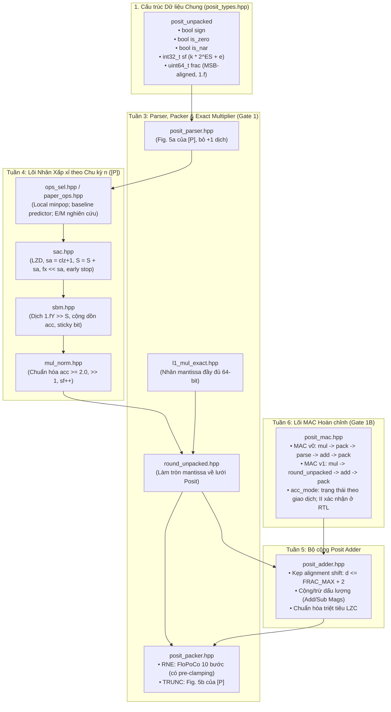

# Kế hoạch Triển khai Mô hình Thuật toán L1 (C++ Golden Model)

**Trạng thái hiện hành 15/10/2026:** tuần12 đã nghiệm thu theo §8.14, SPEC v1.16. Kế hoạch tối ưu timing/LUT và pipeline tại §8.16 là **bản đề xuất để sinh viên xem xét**, chưa cho phép suy ra đã sửa RTL, chốt thêm stage hoặc chạy lại regression/PPA. Các mốc ghi theo ngày bên dưới giữ vai trò lịch sử.

**Hợp đồng tích hợp08/10, cập nhật phạm vi14/10/2026 — SPEC v1.13:** RTL baseline v0/v1 giữ cfg_ops=0/1, cfg_n đếm fraction, hidden khởi tạo riêng; profile predictor/RND của paper là nghiên cứu riêng. H là ngân sách hạng thanh ghi; không bubble thì L_valid=H-1, L_handshake=H (E0 là input handshake). n=0 dùng token init_only; core_done=q+2 cạnh sau OPS launch, q=max(1,n thực tế), last hoàn tất ở accumulator. Top rst_n đồng bộ dùng reset bridge/startup barrier để phối hợp leaf reset_n và nhận A/B/C nguyên tử. Parser/packer đã nghiệm thu đơn vị; core/bridge và multiplier standalone đã kiểm lượt lớn/coverage chức năng theo mục7 (trạng thái10/10/2026). Gate2 multiplier đã nghiệm thu theo mục7.11; NF prepack-preserving đạt mốc numeric/protocol theo mục8.6; strict coverage Gate3 còn theo mục8.7,giữ riêng MAC legacy. Chi tiết tại [SPEC §4–§5 và §11](../SPEC_Posit_MAC_IP.md); kế hoạch thực thi tuần9 tại mục7. Chồng lấn bổ sung sau baseline.

> **Mục tiêu**: Xây dựng mô hình thuật toán C++ L1 (`l1/`) mô phỏng trung thực 100% từng bước biến đổi dữ liệu của vi kiến trúc phần cứng Posit MAC, tham số hóa theo `template <int NB, int ES, int FRAC_W>`, đóng vai trò làm thước đo chân lý bit-exact (AC-01) cho RTL SystemVerilog, vượt qua các cổng kiểm chuẩn nghiêm ngặt **Gate 1 (Tuần 3)** và **Gate 1B (Tuần 6)** theo [SPEC_Posit_MAC_IP.md](../SPEC_Posit_MAC_IP.md).

---

## 1. Bối cảnh và Nguyên tắc Cốt lõi của L1

### 1.1 Khắc phục rủi ro "Sai lệch nhận thức hệ thống" (Systematic Bias)
Do mô hình thuật toán L1 (C++) và RTL (SystemVerilog) đều do cùng tác giả phát triển, nguy cơ lớn nhất là tác giả hiểu sai lý thuyết và hiện thực cái sai đó lên cả hai nơi. Khi đó RTL khớp L1 100% nhưng cả hai đều sai so với chuẩn toán học Posit.
* **Nguyên tắc bắt buộc**: Mọi module của L1 ở chế độ exact **bắt buộc phải qua kiểm định chéo và đạt 0 mismatch tuyệt đối so với L0 (SoftPosit)** trước khi được dùng để kiểm chứng RTL.

### 1.2 Hỗ trợ đa cấu hình (Cấu hình Chuẩn vs Cấu hình Bài báo [P])
* **Cấu hình chuẩn SoftPosit**: `posit8 (ES=0)`, `posit16 (ES=1)`, `posit32 (ES=2)`.
* **Cấu hình bài báo [P]**: `posit32 (ES=3, FRAC_W=12)` (SoftPosit không có sẵn `ES=3`).
* **Giải pháp kiến trúc**: L1 được thiết kế dưới dạng C++ Template tổng quát `template <int NB, int ES, int FRAC_W>`. Khi chạy ở `ES=0, 1, 2`, L1 đối chiếu bit-exact với SoftPosit (L0). Sau khi được chứng minh đúng đắn 100%, L1 chạy ở `ES=3` sẽ là chân lý chuẩn mực để kiểm chứng RTL cho bài báo [P].

---

## 2. Các Quyết định Kỹ thuật

> [!IMPORTANT]
> **Phân kỳ thực hiện theo Tuần (Tuần 3 $\rightarrow$ Tuần 6)**:
> Mặc dù kế hoạch kiến trúc tổng thể L1 được lập toàn diện ngay tại đây, đề tài tuân thủ chặt chẽ tiến độ từng tuần của Đồ án 2:
> - **Giai đoạn 1 (Tuần 3 - Gate 1)**: Tập trung hoàn thiện `posit_parser`, `posit_packer`, `round_unpacked` và bộ nhân Exact `l1_mul` $\rightarrow$ Nghiệm thu **Gate 1** (0 mismatch với L0).
> - **Giai đoạn 2 (Tuần 4)**: Triển khai `ops_sel`, `sac`, `sbm` (vòng lặp $n$ xấp xỉ), tái hiện **TV-PAPER-01** (Fig. 4) và Bảng Table I của [P].
> - **Giai đoạn 3 (Tuần 5)**: Triển khai bộ cộng Posit Adder `l1_add` (kẹp cứng alignment shifter, LZC cancellation).
> - **Giai đoạn 4 (Tuần 6 - Gate 1B)**: Ghép nối hoàn chỉnh lõi MAC `l1_mac` (MAC v0, v1, `round_unpacked`, `acc_mode`) $\rightarrow$ Nghiệm thu **Gate 1B** trước khi code RTL ở Tuần 7.

> [!TIP]
> **Cấu trúc Thư viện Header-Only**:
> L1 sẽ được tổ chức dưới dạng thư viện C++ **Header-Only** (`l1/include/`). Cách tiếp cận này giúp:
> 1. Trình biên dịch C++ tự động tối ưu hóa inline hóa tối đa khi chạy hàng trăm triệu vector.
> 2. Dễ dàng tích hợp vào Verilator harness (Đường A) qua DPI-C mà không gặp lỗi liên kết thư viện tĩnh/động.
> 3. Đi kèm wrapper C (`l1_api.h` / `l1_api.cpp`) để Python có thể gọi trực tiếp qua `ctypes` tương tự như L0.

---

## 3. Kiến trúc Cấu trúc Dữ liệu & Các Module L1



---

## 4. Đặc tả Chi tiết Từng Module L1

### 4.1 Cấu trúc Unpacked (`l1/include/posit_types.hpp`)
```cpp
template <int NB, int ES>
struct posit_unpacked {
    bool sign;           // 0: dương, 1: âm
    bool is_zero;        // Cờ nhận diện số 0
    bool is_nar;         // Cờ nhận diện NaR
    int32_t sf;          // Scale factor gộp: sf = k * 2^ES + e
    uint64_t frac;       // Mantissa căn MSB: bit cao nhất là hidden bit 1.f
    bool exact;          // Không còn đuôi số học; false cung cấp sticky cho packer
};
```

### 4.2 Module Parser (`l1/include/posit_parser.hpp`)
* **Thuật toán theo §5.2 của SPEC (Khớp Fig. 5a của [P], bỏ +1 trong lượng dịch)**:
  1. Trích xuất $s = p[NB-1]$.
  2. Bù hai: $t_1 = s \text{ ? } (\sim p + 1) : p$. Phát hiện $p = 0 \implies \text{is\_zero}$, $p = 0x80..0 \implies \text{is\_nar}$.
  3. $r = t_1[NB-2]$ (bit regime đầu).
  4. Đếm số bit liên tiếp giống $r$ trong $t_1[NB-3:0]$ bằng LOD/LZD $\rightarrow cnt \in [0, NB-2]$.
  5. Tính toán $Rgm$ bằng XNOR bù hai: $Rgm = \sim (\{0, cnt\} \oplus \{(r)\})$. Nếu $r=1 \implies k = cnt$; nếu $r=0 \implies k = -(cnt+1) = -m$.
  6. Payload RTL: $t_2 = t_1[NB-4:0] \ll cnt$, trong vector rộng `NB-3` bit; đã loại regime và terminator. Cách L1 tương đương: lấy `NB-2` bit sau FRB, dịch `cnt` trong độ rộng đó rồi dịch cố định thêm 1 để bỏ terminator; nếu `cnt=NB-2` thì payload bằng 0. Không lấy exponent ngay sau phép dịch `cnt` của cách L1 vì terminator vẫn còn ở MSB.
  7. Trích xuất $e = t_2 \text{ lấy } ES \text{ bit MSB}$; $sf = k \times 2^{ES} + e$ (C++ dùng phép nhân, không dịch trái k âm).
  8. Trích xuất $frac = \{1'b1, t_2 \text{ bỏ } ES \text{ bit}\}$, căn sát MSB 64-bit.

**RTL tuần7:** chốt parser tổ hợp theo hợp đồng SPEC §5.2 trước, nghiệm thu bit-exact với L1 và decoder trường độc lập trên ModelSim rồi mới thêm pipeline. RTL xuất fraction không chứa hidden bit; L1 chứa hidden bit ở vị trí63, cần quy đổi khi đối chiếu. Detector được chọn `vld=0` phải trả `cnt=NB-2`, không dùng trực tiếp `K=0`.

**Nghiệm thu tổ hợp 05/10/2026:** `posit_parser_comb.sv` và testbench đạt 2.465.812 lượt trên ModelSim, 0 mismatch; posit8/16 vét cạn, posit32 ES2/ES3 mỗi format 1.200.010 mẫu, seed20261005. Chi tiết tái chạy và log xem `rtl/README.md`, `results/parser_comb/`.

**Nghiệm thu pipeline 05/10/2026:** `posit_parser.sv` hai tầng elastic đạt toàn bộ 2.465.812 fixture trên ModelSim, 0 mismatch; cả bốn format kiểm reset/startup/flush, stall dài, sức chứa hai slot, bubble, handshake đồng thời và thứ tự/không mất/không nhân đôi giao dịch. Cạnh input E0 → output valid sau E1 → output handshake sớm nhất E2, II=1 khi không stall. Reset leaf `reset_n` assert bất đồng bộ/deassert qua hai FF theo Guidelines; reset top `rst_n` theo SPEC; hợp đồng bridge/startup barrier hiện chốt tại §4.2, RTL tích hợp chưa triển khai. Vivado2026.1 compile/elaborate đạt; chưa tổng hợp/STA. Tuần7 hoàn thành phạm vi đơn vị, chưa phải Gate2/3. Bước tiếp theo là RTL packer/RNE tuần8 rồi kiểm parser→packer. Lệnh, coverage và hash tại `rtl/README.md` mục5, `results/parser_pipeline/`.

**Tinh chỉnh06/10/2026:** chuyển tạo Rgm sang P2 theo Fig.5(a), P1 giữ cnt/FRB thay cho cnt/k. Giảm5 bit thanh ghi RTL mỗi parser NB32; ModelSim2.465.812 fixture và reset/stall/latency/II kiểm lại đạt,0 mismatch. Vivado compile/elaborate đạt, tổng hợp so FF/LUT bị chặn do thiếu license nên chưa công bố lợi ích PPA. Không ảnh hưởng nghiệm thu tuần7 hoặc thứ tự tiếp theo tuần8.

### 4.3 Module Packer (`l1/include/posit_packer.hpp`)
* **Chế độ RNE (FloPoCo 10 bước có pre-clamping, §5.9-A)**:
  1. Xử lý NaR $\rightarrow 0x80..0$, Zero $\rightarrow 0x00..0$.
  2. **Tiền kẹp (Pre-clamping)**: $SF\_MAX = (NB - 2) \ll ES$. Nếu $sf \ge SF\_MAX \implies$ kẹp về `maxpos`; chỉ kẹp sớm `minpos` khi $sf < -SF\_MAX$. Tại sf=-SF_MAX vẫn mã hóa/RNE, tránh sai tie posit8 ES0.
  3. Tách $expF = sf \ \& \ ((1 \ll ES) - 1)$, $regF = sf \gg ES$, $rc = (sf < 0)$. Nếu $rc \implies regF = -regF$.
  4. Ghép vector `inshift` và xác định `offset = rc ? (regF - 1) : regF`.
  5. Dịch phải số học: `ansshf = inshift >> offset`.
  6. Trích xuất $\{anstmp, LSB, G, R, S\}$ (với $S$ là cây OR gom các bit dư).
  7. Làm tròn: $round = G \ \& \ (LSB \mid R \mid S)$, $mag\_rounded = anstmp + round$.
  8. Áp dụng dấu: $R = sign \text{ ? } (-mag\_rounded) : mag\_rounded$.
* **Chế độ TRUNC (Fig. 5b của [P], §5.9-B)**:
  * Cắt cụt trực tiếp không làm tròn, phục vụ đối chiếu profile paper; không tự bảo đảm tái hiện số liệu PPA/accuracy gốc.

**Phân tầng RTL packer chốt06/10/2026 (SPEC §5.9-D):** P1 thực hiện ngoại lệ/pre-clamping, mã hóa regime/exponent, dịch và gom G/R/S; chốt magnitude NB-1 bit, G/R/S, dấu, special_sel và flags. P2 tính round_up, cộng mở rộng/xử lý carry, kẹp, bù hai dấu và chốt d/flags. Hai bank elastic dùng enable chung cho toàn bundle, reset flush hai slot. E0 nhận→valid sau E1→handshake E2, II=1 không stall; TRUNC một bank riêng. Kiểm tổ hợp trước pipeline, rồi round/corner và parser→packer; Tại thời điểm chốt06/10 chưa nghiệm thu RTL; kết quả triển khai và STA ngày07/10 ghi ngay dưới. Giao diện07/10 đã chốt F_IN=2*FRAC_MAX+1 (11/25/55/53 cho bốn format), frac không hidden, sticky gom bit thấp. Parser đệm0; nhân/cộng chuẩn hóa trước, lấy fraction cao và gom đuôi, không làm tròn ở adapter. Xem SPEC v1.5 §5.9-D và rtl/README.md mục6.

**Nghiệm thu RTL tuần8 —07/10/2026, ✅ đơn vị:** packer tổ hợp/pipeline RNE2/TRUNC1 bốn format đạt5.947.048 lượt fixture, chain parser→packer4.931.624 lượt,0 mismatch trên ModelSim. Vét cạn identity8/16,32 phân tầng; ties/sticky/carry/clamp, flags, reset/full slot/stall/order/II/latency đạt. L1/bit-list generator2.973.524 dòng, seed20261006, hash và lệnh tại results/packer/. Vivado compile/elaborate đạt; Quartus3seed/cấu hình sau tối ưu P2: RNE537 LUT4/196FF,122,50–124,42MHz; TRUNC522 LUT4/152FF,100,67–101,01MHz; cả sáu run đạt setup100MHz ở benchmark riêng. Bộ cộng gộp làm tròn/dấu giảm LUT, không thêm tầng. Không suy Gate2/3 toàn MAC. Tiếp theo core tuần9; tối ưu timing theo đường tới hạn đã đo, chưa tự thêm tầng hoặc đổi spec.

### 4.4 Module `round_unpacked.hpp` (§5.9-C)
* **Ý nghĩa sống còn cho MAC v1 Non-fused**:
  * Khi tích $A \times B$ hoàn tất, thay vì phải chạy qua `posit_pack` thành bitstring rồi gọi `posit_parser` giải mã lại (tốn 2 chu kỳ trễ vô ích), khối `round_unpacked` thực hiện làm tròn mantissa tích ngay trên miền unpacked theo số bit fraction khả dụng của $sf_{\text{mul}}$.
  * Cắt bỏ toàn bộ bit dư dưới lưới Posit. Đảm bảo tích $P$ đưa vào Adder hoàn toàn sạch bit dư, giữ đúng ngữ nghĩa Non-fused 2 lần làm tròn, đạt **bit-exact 100% với hàm tách rời `p<N>_add(p<N>_mul(a, b), c)` của SoftPosit**.

### 4.5 Module OPS (`l1/include/ops_sel.hpp`)
* Thực hiện chính sách chọn toán hạng:
  * `cfg_ops = 0`: $X = A, Y = B$.
  * `cfg_ops = 1`: Đếm số bit 1 bằng `popcount(fracA)` và `popcount(fracB)`. Toán hạng nào ít bit 1 hơn được chọn làm $X$ (điều khiển số vòng lặp SAC), toán hạng còn lại làm $Y$ (bị dịch trong SBM). Giảm số vòng để vét hết fraction; không bảo đảm sai số nhỏ hơn ở cùng n. Chỉ đếm fraction thực dùng sau cắt/pad; hòa chọn A; cfg_ops=2/3 bị từ chối.
  * Tính $sign_o = s_A \oplus s_B$, $sf_o = sf_A + sf_B$.

### 4.6 Module SAC (`l1/include/sac.hpp`) và SBM (`l1/include/sbm.hpp`)
* Hợp đồng triển khai theo SPEC v1.4 §5.5–5.7; mô hình C++ mô tả từng bước số học, chưa chứng minh timing FSM/RTL.
* Nạp acc=1.fY trước vòng lặp (đóng góp hidden bit X). Với n=0 trả đóng góp này.
* Mỗi bước chọn bit 1 đầu tiên: sa=clz(fx)+1, S+=sa, fx=(fx<<sa) & mask(W), acc+=Y>>S. Dừng khi fx=0 hoặc đạt n.
* Approximate dùng FRAC_W bit fraction cao; FLOOR cắt từng số hạng về FRAC_W (G/R bằng 0), STICKY_ACC giữ thêm hai bit G/R và OR các đuôi dịch vào sticky. Hai scheme độc lập EXACT_EN.
* Exact dùng đầy đủ FRAC_MAX, acc có 2*FRAC_MAX bit fraction và hai bit nguyên, không giới hạn bởi N_MAX. Chuẩn hóa tích >=2 đúng một lần rồi pack RNE/TRUNC.
* fx=0 chỉ nghĩa đã vét hết fraction X được chọn. IterResult lưu iterations, remaining_fx, approx_cut, input_cut, inexact và saturated riêng; unpacked.exact chỉ phản ánh đuôi số học SBM/normalize, không dùng để báo hoàn thành SAC.
* Trace gồm sa, S, fx, acc và sticky sau từng bước. TV-PAPER-01 FLOOR n=2 có sa=2/3, S=2/5, acc=0x168a/0x171a; vòng lặp hoàn tất nhưng inexact=true.

### 4.7 Module Bộ cộng Posit Adder (`l1/include/posit_adder.hpp`)
* **Thuật toán theo §5.8**:
  1. Tính chênh lệch scale factor: $d = sf_1 - sf_2$ (giả sử $sf_1 \ge sf_2$).
  2. **Kẹp cứng Alignment Shifter**: $d_{clamp} = \min(d, \text{FRAC\_MAX} + 2)$. Nếu $d > \text{FRAC\_MAX} + 2$, dồn toàn bộ $m_2$ vào bit sticky $S$.
  3. Dịch căn chỉnh mantissa $m_2 \gg d_{clamp}$.
  4. Thực hiện phép cộng/trừ dấu lượng (Add/Sub Magnitudes).
  5. Nếu trừ hai số gần bằng nhau: Dò số 0 đầu bằng LZC (Leading Zero Counter), dịch trái phục hồi chuẩn hóa và trừ bù tương ứng vào scale factor $sf$.

---

## 5. Kế hoạch Triển khai Chi tiết và Phân kỳ

### Giai đoạn 1 (Tuần 3) — Khởi đầu L1 & Nghiệm thu Gate 1
* **Mục tiêu**: Xây dựng nền tảng Parser, Packer, Round Unpacked và Bộ nhân Exact. Đạt chuẩn Gate 1.
* **Các file tạo mới**:
  1. `l1/include/posit_types.hpp`: Định nghĩa kiểu dữ liệu unpacked và config template.
  2. `l1/include/posit_parser.hpp`: Thuật toán Parser Fig. 5a.
  3. `l1/include/posit_packer.hpp`: Thuật toán Packer RNE (FloPoCo 10 bước) và TRUNC.
  4. `l1/include/round_unpacked.hpp`: Làm tròn mantissa trên miền unpacked.
  5. `l1/include/l1_multiplier_exact.hpp`: Lõi nhân mantissa 64-bit đầy đủ.
  6. `l1/test/test_identity.cpp`: Kiểm chứng vòng khép kín $\text{pack}(\text{parse}(p)) \equiv p$.
  7. `l1/test/test_mul_exact.cpp`: Đối chiếu `l1_mul` exact vs SoftPosit `p<N>_mul`.
  8. `l1/Makefile`: Biên dịch các test suite L1 trên cả Windows và Linux.
* **Tiêu chí nghiệm thu Gate 1**:
  - Identity test: 100% Pass trên $2^8 = 256$ posit8 và $2^{16} = 65,536$ posit16.
  - Multiplier exact: 0 mismatch với SoftPosit trên $2^{16}$ cặp posit8, $2^{32}$ cặp posit16, toàn bộ Corner List (§6.4) và $\ge 10^7$ vector phân tầng posit32.

### Giai đoạn 2 (Tuần 4) — Lõi Nhân Xấp xỉ theo Chu kỳ n & Tái hiện Bài báo [P]
* **Mục tiêu**: Xây dựng OPS, SAC, SBM, FSM lặp; tái hiện thực nghiệm bài báo gốc.
* **Các file tạo mới**:
  1. `l1/include/ops_sel.hpp`: OPS min-popcount của profile local; `paper_ops.hpp`: predictor n=2/7-bit baseline và tùy chọn E/M.
  2. `l1/include/sac.hpp`: Shift Amount Calculator + LZD + Early Termination.
  3. `l1/include/sbm.hpp`: Shift-Based Multiplier + Accumulator + Sticky bit.
  4. `l1/include/mul_norm.hpp`: Chuẩn hóa tích.
  5. `l1/include/l1_multiplier_iter.hpp`: Bộ nhân lặp hoàn chỉnh tham số hóa $n \in [0, N\_MAX]$.
  6. `l1/test/test_tv_paper.cpp`: Kiểm chứng TV-PAPER-01 (Fig. 4 của [P]).
  7. `l1/test/test_table1_reproduce.cpp`: Khảo sát profile local n=1..6; `test_paper_table1.cpp`: bộ đo FP32 chính thức cho baseline/relative n=2..4, tiêu chí sai lệch <=1 điểm phần trăm.

**Cập nhật 04/10/2026:** các header và test tuần 4 đã triển khai. TV-ITER/TV-PAPER và oracle bit-position approximate đạt; nhánh iterative exact đối chiếu L0 cho ES=0/1/2, đối chiếu nhân rộng cho ES=3. Đây chưa phải chạy lại toàn miền posit16/posit32 phân tầng cho nhánh iterative mới.
Thống kê 10 triệu cặp mỗi n=1..6 đã chạy theo hai phân bố ghi rõ trong README/log. Chưa đạt ngưỡng Table I ≤1 điểm phần trăm; tuần 4 vẫn processing. Không điều chỉnh thuật toán normative chỉ để ép khớp số liệu. Lệnh make test_table1 trả lỗi nếu chưa đạt; chạy test_table1_reproduce không có --require-match chỉ xác nhận thí nghiệm chạy xong.

### Giai đoạn 3 (Tuần 5) — Bộ cộng Posit Adder (`l1_add`)
* **Mục tiêu**: Hoàn thành mô hình thuật toán bộ cộng chuẩn bị cho MAC.
* **Các file tạo mới**:
  1. `l1/include/posit_adder.hpp`: Alignment shifter clamping + Add/Sub Mags + LZC cancellation.
  2. `l1/test/test_adder.cpp`: Đối chiếu bit-exact với SoftPosit `p<N>_add`.
* **Tiêu chí nghiệm thu**: 0 mismatch trên $2^{16}$ cặp posit8, $2^{32}$ cặp posit16, corner list và $\ge 10^7$ vector posit32.


**Nghiệm thu 04/10/2026:** posit_adder.hpp và test_adder.cpp đã triển khai. Posit8/16 vét cạn 65.536/4.294.967.296 cặp và posit32 ES2 phân tầng 10 triệu khớp SoftPosit, 0 mismatch. ES3 kiểm 10 triệu bằng oracle integer rộng, không gọi là đối chuẩn L0 ES3. Cả4 format có corner/ties/clamp/cancellation; >=30% near-opposite và mọi polarity/run hữu hạn >=10.000 operands. Linux/Windows/UBSan smoke 3.468.043 đối chiếu/nền tảng, regression đạt; Windows có thêm 10 triệu ES2/ES3. Full suite Linux 4.316.435.339 đối chiếu đạt. Tuần 5 hoàn thành; Gate 1B vẫn chờ MAC tuần 6. Xem README mục 12, results/week5_adder_* và make test-adder-acceptance.

### Giai đoạn 4 (Tuần 6) — Lõi Posit MAC Hoàn chỉnh & Nghiệm thu Gate 1B
* **Mục tiêu**: Ghép nối hoàn chỉnh MAC v0, MAC v1 (Non-fused), và `acc_mode`. Đạt chuẩn Gate 1B.
* **Các file tạo mới**:
  1. `l1/include/posit_mac.hpp`: Luồng tính toán MAC tích hợp Non-fused và tích lũy chuỗi.
  2. `l1/src/l1_api.cpp` / `l1/include/l1_api.h`: Cung cấp hàm DPI-C và ctypes (`l1_p32_mul`, `l1_p32_mac`).
  3. `l1/test/test_mac_gate1b.cpp`: Kịch bản nghiệm thu Cổng Gate 1B đối chiếu `p<N>_add(p<N>_mul(a,b), c)`.
* **Tiêu chí nghiệm thu Gate 1B**: 0 mismatch trên $2^{24}$ bộ ba posit8, corner list và $\ge 10^7$ vector phân tầng posit32.

**Nghiệm thu 04/10/2026 — ✅:** MAC v0/v1 non-fused, exact/approx, RNE/TRUNC, metadata và trạng thái `acc_mode/acc_clr` đã triển khai. Gate1B Linux/Windows đều đạt 36.841.216 đối chiếu: toàn bộ 2^24 bộ ba posit8, 10 triệu posit32 ES2 với L0 và 10 triệu ES3 với oracle integer riêng, corner/state; 0 mismatch, coverage đạt SPEC §6.3. ES3 không được gọi là đối chuẩn SoftPosit. API C/DPI scalar/ctypes và client C đạt Linux/Windows; UBSan và regression đạt. Xem README mục15, logs `results/week6_*`. Tuần6 hoàn thành về mô hình số học; handshake, pipeline, backpressure và II còn phải kiểm ở RTL.

### Giai đoạn so sánh chính (Tuần 11–12, kế hoạch cập nhật §8) — Mô hình Thuật toán Fused MAC (`l1_mac_fused`, §5.12 SPEC)
* **Mục tiêu**: Hiện thực kiến trúc MAC v2 Fused (1 lần làm tròn, gộp toán hạng $C$ vào Accumulator SBM có dấu, độ rộng `ACC_WIN = FRAC_MAX + 6 = 33` bit cho Posit32).
* **Các file tạo mới**:
  1. `l1/include/posit_mac_fused.hpp`: Căn chỉnh theo $\Delta SF$, chọn mốc Tích/C, phát số hạng vòng 0, trừ có mượn sticky (§5.12-c), hậu xử lý ABS/LZC và chuẩn hóa.
  2. `l1/test/test_mac_fused.cpp`: Kiểm chứng TV-FUSE-01, TV-FUSE-02, các vector biên $|\Delta SF| = \text{FRAC\_MAX} + 2, 3$, triệt tiêu chính xác/gần đúng; đối chuẩn bit-exact với `p8_mulAdd` trên $2^{24}$ vector posit8.
* **Vị trí lộ trình hiện hành**: NF/Gate3 hoàn thành trước; fused là mục tiêu so sánh chính của kế hoạch11/10 tại §8, triển khai L1 tuần11–12 và RTL tuần13–14.

---

## 6. Kế hoạch Kiểm thử & Đối chiếu Tự động (Verification Plan)

| Test Suite | Lệnh thực thi | Mục tiêu xác minh | Ngưỡng Pass bắt buộc |
| :--- | :---| :---| :---: |
| **Identity Roundtrip** | `make -C l1 test_identity` | $\text{pack}(\text{parse}(p)) \equiv p$ | $100\%$ Pass trên mọi bitstring hợp lệ (p8, p16) |
| **Exact Mul Gate 1** | `make -C l1 test_mul_exact` | Đối chiếu L1 exact với SoftPosit L0 | **0 mismatch tuyệt đối** ($2^{16}$ p8, corner list, $10^7$ p32) |
| **TV-PAPER-01 Test** | `make -C l1 test_tv_paper` | Kiểm tra từng chu kỳ của Fig. 4 [P] | Khớp chính xác $S=2, S=5$, tích mantissa kết thúc sau 2 vòng lặp |
| **Table I Baseline / E/M** | `make -C l1 paper-table1` / `paper-table1-relative` | Bộ đo chính thức FP32, 200 triệu accepted, bốn ngưỡng; ghi riêng profile | <=1 điểm % so Proposed; baseline chưa đạt, E/M đã đạt trong generator địa phương |
| **Adder Exact** | `make -C l1 test_adder` | Đối chiếu `l1_add` với `p<N>_add` | **0 mismatch tuyệt đối** |
| **MAC Gate 1B** | `make -C l1 test_mac_gate1b` | Đối chiếu MAC v0/v1 với SoftPosit | **0 mismatch tuyệt đối** ($2^{24}$ p8, corner list, $10^7$ p32) |
| **Fused MAC (Tier 3)** | `make -C l1 test_mac_fused` | Đối chiếu `l1_mac_fused` với `p8_mulAdd` | **0 mismatch tuyệt đối** ($2^{24}$ p8 exhaustive, TV-FUSE-01/02) |

## Cập nhật thực nghiệm baseline + cải tiến — 04/10/2026

Đã hoàn thành các bước triển khai/kiểm chứng theo quy trình baseline trước, biến thể sau:
1. `paper_multiplier.hpp`: RND có dấu, complement và n đếm tổng số hạng; ví dụ [15] và Fig.4 [P] đã kiểm.
2. OPS predictor n=2/7-bit tái dựng; tie-A là giả định; 128-entry truth table đã kiểm độc lập.
3. Generator [0,1) uniform-value grid24, oracle FP32 RNE, chính sách loại zero được ghi; paper chưa cung cấp seed/phân bố chi tiết.
4. 200 triệu cặp/hàng: max lệch Kim [15] 0,942710 điểm %, Proposed [P] 1,352910 điểm %; chưa đạt tiêu chí Proposed <=1 điểm %, không đánh dấu tuần 4 hoàn thành.
5. Cùng dữ liệu chỉ thay OPS min-popcount; ModelSim 116.384 cặp và Quartus ba seed/policy trên EP4CE22F17C6. Cây cân bằng giảm LUT4 73->63, nhưng register 15->25; fmax range chồng lấn và độ chính xác ngưỡng chặt giảm.

Nguồn đầy đủ/giả định/log/lệnh: README mục 6, SPEC phụ lục B/C, `results/paper_table1_200m.log` và `results/ops_ppa_summary.csv`. Không coi khảo sát OPS riêng là Gate 2 hoặc kết quả full MAC. Khóa các giả định còn lại trước khi mở rộng RTL.

### Bước 2 OPS đã tách và vét cạn — 04/10/2026

`paper_ops.hpp` cung cấp predictor cố định n=2/7-bit và tiền xử lý FP32 normal cắt 11 bit, giữ 12 bit fraction; predictor chỉ nhận 7 bit cao. `PaperMultiplier` dùng chung module; không đổi bảng hay RND/SBM. `test_paper_ops` kiểm 33.587.337 đối chiếu Linux/Windows/UBSan, gồm toàn bộ fraction23 và 4096x4096 cặp OPS, tie và n-independence. FP32 special classification có bypass/preserve payload, chưa là full IEEE multiply. Xem README mục 7 và log `paper_ops_step2_*.log`.

### Bước 3 bộ đo đã tách và kiểm chứng — 04/10/2026

`paper_measurement.hpp` khóa generator FP32 [0,1), seed/PRNG, oracle RNE trước cắt, thứ tự lọc và counters; so bốn ngưỡng bằng số nguyên chính xác. Suite 1.900.058 đối chiếu Linux/Windows/UBSan đạt, gồm oracle integer độc lập một triệu tích và ties tại ngưỡng. Replay/Linux/Windows khớp 100.000 accepted cho cả hai phân bố về tỷ lệ, counters và fingerprint. Xem README mục 8 và logs paper_measurement_step3. Bước 3 chức năng hoàn thành; lần 200 triệu trước là lịch sử, cần chạy lại bộ đo mới để nghiệm thu Table I. Tuần 4 giữ processing.

### Bước 4 chạy lại 200 triệu đã hoàn tất — 04/10/2026

Bộ đo bước 3 chạy seed 314159/grid24 trên 200.000.000 accepted (attempted=200.000.023, zero loại 23), fingerprint b4c229e09c0ec0ba. Các hàng trùng lịch sử ở độ chính xác log; max Proposed=1,352910 điểm %, max Kim=0,942710. --require-match trả 1 đúng vì chưa đạt Proposed <=1 điểm %. Xem README mục 9 và results/paper_table1_step4_*. Tuần 4 vẫn processing; ưu tiên khảo sát các giả định tái dựng còn mở và độ nhạy seed, ghi rõ nguyên nhân chưa được xác định.

### Khảo sát giả định và seed đã hoàn tất — 04/10/2026

Công cụ nghiên cứu test_paper_sensitivity kiểm một yếu tố mỗi lượt, 7 profile x 5 seed x 10 triệu accepted/hàng. Baseline max Proposed 1,337120–1,372450 điểm %; tie/pack không giải quyết sai lệch, guard12 có ảnh hưởng nhưng chưa đạt. Relative predictor E/M đạt <=1 trên 5 pilot seed; xác nhận seed mới 271828/200 triệu cho max 0,976696 điểm %, baseline cùng corpus 1,347652. Self-test Linux/Windows/UBSan 1.500.128 đối chiếu đạt; smoke cross-platform khớp. Xem README mục 10, paper_sensitivity_* logs/CSV/hash. Baseline/RTL giữ nguyên và tuần 4 processing: kết quả của biến thể không chứng minh LUT gốc. Bước tiếp theo có căn cứ là đưa relative_prediction thành tùy chọn nghiên cứu được kiểm chứng và đo chi phí comparator/PPA trước khi chọn cải tiến cuối.

### Tích hợp E/M và nghiệm thu profile L1 đã đạt — 04/10/2026

API paper_ops_select_relative<W>, PaperOps::PredictN2Relative và --profile relative đã tích hợp; mặc định/enum cũ/cfg_ops normative giữ nguyên. 35.503.586 đối chiếu Linux/Windows/UBSan đạt; make test đạt; smoke mặc định không đổi, relative cross-platform khớp. Target make paper-table1-relative chạy 200 triệu accepted seed271828: PASS/exit0, max Proposed 0,976696 điểm %, output khớp công cụ khảo sát. Xem README mục 11 và paper_relative_integration_* logs/CSV/hash.

Đã hoàn thành phần tích hợp, kiểm chứng và nghiệm thu số học của tùy chọn E/M. Tuần4 giữ processing vì yêu cầu tái hiện baseline hiện hành còn chưa đạt; không đánh đồng biến thể đạt ngưỡng với chứng minh LUT gốc. Đo PPA E/M phục vụ lựa chọn cải tiến sau đó, không bổ sung thành điều kiện bắt buộc của tuần4 L1.


### Đối chiếu [18] và ưu tiên khóa baseline — 04/10/2026

Đã đọc toàn bộ bản Babić 2010 vừa tải và đối chiếu [15]/[P]; bản được trích dẫn là 2011, chưa có toàn văn tương ứng. Recurrence hai toán hạng/CT và audit 65.025 cặp dương 8-bit được ghi ở README mục13; AE khớp Table4, một ô Table3 còn lệch0,1 điểm %. Không dùng kết quả này để đóng TableI FP32.

Ưu tiên baseline tiếp theo: kiểm cách căn accumulator theo exponent số hạng đầu l1 trong [15] §3.3. Mô hình hiện căn theo scale đầu vào; fixture p1=1 cho khác biệt khi cắt từng số hạng. Khảo sát anchor-first riêng, đối chiếu trace p1=0/1, oracle và nhiều độ rộng, rồi đo cùng corpus/seed trước khi quyết định sửa baseline. Chưa xác nhận đây là nguyên nhân sai lệch. Full LUT n2/tie, width và generator vẫn mở; E/M giữ vai trò cải tiến. Tuần4 processing và tuần5 đã nghiệm thu được giữ nguyên.


### Danh sách ưu tiên hoàn thiện baseline gốc — rà soát 04/10/2026

Mục tiêu: tái dựng đúng thuật toán Proposed từ [15]/[P] với provenance, sau đó đánh giá tái hiện Table I. Ngưỡng <=1 điểm % là tiêu chí số học của dự án; không đủ để khẳng định thuật toán/LUT gốc. E/M là cải tiến riêng. Các mục dưới là kế hoạch, chưa triển khai trong lần rà soát này.

| Ưu tiên | Công việc tiếp theo | Kiểm chứng / điều kiện kết thúc | Trạng thái |
| --- | --- | --- | --- |
| 1 | Khảo sát anchor-first theo [15] §3.3: p1 làm mốc, shift=pj−p1; giữ OPS tuyệt đối, SAC complement và các yếu tố khác | Oracle dyadic/số nguyên độc lập; directed p1=0/1, ngưỡng1,5, phần dư0, số hạng âm và shift lớn; đối chiếu fixture6144/4096, ví dụ [15], Fig.4; log riêng, không đổi default trước kiểm chứng | ✅ |
| 2 | Tách ảnh hưởng mốc căn và độ rộng/cắt accumulator | So scale-input/anchor-first với cùng width; sau đó quét guard0/1/2/12, giữ input Q12. Xác định cắt ở từng số hạng hay sau cộng và đuôi âm. Đối chiếu oracle giữ đủ precision; đánh dấu width chưa được nguồn công bố, không chọn cấu hình chỉ vì khớp bảng | processing |
| 3 | Kiểm predictor theo bảng mẫu [15], không chỉ oracle cùng recurrence | Truy vết các pattern RD/RU, số hạng và lỗi dự đoán; phân biệt lỗi trên mantissa với score E/M, 7-bit complement và điểm cắt. Vét cạn128 prefix, kiểm low5/tie riêng; nếu không suy ra được LUT duy nhất thì giữ nhãn tái dựng và liệt kê entry/giả định còn mở | processing |
| 4 | Đối chiếu đường Kim FP32 và Proposed Posit trên cùng cặp đầu vào | Theo dõi trước/sau cut11, conversion FP32→Posit, m>15, scale, normalize và pack; tách sai số cắt đầu vào, approximation và output. Có reference Kim riêng cùng thuật toán/corpus để xác định gap từ core hay chuyển định dạng; không lấy cột Kim làm chuẩn của Proposed | ✅ |
| 5 | Pilot và xác nhận Table I cho ứng viên có căn cứ | Pilot nhiều seed trên corpus dùng chung; baseline hiện tại làm control, báo đủ12 ô n2/3/4, max gap và paired differences. Chỉ chạy200 triệu seed holdout khi ứng viên đã qua kiểm chứng; ghi compiler/hash/seed/lệnh/filters/fingerprint. Không đổi seed/tie/pack để ép khớp | ✅ |
| 6 | Hoàn thiện provenance và giới hạn tái hiện | Đối chiếu toàn văn bản Babić2011 nếu tiếp cận được; tìm code/LUT hoặc mô tả generator từ nguồn tác giả. Chốt cái nào nguồn công bố, cái nào suy ra, cái nào giả định. Khi nguồn không đủ, công bố baseline tái dựng có giới hạn thay vì khẳng định bit-exact gốc | processing |
| 7 | Comparator Babic FP32 riêng để bổ sung đủ ba cột Table I | Làm sau ưu tiên core Proposed; recurrence integer đã audit, nhưng mở rộng FP32/cut/normalize phải theo [15]/bản2011. Giải trình ô Table3 integer còn lệch0,1 điểm %. Không đưa recurrence hai toán hạng vào core Proposed | ✅ |

Thứ tự thực hiện: 1→2→3→4→5; truy tìm nguồn mục6 có thể làm song song về mặt công việc. Mục7 bổ sung độ đầy đủ của bảng so sánh, không phải điều kiện để sửa core Proposed. Chưa mở PPA E/M hoặc tối ưu RTL như một cách giải quyết sai lệch baseline. Không cần chạy lại các nghiệm thu parser/adder/SoftPosit dài khi các khối đó không đổi; chạy regression liên quan nếu sửa mã nguồn.

Tuần4 chỉ được đóng khi ứng viên có kiểm chứng chức năng, giả định/provenance đầy đủ và kết quả đo đạt tiêu chí đã chốt; nếu vẫn thiếu nguồn gốc thì phải ghi rõ giới hạn tái dựng. Tuần5 đã đạt và tiến độ MAC tuần6 được giữ riêng.

### Kết quả thực hiện ưu tiên baseline — 04/10/2026

Mục1: anchor-first đã triển khai/kiểm oracle; riêng anchor/guard chưa đạt. Mục2: đã quét guard0/1/2/12 và post-sum cut, kiểm oracle Q96/Q64; width gốc chưa xác minh. Mục3:2.097.282 đối chiếu tám fixture Table2/all don't-care tails,128 prefix/Fig2 đạt; prefix7 zero-extended trước complement tạo2 entry126/127 khác, nhưng chưa có full LUT n2/tie tác giả.

Mục4:200 triệu paired FP32/Posit, conversion/cut input không khác,12 tỷ lệ giống ở6 chữ số; source maxKim0,801969. Mục5:source_config đã tích hợp và29.878.945 đối chiếu Linux/Windows/UBSan đạt, regression đạt; bộ đo chính thức200 triệu seed271828 PASS maxProposed0,984213, legacy baseline/relative không đổi. Pilot5seed max0,970200–1,006150, hai seed vượt1; không công bố mọi seed đạt.

Mục6:PDF Babic2011 từ tác giả trảHTTP403; chưa tìm code/LUT/generator gốc. Tìm thấy publication2024 trên trang tác giả, chưa đọc full và chưa dùng thay baseline2021. Mục7:comparator Babic FP32 riêng200 triệu cùngcorpus PASS max0,009091 điểm %.

TableI baseline tái dựng đã đạt tiêu chí số học; xác minh baseline gốc vẫn processing ở LUT/width/provenance. Giữ default cũ và cfg_ops normative; source là profile có tên/lệnh rõ ràng để review. README mục14 và results/paper_source_* chứa bằng chứng. Không tự coi tuần4 hoàn thành về nguồn gốc, không thay tiến độ tuần5/6.

### Phương án1 — đọc và đối chiếu journal2024 — 08/10/2026

Đã đọc toàn văn và đối chiếu hình/bảng; kết quả ở README mục18 và `results/paper_journal2024/summary.json`. Kiểm PT2 theo pattern độc lập PASS128 entry dưới giả định prefix7 đệm0 đến Q12; củng cố predictor `source` và anchor-first. Chưa xác minh tie policy, guard12 hoặc generator gốc. Phép đo journal khác format/oracle2021, không dùng thay TableI2021.

Hoàn thành phạm vi tìm/đọc/kiểm của phương án1; mục3 và6 trong danh sách ưu tiên, cùng tuần4, vẫn **processing**. Không sửa profile normative hoặc công bố lượt200M mới. Ưu tiên còn lại: lập hợp đồng width/cut có căn cứ từ sơ đồ, kiểm riêng với oracle và control `source`; chỉ đo lại khi có thay đổi đã kiểm chứng. Lưu rõ phần suy luận nếu vẫn thiếu RTL/LUT/generator tác giả.

### Chốt và kiểm accumulator theo Fig.3 — 08/10/2026

Mốc width/cut L1 **✅**: `paper_fig3_config()` giữ Q12, guard thấp0, term logical-shift/cut trước khi áp dấu, normalize cuối vòng; payload13 + carry riêng biểu diễn tổng độ lớn14 bit. Mã hóa hidden/carry là hợp đồng tái dựng vì Fig.3 lược bỏ mạch cờ; không tuyên bố layout tác giả đã xác minh. Profile normative §5.6 và source guard12 giữ nguyên.

Vét cạn16.777.216 cặp mantissa và raw/corner/n1..8 PASS trên Windows/Linux/UBSan, regression liên quan đạt. Đo200 triệu cùng seed271828: fig3 **NOT_REPRODUCED**, max1,292319 điểm %, source control vẫn0,984213; năm pilot10M đều vượt1. README mục19 và results/paper_fig3 chứa hợp đồng,12 ô, log/CSV/metadata/hash.

Mục2 trong danh sách ưu tiên đã hoàn tất phần triển khai/kiểm/đo của hợp đồng tái dựng; provenance layout/cut gốc vẫn mở. **Tuần4 giữ processing**: không dùng nghiệm thu chức năng thay tiêu chí TableI, không sửa seed/guard để ép khớp. Cần xác minh generator, tie/PT2 padding và normalize/cờ nguyên bản trước khi kết luận nguyên nhân gap; chưa đủ căn cứ đưa profile paper vào RTL normative.

### Phương án3 — vector phân biệt, bốn bước hoàn thành — 08/10/2026

1. Tìm199.800 cặp `(A,B,n)`, chọn292 bản ghi/206 trường hợp khác nhau cho10 ứng viên; đủ32 vector mỗi nhóm9 loại và4 fixture trực tiếp.
2. Xuất trace từng vòng/output/first-difference;205.882 đối chiếu/nền tảng Windows/Linux/UBSan PASS. CSV ba nền tảng và pilot1M exact counts khớp.
3. Đọc lại Fig.4/5 bản2021: ép X theo hình, accumulator Q12=4616→5770→5914, output0x1ae34000. Source-uncut trả0x1ae34800 nên **loại khỏi baseline bit-exact2021**; các profile cut12 khớp ví dụ. Fig.4 không quyết định OPS tie, p1=1 hay precision nội bộ.
4. Đo200M cùng seed271828/corpus cũ cho fig3, guard12/cut12 và source-uncut. Maxgap lần lượt1,2923195 /1,3387730 /0,9842130 điểm %; hai profile khớp output chưa đạt thống kê, source chỉ đạt thống kê và giữ làm control.

README mục20 và `results/paper_discriminators/summary.json` chứa36 ô/counts, ma trận bằng chứng, compiler/seed/lệnh/hash. Mốc kiểm chứng phương án3 **✅**, baseline gốc/tuần4 **processing**. Kết luận source TableI đạt ở các mục lịch sử04/10 chỉ áp cho phép đo thời điểm đó, không xác nhận thuật toán gốc. Không đổi default/normative/RTL. Ưu tiên tiếp theo là nguồn trace/LUT cho tie/prefix126–127/đuôi âm, normalize/cờ và generator; không tăng guard/đổi seed để ép khớp.

## 7. Kế hoạch thực thi tuần9 — lõi nhân RTL và đối chiếu paper

**Mục tiêu chính:** hiện thực `posit_mul_iter` theo SPEC/L1 normative, đạt Gate2. **Mục tiêu nghiên cứu:** dựng RTL tối thiểu theo paper để kiểm giả thuyết width/cut bằng trace. Hai mục tiêu có oracle và tiêu chí riêng; nghiên cứu TableI không thay nghiệm thu Gate2. Tuần9 hiện **✅**, nghiệm thu Gate2 tại mục7.11; tuần4 giữ processing.

### 7.1. Công việc mở đầu đã thực hiện — 08/10/2026

Đã chốt bundle context/token/accumulator, độ rộng và lịch drain trong SPEC §5.5-A. M0 chính là bank chốt context tại L0, không chốt OPS rồi thêm một bank context ngầm. cfg_n đếm fraction; exact không bị N_MAX giới hạn. init_only chỉ nạp Y; last commit tại accumulator mới phát done. SPEC §5.7 làm rõ FLOOR normalize trên Q(FRAC_W), không giữ bit rơi thành guard mới do thanh ghi có padding G/R.

Đã triển khai `rtl/multiplier/ops_sel_comb.sv` và `rtl/multiplier/sac_step_comb.sv`: OPS cắt trước cây popcount cân bằng, tie-A và kiểm cấu hình; SAC dùng LOD/shifter đã kiểm, hỗ trợ W_X=1, dịch bằng chiều rộng và kiểm S không wrap. Hai khối chỉ có logic tổ hợp; chưa phải M0/SAC pipeline hoặc multiplier hoàn chỉnh.

ModelSim kiểm159.820 vector OPS (feature bật/tắt) và167.620 trạng thái SAC ở độ rộng1/5/12/26/27,0 mismatch. W_X<=12 vét cạn fx và toàn miền scale biểu diễn; OPS width1/5 vét cạn cặp/mode/policy, width12/26/27 có directed +50.000 random mỗi width. Generator đối chiếu L1 với oracle đếm/quét bit độc lập, Linux/Windows/UBSan PASS và fixture khớp. Seed20261008; compile/mô phỏng cuối không warning. Log/compiler/seed/lệnh/hash ở `results/week9_frontend/summary.json`. Chưa có Verilator lint, STA/PPA hoặc handshake core từ mốc này.

### 7.2. Thứ tự triển khai và điều kiện chuyển bước

| Mốc | Công việc / sản phẩm | Kiểm chứng bắt buộc | Trạng thái |
| --- | --- | --- | --- |
| W9-01 | Giao diện, width, token và lịch core; phân biệt normative/paper | Đồng nhất SPEC §5.5-A/§5.7, PLAN và README RTL; không thêm bank ngầm | ✅ |
| W9-02 | OPS/SAC tổ hợp, generator và testbench | Cắt trước popcount, tie/disable, S tới W_X, fx=0, overflow; ModelSim0 mismatch, fixture cross-platform/UBSan | ✅ |
| W9-03 | `sbm_shift_comb`, `sbm_accum`, `mul_norm_comb` và adapter packer | So term/cut/tail, carry, first/init_only, normalize với L1; FLOOR/STICKY_ACC/exact, không dùng input_cut làm sticky RNE | ✅ |
| W9-R1 | Giao diện riêng cho paper: score/PT2, power/coefficient, anchor và outputcut12 | Prefix padding/tie-A/hidden-carry ghi nhãn giả định; fig3 là ứng viên tái dựng, source-uncut chỉ là control | ✅ |
| W9-R2 | RTL paper tối thiểu, Fig.4 và206 trường hợp phân biệt | So từng commit với harness; ép X ở fixture, output0x1ae34000; giải thích mismatch đầu tiên, không coi khớp harness là khớp RTL tác giả | ✅ |
| W9-04 | `iter_ctrl` + SAC/Shifter/Accumulator có FF thành `mul_iter_core` | L0→done=t+2 nếu t>=1, hoặc3 nếu t=0; n=0/early-stop/max n/exact vượt N_MAX, drain, context cố định, reset/startup | ✅ |
| W9-05 | Parser A/B + context M0 + core + norm + packer thành `posit_mul_iter` | A/B nhận nguyên tử, config/flags đi cùng, NaR ưu tiên zero, slot result dự trữ, stall/order/không mất hoặc nhân đôi giao dịch | ✅ |
| W9-06 | Gate2, coverage và tái chạy | RTL=L1 bit-exact trên10^7 vector, coverage mọi n/policy/mode; exact/RNE so L0 ở format hỗ trợ, ES3 so oracle riêng; reset/stall/ordering và lint | ✅ (10/10, mục7.11) |
| W9-R3 | TableI khi có thay đổi RTL được xác minh | Giữ corpus/oracle/seed; pilot trước,200M sau đối chuẩn. Chỉ chạy khi có căn cứ mới, không quét tham số để ép bảng | không |

**Thứ tự:** W9-01→02→03; sau đó W9-R1→R2 để kiểm nghi vấn baseline phần cứng, rồi W9-04→05→06. R3 phụ thuộc R2 và bằng chứng nguồn, không phải điều kiện đóng Gate2. Khối dùng chung được reuse, nhưng OPS/SAC paper có thuật toán khác nên không trộn cfg_ops reserved vào profile chính. Nếu RND/coefficient âm cần lịch khác, ghi ngân sách research riêng.

**Mốc W9-03 đã được thực hiện 09/10/2026; hợp đồng vẫn giữ:** kiểm shifter/normalize tổ hợp và vector số học trước khi thêm bank accumulator. Exact giữ Q(2*FRAC_MAX), approx giữ payload theo §5.6; mux/zero-extension phải giữ đúng đơn vị. Chưa tăng pipeline hoặc chọn chia sẻ tài nguyên khi chưa đo timing.

### 7.3. Phạm vi paper và điều kiện đóng tuần9

Lõi paper đầu tiên cố định posit32ES3/fraction12: OPS PT2 prefix7 đệmQ12/tie-A là giả định; SAC RND/complement, anchor số hạng đầu, guard0, outputcut12/TRUNC theo profile fig3 đã kiểm. Trace power/coefficient có dấu ghi riêng. n_terms không thay trực tiếp cfg_n normative vì recurrence khác. Width hidden/carry và generator gốc giữ nhãn tái dựng; trace/code tác giả, nếu có, ưu tiên làm oracle cho tie/prefix126–127/đuôi âm.

W9-R2 kiểm RTL chức năng tối thiểu trước pipeline/ghép MAC. ModelSim dùng tập nhỏ; mô hình phần mềm chỉ đo lớn sau đối chuẩn commit RTL. Paper phải khớp Fig.4 và hợp đồng packer trước khi dùng TableI làm căn cứ. Nếu vẫn lệch bảng thì công bố giới hạn tái dựng, không chọn precision thiếu nguồn xác nhận.

**Đóng tuần9 khi W9-01..06 đạt Gate2.** Provenance paper còn mở không chặn nghiệm thu profile normative, nhưng không được gọi RTL tái dựng là baseline gốc hoặc dùng PPA khối riêng thay toàn multiplier. Tuần4 giữ processing nếu TableI/provenance chưa đạt. Digital Design Guidelines áp cho mã mới: một module/file, named ports, assign/always_comb không latch, always_ff+enable+CK2Q, FSM localparam/default và reset theo §4.2.

### 7.4. Triển khai và kiểm chứng — 09/10/2026

W9-03 đã kiểm shifter, cộng tổ hợp, normalize/adapter:252.455 commit trên width1/5/12/26/27, hai scheme,0 mismatch. Bank `sbm_accum` được kiểm trong core; FLOOR bỏ padding trước normalize, không đưa input_cut vào numerical sticky.

W9-R1 chốt interface `paper_ops_comb`/`paper_step_comb`: Q12/prefix7 đệm0, tie-A, anchor số hạng đầu và payload13+carry1 là giả định tái dựng; RND/complement, coefficient âm và cut trước cộng/trừ ghi riêng. W9-R2 đạt843 commit,293 bản ghi (292 bản ghi corpus/206 trường hợp phân biệt + một fixture Fig.4),0 mismatch. Output force-X=0x1ae34000; kiểm thêm đủ128 entry PT2 và tie-A đạt. Không có bằng chứng mới để chạy R3 hoặc xác nhận RTL tác giả.

W9-04 đạt39.580 giao dịch hoàn tất và420 lượt reset hủy; width1/5/12/26/27, exact vượt N_MAX, n=0/early-stop, done=t+2 hoặc3, drain và context cố định đều được kiểm. W9-05 tích hợp parser A/B → M0/core → norm → packer với một slot dự trữ; pilot bản cuối31.840 giao dịch +160 reset hủy,0 mismatch. Reset bridge lấy mẫu rst_n; out_valid bị chặn tại cạnh reset, mỗi leaf nhả qua hai FF. RNE: L_valid=max(1,t)+7, TRUNC:max(1,t)+6; handshake khi không stall sau đó một cạnh. Thử config reserved/n>N_MAX, NaR/zero, stall dài, cạnh reset và giữ thứ tự.

ModelSim đối chiếu 16.815.920 giao dịch, hủy 80.080 giao dịch bằng reset,0 mismatch.

Corpus random-bit10.080.000 dòng chỉ kiểm số học, không đủ coverage regime dài. Đã bổ sung corpus phân tầng16.896.000 dòng/16 profile, có36 ô mode/ops/n, nhóm regime–dấu và fraction đặc thù theo §6.3. Generator phân tầng kiểm3.168.256 exact/RNE với L0 và1.056.256 với oracle ES3 độc lập; chỉ số này chưa thay kiểm RTL. Chạy riêng từng profile bằng verify_week9_multiplier_parallel.ps1; pilot đối chuẩn cùng checker đạt31.840 giao dịch/0 mismatch. Lượt16-DUT cũ đã dừng và không được tính nghiệm thu. Generator/fixture không thay nghiệm thu RTL. Verilator chưa có; `make lint` hiện trả lỗi khi thiếu công cụ thay vì skip rồi báo thành công. Harness C++ và `scripts/verify_week9_verilator.sh` đã chuẩn bị nhưng chưa build/chạy, cần đối chuẩn pilot khi có công cụ. Không tự cài công cụ ngoài quyền đã cấp.

Quartus13 phân tích/tổng hợp NB32/ES2/FLOOR/RNE đạt0 lỗi,14 warning đã phân loại (license parallel, attribute ASYNC_REG của Xilinx và constant resize có giới hạn); không có cảnh báo latch. Đây không thay strict lint, STA, CDC, PPA hay Gate4. Chỉ đổi generate/genvar để hỗ trợ compiler cũ trong hai shifter/OPS, không đổi phương trình; đã chạy lại327.440 frontend vector và843 paper commit đạt.

Bằng chứng, compiler, seed20261009, SoftPosit library hash, lệnh và SHA256: `results/week9_implementation/summary.json`; các log ở `results/week9_arithmetic`, `week9_paper`, `week9_core`, `week9_multiplier`. Gate2/tuần9 vẫn processing do lint/harness chính thức còn thiếu (coverage chức năng phân tầng đã đạt); tuần4/provenance paper giữ processing. GitHub đã push checkpoint 0ae39c4 lên main bằng checkout riêng trong Posit_MAC; kết quả lượt lớn được bổ sung cuối phiên.

Lượt phân tầng cuối đạt16.815.920 giao dịch hoàn tất,80.080 reset hủy; control random-bit đạt10.032.224 giao dịch,47.776 reset hủy; cả hai0 mismatch. Audit đối chiếu SHA fixture với log PASS và loại reset-abort trước coverage:16 profile đầy đủ, posit32 đạt256/256 bin regime–dấu, tối thiểu4.104 mẫu/bin và26.241 operands mỗi run/polarity hữu hạn;36 ô mode/OPS/n mỗi profile. Code coverage line/branch/toggle chưa đo.

Corner riêng đạt114.656 so sánh/544 reset hủy,3600 trường hợp khác nhau mỗi profile (100 cặp ×36 config), gồm ±1, ±minpos/maxpos và NaR×0/0×NaR; Linux/Windows/UBSan và replay32.000 dòng uniform cũ khớp. Pilot stall96 chu kỳ đạt31.840 so sánh/160 reset,336 lượt giữ dài;0 mismatch. Chỉ chỉnh khoảng trắng RTL để tách port/parameter, có proof và pilot biên dịch lại; SHA nguồn trước/sau lưu riêng. Logic không đổi, TableI không chạy lại.

Gate2/W9-06 vẫn processing: Verilator chưa có, harness C++ và lint chính thức chưa build/chạy. Không tự cài công cụ hoặc thay tiêu chí. Bằng chứng: results/week9_multiplier/{stratified_acceptance,acceptance_parallel,corners_final_rtl,long_stall_pilot}; snapshot/version/seed/lệnh tại results/week9_implementation/summary.json.

### 7.5. Top paper hồi tiếp tự động — 09/10/2026

`paper_mul_iter` là top structural riêng, logic trong `paper_mul_wrapper` và `paper_norm_comb`; cố định posit32/ES3, fraction12, PT2 prefix7 đệm0/tie-A, complement/RND, anchor số hạng đầu, accumulator Q2.12/14 bit và per-term FLOOR trước áp dấu, output cut12/TRUNC. Các lựa chọn tái dựng giữ nguyên; không đổi hợp đồng normative. `n_terms=1..8` đếm cả số hạng đầu, khác `cfg_n` normative; 0 và9..15 không được nhận. `force_a` phục vụ fixture/so fixed-A, bình thường0. NaR ưu tiên Zero.

E0 nhận A/B/n/force nguyên tử qua valid/ready; chốt X/Y, sign, sf_base, anchor và limit. Mỗi cạnh tiếp theo tự cập nhật một term cùng mantissa/exponent/coefficient/accumulator; dừng khi residual0 hoặc đủ n_terms. Sau t commit, cạnh E(t+1) chốt kết quả normalize→packer và phát out_valid; special t=0. Một slot giữ kết quả tới retire, không nhận thêm khi busy/stalled. `reset_n` assert bất đồng bộ, deassert qua hai FF tại wrapper; reset hủy giao dịch và chặn valid/ready/trace. Đây là lịch research địa phương, chưa xác nhận pipeline/timing của tác giả.

ModelSim10.1d đạt **17.181 giao dịch hoàn tất /65.710 commit,0 mismatch**. Bao gồm292 bản ghi corpus phân biệt cũ + fixture Fig.4, toàn4096 fraction A Q12 ở n1/3/8,100 cặp corner x3 giá trị n x2 policy force,500 cặp random x n1..8; seed20261009. Đối chiếu thụ động trace trước/sau từng vòng và output; không cấp lại trạng thái, không hierarchical force/write. Audit xác nhận843 commit cũ giống hoàn toàn, Linux/Windows/UBSan fixture MATCH; reference residual Q96 độc lập kiểm power/coefficient/accumulator/pack.

Fig.4 force-X: accumulator4616→5770→5914, output **0x1ae34000**. Kiểm216 special,24.036 term âm,14.199 term0,45.468 term có tail,1.082 dừng sớm,178 stall96 chu kỳ và4 reset hủy (sau capture, giữa vòng, PACK, HOLD) đạt; config/context đổi khi busy không ảnh hưởng giao dịch đang sở hữu. Không nghiệm thu flags riêng của paper, code coverage, lint, STA/PPA hoặc Gate2 bằng suite này.

Bằng chứng: `results/paper_top/windows/summary.json`, `results/paper_top/audit.json`; lệnh `make -C l1 gen_paper_top gen_paper_top.exe gen_paper_top_ubsan`, `scripts/verify_paper_top_modelsim.ps1`, `scripts/audit_paper_top.py`. Compiler/seed/lệnh/hash được lưu cùng kết quả. Không có thay đổi số học hoặc bằng chứng nguồn mới: **không chạy pilot TableI**, baseline gốc và tuần4 tiếp tục processing; Gate2 normative giữ trạng thái trước đó.

### 7.6. Rà soát SAC/n và packer theo nguồn — 09/10/2026

Audit trực tiếp nguồn2019/2021 và kiểm deterministic163.840 cặp cho thấy RND/complement và quét bit1 không tương đương. Fig4 khớp n_fraction2/n_total3 (0x1ae34000), nhưng n_total2 cho0x1ad14000; TableI Proposed chưa khóa cách đếm/recurrence từ nguồn. Giữ nguyên profile normative và top RND nghiên cứu, không đổi n/seed để ép bảng.

Reference cổng Fig5 độc lập khớp L1 trên3.940.352 trường hợp; ModelSim155.648 trường hợp đạt0 mismatch, Linux/Windows/UBSan MATCH.8.448 raw/clamped differences nằm ngoài miền sf−240..240, do range handling đồ án bổ sung; không phải lỗi RTL hoặc xác nhận clamp tác giả. Không chạy pilotTableI, baseline gốc/Gate2 vẫn processing. Chi tiết duy nhất tại README L1 §24; bằng chứng/lệnh/hash/compiler tại results/paper_contract_audit/{summary.json,windows/summary.json}.

### 7.7. Đối chiếu baseline Posit journal2024 — 09/10/2026

Pilot journal2024 dùng Posit32 ES2/Q12/PT2 tuyệt đối, oracle SoftPosit0.4.1; n đếm tổng số hạng. Self-test600.127 đối chiếu/lượt đạt0 mismatch, smoke Linux/Windows MATCH và UBSan đạt. Hai phân bố địa phương10M mỗi loại chưa khớp Fig9: rawPosit n2 Err<0,1%=8,954950%, cột nguồn khoảng53–57%. Cận OPS lý tưởng trong cùng hợp đồng chỉ9,667460%. TableVI khớp output n2 nhưng còn dư; lời văn nói t2=0 bất nhất với bảng. Không kết luận số liệu2021/2024 sai; không đổi n/cut/seed để ép bảng, không chạy full200M hoặc RTL ES2. Baseline gốc/tuần4 và Gate2 vẫn processing. Chi tiết tại README L1 §25, kết quả/compiler/seed/lệnh/hash tại results/paper_journal2024/measurement/summary.json.


### 7.8. Gate2 tool availability recheck - 10/10/2026

Rechecked 2026-10-10: WSL PATH contains g++ and make, but no Verilator or yosys. No installation is authorized. Official Verilator lint/harness remain unrun; Gate2 stays processing. No RTL changes, no simulation rerun, no Table I rerun. Historical stratified ModelSim evidence remains 16,815,920 completed transactions, 80,080 reset aborts, 0 mismatch. W9-03/R1/R2/04/05 evidence is retained; W9-06 is not accepted. No new source evidence justifies W9-R3.


### 7.9. Verilator installed; lint timing option corrected - 10/10/2026

Verilator 5.032 (Debian 5.032-1) is now installed by the user. Makefile lint explicitly uses --timing, preserving CK2Q delays. Re-run make lint: NEEDTIMINGOPT removed, exit 2 from make, 60 warnings remain (including MULTITOP, width and UNOPTFLAT diagnostics). No warning suppression, no RTL arithmetic changes, no functional harness run or Table I rerun; Gate2 remains processing. Raw output/version appended to results/week9_implementation/lint.log. Earlier missing-tool entry is historical.


### 7.10. Harness Verilator pilot — 10/10/2026

Pilot Verilator5.032 đã build/chạy đủ16 profile từ final_pilot:32.000 dòng,31.840 so sánh,160 reset hủy,336 stall96 chu kỳ,0 mismatch. Hash fixture và counters khớp ModelSim parallel_pilot; kiểm config reserved/n>8, startup/reset, latency, đổi context lúc busy, stall/order. Runner mặc định chuyển sang final_pilot còn giữ; preflight16 fixture, snapshot nguồn và make với đường dẫn tương đối/CURDIR=. xử lý thư mục có khoảng trắng, không sửa cài đặt. --no-timing bỏ delay CK2Q cho mô phỏng chu kỳ; warning giữ trong build.log, -Wno-fatal chỉ dùng build chức năng, không thay strict lint. Đây là fixture replay, chưa phải scoreboard gọi trực tiếp L1/L0. Gate2/W9-06 vẫn processing: lint còn cảnh báo, cần scoreboard trực tiếp, corpus phân tầng>=10^7 và coverage; line/branch/toggle chưa đo. Vector lớn đã dọn, phải sinh lại và kiểm hash trước replay. Không sửa RTL số học hoặc chạy TableI. Bằng chứng results/week9_multiplier/verilator/final_pilot/summary.json; lệnh bash --noprofile --norc scripts/verify_week9_verilator.sh final_pilot, audit scripts/audit_week9_verilator.py. Seed20261009; compiler/make/version và hash lưu cùng kết quả.

### 7.11. Nghiệm thu Gate2 — 10/10/2026


**Gate2 normative multiplier / W9-01..06: ✅ — 10/10/2026.** Nghiệm thu theo PLAN mục7 và mốc tuần9 của SPEC; không thay ma trận regression cuối §6.7, Gate3 MAC, STA/PPA hoặc baseline gốc của tác giả. Các ghi chép processing phía trước là trạng thái lịch sử, được thay bằng kết quả này.

- Verilator5.032/GCC15.2.0:16 profile NB/ES=8/0,16/1,32/2,32/3 × FLOOR/JAM × RNE/TRUNC, EXACT_EN=OPS_EN=1. Corpus seed20261009 có16.896.000 dòng, hash khớp corpus ModelSim đã nghiệm thu; **16.815.920 so sánh,80.080 reset hủy,173.376 stall dài,0 mismatch**.
- Scoreboard gọi L1 trực tiếp trên16.896.000 dòng; exact/RNE đối chiếu3.168.256 với L0 SoftPosit0.4.1 và1.056.256 với oracle ES3 integer/bit-list độc lập. Counts oracle gồm cả input bị reset hủy; counts RTL chỉ gồm giao dịch hoàn tất. Source/fixture/library SHA256, compiler và lệnh được lưu.
- Corner đạt114.656 so sánh/544 reset hủy/0 mismatch trên cùng binary Verilator và ModelSim10.1d; đủ3600 ô corner/config mỗi profile. Pilot cuối31.840/160/0; frontend327.440, core39.580 và top paper17.181 giao dịch/65.710 commit đều0 mismatch khi chạy lại sau sửa lint; Fig.4 force-X giữ0x1ae34000.
- Strict lint `--timing -Wall` sạch16/16, không tắt warning. Sửa cast/width, tên debug và tách dependency tổ hợp; split_var chỉ hướng dẫn phân tích array. Functional build dùng `--no-timing`, bỏ CK2Q cho kiểm chu kỳ; warning ASSIGNDLY được giữ, không thay lint/ModelSim4-state hoặc STA.
- Coverage chức năng đạt mọi bin hợp lệ; posit32:256/256 bin regime–dấu, tối thiểu4104 mẫu/bin,26241 operands/run/polarity,36 ô mode/OPS/n mỗi profile. Raw coverage sau ghép stratified+corner: **line 91.67–96.23%; branch 91.84–94.79%; toggle 73.10–87.33%**. Giữ đầy đủ điểm chưa hit, không loại điểm để nâng tỷ lệ; padding/constants và nhánh config bị chặn ở top còn trong raw metrics. Mốc tuần9 không quy định ngưỡng phần trăm structural coverage. Chưa gọi đây là coverage100% hoặc signoff vật lý.

Báo cáo chốt: `results/week9_implementation/gate2_acceptance.json`; bằng chứng `results/week9_multiplier/verilator/gate2_stratified/{summary.json,comparisons.csv,functional_coverage.json,structural_coverage.json}` và `results/week9_implementation/lint_gate2/`. JSON chức năng/structure riêng không tự nghiệm thu Gate2; báo cáo tích hợp là trạng thái hiện hành.

Tái lập từ Posit_MAC với WSL `bash --noprofile --norc`, TMPDIR trong dự án:

```sh
make -C l1 gen_week9_multiplier
./l1/gen_week9_multiplier results/week9_multiplier/stratified_corpus 1056000 stratified
./l1/gen_week9_multiplier results/week9_multiplier/gate2_cornercorpus 7200 corners
make lint
bash scripts/verify_week9_verilator.sh stratified_corpus gate2_stratified
bash scripts/verify_gate2_corners.sh
make cov
python3 scripts/audit_gate2_acceptance.py
```

WSL runner cuối trả lỗi parser shell sau khi16 binary đã PASS do script được chỉnh khi còn chạy. `bash -n` trên bản cuối đạt; audit nguồn/hash/counters được chạy độc lập rồi replay corner và audit coverage đạt. Không coi exit của runner ấy là nghiệm thu; chỉ báo cáo tích hợp dựa trên đủ16 log và hash đã kiểm. Khi tái lập phải giữ runner/nguồn cố định suốt phiên.

Bước tiếp theo: tuần10 RTL adder → tuần11 MAC v1/Gate3. Ma trận lớn cuối §6.7, STA/CDC/PPA/Gate4 và provenance/TableI còn mở. Không có thay đổi số học được xác minh bằng nguồn paper trong phiên này, nên không chạy lại TableI; tuần4 giữ processing.

## 8. Kế hoạch MAC non-fused/fused và baseline nội bộ — 11/10/2026

Theo lựa chọn của sinh viên: ưu tiên hoàn thành trước05/12/2026; đóng hồ sơ chính29/11, giữ30/11–04/12 làm đệm. Đây là lịch dự kiến theo khối lượng, không tuyên bố công việc chưa chạy đã đạt. Mục8 thay ưu tiên paper/fused tùy chọn trong kế hoạch cũ; giữ nguyên bằng chứng các tuần1–9.

| Tuần | Ngày dự kiến năm2026 | Việc chính | Điều kiện kết thúc / bàn giao |
| --- | --- | --- | --- |
| 10 | 12–18/10 | Khóa hợp đồng so sánh; RTL adder, testbench và căn chỉnh/GRS; xác định đủ oracle NF/F | Adder đạt L1/L0 ở format hỗ trợ; corner/flags/reset/stall; bảng config/corpus/width của hai bản được chốt |
| 11 | 19–25/10 | Ghép MAC v1 non-fused đơn giao dịch; C/context, reset/stall/acc_mode; bắt đầu L1 fused | Gate3 v1 đạt với bằng chứng; đóng băng tag/hash baseline NF trước đo so sánh; L1 F có trace triệt tiêu đầu tiên |
| 12 | 26/10–01/11, có thể thực hiện sớm | Bổ sung coverage NF; oracle/L1 fused, chốt window/residual và hợp đồng; đo NF/đánh giá pipeline theo mục8.8 | G-F-L1 đạt trong phạm vi công bố, coverage Gate3 bổ sung đạt, bàn giao contract F và báo cáo timing/tool; chưa nghiệm thu RTL F hoặc Gate4 |
| 13 | 02–08/11 | RTL fused theo contract đã kiểm; reuse parser/OPS/SAC khi hợp lệ, căn C/acc/ABS-norm/packer riêng | Pilot RTL F=L1 F đạt; reset/order/stall, NaR/zero, gần triệt tiêu và scale lệch lớn; không mặc định exact từ ACC_WIN |
| 14 | 09–15/11 | Regression lớn NF/F, coverage và corpus ứng dụng/corner chung; đo accuracy pilot rồi lượt chính | G-F-RTL:0 mismatch RTL↔oracle của từng bản trên ma trận đã chốt; đáp ứng AC01/AC04 áp dụng, lưu counts/hash; paired accuracy hợp lệ |
| 15 | 16–22/11 | Tổng hợp/P&R hai bản cùng thiết bị/ràng buộc; ít nhất3 run mỗi cấu hình; bảng accuracy–PPA và bản thảo | Gate4: số liệu post-route/II/latency tái lập; raw report và script; kết luận không chọn riêng seed có lợi |
| 16 | 23–29/11 | Chốt báo cáo, slide, demo hai bản; kiểm lại từ nguồn đóng băng | Hồ sơ chính hoàn tất29/11; chạy tái lập, truy vết FR→TC→report; ghi giới hạn và câu hỏi phản biện |
| Đệm | 30/11–04/12 | Sửa phản hồi, lỗi tái lập và tập bảo vệ; không thêm kiến trúc | Hoàn tất trước05/12; mọi thay đổi RTL phải chạy lại test liên quan |


### Hợp đồng baseline nội bộ và so sánh

Baseline chính là **MAC v1 non-fused normative**, biến thể là **MAC v2 fused**. Lõi nhân tuần9 tái sử dụng theo SPEC, không gọi là RTL gốc của [P]. Paper giữ vai trò nguồn kiến trúc/thảo luận và các thí nghiệm lịch sử; thiếu provenance không chặn các mốc mới. Không kết luận paper sai từ việc không tái hiện được.

Profile nhân so sánh đã chốt11/10: NB32/ES3, FRAC_W12, RNE, FLOOR, OPS1, N_MAX8; kiểm các n hợp lệ0..8, báo paired results cho n2/4/8 trước rồi bổ sung sweep đầy đủ. Tích prepack theo SPEC§11.9; matrix fused/corpus đánh giá còn chốt trước đo; format32/ES2 là kiểm bổ trợ có SoftPosit. Các format/feature đã nghiệm thu ở multiplier giữ nguyên trạng thái; không tự suy chúng đã được triển khai/kiểm trong fused. TRUNC/JAM và exact fused rộng là khảo sát bổ sung sau profile chính.

Gọi P_hat là tích xấp xỉ **trước pack** từ cùng hợp đồng nhân: NF=R(R(P_hat)+C); F=R(P_hat+C), với R là RNE về cùng Posit. Khi RTL F có cửa sổ hữu hạn W, L1 phải mô hình đầy đủ từng cut và phần dư có dấu; phải báo sai số cửa sổ riêng, không ngầm coi F_W là R(A×B+C) exact. Muốn cô lập tác động rounding phải có reference phần mềm dùng chung P_hat đủ chính xác và báo khác biệt do W. Không lấy tích đã pack của NF làm input F rồi gọi là fused.

Mỗi bản kiểm bit-exact với L1 riêng. NF exact so add(mul(A,B),C); F exact so mulAdd(A,B,C) ở format L0 hỗ trợ, ES3 dùng integer/rational độc lập. Exact oracle/reference không biến profile approx/cửa sổ hẹp thành exact. FMA một giao dịch làm tròn cuối không đồng nghĩa dot-product/quire tích lũy cả chuỗi chỉ làm tròn một lần; ghi rõ chuỗi acc_mode có làm tròn mỗi giao dịch.

Cùng bộ A/B/C, seed đóng băng, phân bố và quy tắc đặc biệt; dùng oracle số nguyên/hữu tỉ độ chính xác đủ cho A×B+C của input ban đầu để đo accuracy, không dùng NF làm chân lý của F. Báo sai số tuyệt đối/ULP-distance, NMSE theo miền, percentile/max, số ca triệt tiêu/zero/NaR và tỷ lệ mỗi bản thắng/thua/hòa. Với r=0 báo riêng, không chia tương đối; gần0 phải có nhóm riêng. Fused không được mặc định luôn tốt hơn khi nhân xấp xỉ hoặc cắt cửa sổ.

So PPA cùng part/speed-grade/tool, clock/I/O constraints và chính sách DSP/BRAM, cùng n/OPS/precision; ghi số stage khác nhau thay vì ép pipeline bất lợi cho một bản. Báo LUT/FF/CARRY/DSP/BRAM, WNS/hold post-route, fmax đạt timing, latency, II, throughput=fclk/II và throughput/LUT; tối thiểu3 run/config, báo min/median/max. Power chỉ đánh giá năng lượng/phép tính khi có activity phù hợp; không suy từ vectorless. Nếu chưa có công cụ P&R hợp lệ, ghi rõ blocker và không gọi synthesis-only là fmax post-route.

Pilot đo100.000 triple/profile; phép so chính tối thiểu1.000.000 triple/profile trên corpus paired đã đóng băng, kèm các ca phân tầng/triệt tiêu. Đây là số mẫu đánh giá kiến trúc, **không thay ngưỡng kiểm đúng AC01/AC02/§6.7**. Fused chọn ma trận bắt buộc riêng trong tuần10–12: RNE/profile chính, n0..8 và control/flags theo contract; chốt trước khi chạy, không giảm sau khi thấy FAIL. AC04 cuối vẫn line≥95%,branch≥90%,toggle≥85% và functional bins; coverage Gate2 milestone chưa đồng nghĩa đã đạt AC04 cuối.

Tính mới cần trình bày là hiện thực và kiểm chứng hai kiến trúc trên cùng multiplier lặp, xử lý width/cut/đuôi có dấu, phân tích đánh đổi bằng thực nghiệm và khả năng tái lập. Fused arithmetic có trước; không gọi việc thêm fused là thuật toán mới nếu chưa có cải tiến cụ thể và so sánh nguồn. Nguồn định nghĩa single-round FMA: https://www.gnu.org/software/c-intro-and-ref/manual/html_node/Fused-Multiply_002dAdd.html; SoftPosit có fused-multiply-add: https://www.posithub.org/khub_community.

### Thứ tự thực thi và quản lý rủi ro

NF contract/adder → NF RTL/Gate3 → F L1/oracle → F RTL → paired regression → PPA → báo cáo. W10 bàn giao ở mục8.4; NF tuần11 đạt số học/protocol ở mục8.6, coverage Gate3 còn theo mục8.7. Kế hoạch tuần12 chi tiết ở mục8.8: bổ sung coverage NF và chuẩn bị F L1/oracle, đo timing sơ bộ. Có thể chuẩn bị phần mềm F độc lập khi coverage NF đang chạy; chỉ bàn giao RTL F sau các điều kiện mục8.8. Các mốc sau vẫn là kế hoạch.

Dừng dò baseline gốc/TableI trong đường găng; chỉ mở lại khi có source/trace tác giả hoặc yêu cầu riêng. Không tự điều chỉnh seed để đạt số liệu paper. Cuối tuần12 phải kiểm khả năng P&R và chốt W; nếu vướng oracle/cancellation, giảm khảo sát phụ (ASIC, FP32/FP16, TRUNC/JAM, exact fused toàn miền, chồng lấn), giữ hai bản và tính đúng ở profile chính. Không gọi fused hoàn thành khi còn mismatch. Nếu mốc bắt buộc không đạt, báo ngay phạm vi thiếu và ảnh hưởng đến hạn; không đổi nhãn nghiệm thu để giữ lịch.

### 8.1. Checkpoint FLOOR/RNE prepack — 11/10/2026

Profile chính đã khóa tại SPEC§11.9, chọn tường minh qua `floor_rne_profile(n)`; không đổi API legacy. Exporter giữ magnitude/scale/Q trước mul_norm/pack, metadata cut tách khỏi numerical sticky. Linux/Windows17.184.416 kiểm mỗi bản khớp, UBSan smoke đạt; MAC/round regression và32.000 payload pilot cũ không đổi. Hash đóng băng tại results/l1_floor_rne_freeze/summary.json. Mốc W4 mới “hợp đồng nhân và tích nội bộ” đã kiểm; research TableI chưa xác nhận và được giữ riêng.

Đóng băng này không nghiệm thu L1 fused/căn chỉnh C/đuôi có dấu hoặc MAC RTL. Bước tiếp theo vẫn adder/NF/Gate3; L1 F cần oracle riêng và chính sách cửa sổ/cancellation trước RTL.

Tái kiểm từ Posit_MAC, WSL với TMPDIR trong dự án và LD_LIBRARY_PATH trỏ l0/l1:

```sh
make -C l1 test_prepack_product test_prepack_product.exe test_prepack_product_ubsan
./l1/test_prepack_product
./l1/test_prepack_product_ubsan --smoke
python3 scripts/audit_l1_floor_rne.py
```

Windows chạy l1/test_prepack_product.exe; audit còn cần log Linux/Windows, regression và fixture replay. Không xóa fixture replay trước audit. Source đổi thì audit từ chối; không dùng --refreeze để bỏ qua test lỗi.


### 8.2. Điều hành tuần10 và checklist tạm — 11/10/2026

Fused profile chính32/3,FRAC_W12,OPS1,FLOOR/RNE,n0..8 là MUST ở SPEC v1.8§6.7; ≥10^7 vector/n/bản cho nghiệm thu cuối, giữ các yêu cầu cũ. Exact fused/F32/2 là MAY; width/cut/residual và latency F còn phải khóa sau oracle tuần12.

Checklist thực thi W10-01..07 và lịch12–18/10 đặt tại docs/TIEN_DO_DO_AN.md mục3.1, cập nhật theo bằng chứng. Khi cả tuần10 được nghiệm thu, gỡ mục3.1 khỏi tiến độ, giữ hàng tổng kết tuần10, nhật ký/ngày và đường dẫn report; sau đó thay bằng kế hoạch tuần11 khi bắt đầu. Không tự gỡ vì hết ngày dự kiến. Mục8 giữ lịch tổng thể và SPEC giữ hợp đồng lâu dài.

### 8.3. Bàn giao W10-01 — 12/10/2026

Đã chốt posit_add NF ở SPEC§5.8-A..D: operand exact normalized F bits sau parser/round_unpacked; output F_OUT=2F+1+sticky tách metadata, ba tầng elastic A1/A2/A3 (H3,valid E2,handshake E3 khi input E0). GRS cuối do packer, không truyền tích prepack chưa round vào adder NF. Reset leaf/bridge, special/flags, enables và slot/order đã quy định; pipeline chưa triển khai.

Projection L1→ports→packer365.836 cặp,bốn format,0 mismatch; kiểm mọi32 metadata và RNE/TRUNC, UBSan cùng đạt. Kết quả chỉ kiểm hợp đồng/mapping, không thay RTL/oracle/STA. L1 frozen source hash giữ nguyên. Bằng chứng results/week10_contract/summary.json và l1/test/test_week10_adder_contract.cpp; W10-01✅, tuần10 processing. Tiếp W10-02: khóa vector/oracle/control/flags matrix trước RTL.

### 8.4. Bàn giao tuần10 — 12/10/2026

W10-02 oracle raw-bit/full-grid/serial-pack độc lập đã kiểm L1 và L0 ở đúng format; W10-03/04 comb align/arithmetic/normalize; W10-05 ba tầng elastic; W10-06 strict lint8/8,ModelSim143.976 comb/143.376 completed+600 abort,0 mismatch và fullES2/ES3 tổng20.000.004 completed; W10-07 matrix/corpus input/metric/width requirements đã chốt. Canonical results/week10_adder/summary.json. Không đổi hash L1 đã frozen, không chạy TableI.

W10✅ ở phạm vi adder đơn vị, không phải Gate3 hoặc final AC02/AC04: raw line80,00–80,95%,branch92,31–96,15%,toggle75,18–84,74%; giữ mọi unhit point, không waiver. P16 fullRTL2^32/P32>=1e8 và final coverage còn thực hiện; không giảm ngưỡng. F reference/Ideal full-sum, signed residual và RTL window còn tuần12. Input corpus paired100k/seed20261012 đã replay byte-exact; chưa có accuracy hoặc PPA NF/F.

Tái chạy từ Posit_MAC: build gen_week10_adder.cpp -I l1/include -L l0 -lsoftposit với LD_LIBRARY_PATH l0, sinh pilot20000; chạy scripts/verify_week10_adder_comb.ps1 và pipeline.ps1 với RunName *_final; WSL bash scripts/verify_week10_adder_verilator.sh; cuối cùng python scripts/audit_week10_adder.py. Build snapshot/relative paths giải quyết thư mục có khoảng trắng, TMPDIR đặt trong results/week10_adder. Audit cần fixture/source snapshot/rawcoverage được giữ tới cuối kiểm; missing không là PASS.

Theo yêu cầu sinh viên, checklist tạm W10 đã gỡ khỏi tiến độ sau nghiệm thu; giữ hàng tổng kết và nhật ký/report. Bước tiếp tuần11: ghép multiplier đã kiểm→round_unpacked→adder→packer, context C_eff/reset/acc_mode, rồi Gate3. Tại checkpoint12/10 chưa tạo checklist tuần11 hoặc triển khai MAC mới; kế hoạch hiện hành bổ sung ở mục8.5 ngày13/10.

Lệnh W10 chuẩn đã kiểm từ nguồn (WSL không nạp profile, các runner PowerShell từ Posit_MAC):

```sh
bash scripts/prepare_week10_adder.sh
bash scripts/verify_week10_adder_verilator.sh
python3 scripts/audit_week10_adder.py
```

Giữa prepare và audit chạy Windows `powershell -NoProfile -ExecutionPolicy Bypass -File scripts/verify_week10_adder_comb.ps1 -RunName modelsim_comb_final`, tương tự pipeline.ps1 với modelsim_pipeline_final, và verify_week10_invalid_params.ps1. Chạy cả ModelSim và Verilator trước audit. prepare chốt pilot143.976 rows/UBSan/corpus paired100k; native runner pilot50k/format trước full10M/format32. Invalid params3/3 chặn F/SF_W/F_OUT sai. Khi dùng Git, scripts W10 .sh giữ LF bằng .gitattributes. Giữ report cũ trước chạy lại nếu cần bảo toàn checkpoint lịch sử.


### 8.5. Kế hoạch thực thi tuần11 — 13/10/2026

Lịch chính19–25/10/2026; có thể chuẩn bị sớm từ13–18/10. Giữ hạn hồ sơ29/11 và đệm30/11–04/12. Tuần10 đã đạt phạm vi adder đơn vị: audit ngày13/10 xác nhận143.976 comb,143.376 pipeline và20.000.004 giao dịch lớn,0 mismatch. Audit đọc bằng chứng đã lưu, không phải chạy lại mô phỏng. W10-07 mới chốt đầu vào/matrix so sánh; sự tương đương đường tích legacy với R(P_hat) còn phải xác minh trước freeze baseline NF/F.

**Điểm chặn cần xử lý đầu tiên:** mul_norm legacy khi carry có thể đưa bit thấp của magnitude sang sticky và giảm một bit chính xác. Với FLOOR/Q12 và fraction Posit32/ES3 dài26 bit, không mặc định pack(mul_norm(M))=R(M*2^(scale-Q)). Tại lúc lập plan đây là nghi vấn từ nguồn; kiểm thực hiện ở mục8.6 đã xác nhận bằng vector phân biệt. Không sửa checkpoint L1/Gate2 lịch sử trước khi có bằng chứng. Nếu có khác biệt, xây adapter/model so sánh có tên riêng bảo toàn giá trị P_hat; review hợp đồng và kiểm lại đường bị ảnh hưởng. Không thay P_hat bằng tích đã pack trong fused.

| ID | Lịch mục tiêu | Công việc / điều kiện nghiệm thu | Trạng thái |
| --- | --- | --- | --- |
| W11-01 | Chuẩn bị sớm, chốt19/10 | Đối chiếu raw P_hat, legacy normalize/pack và oracle RNE độc lập; vector carry chẵn/lẻ, n0..8, scale/biên dải. Khóa đường R(P_hat), width/cut/sticky và phép OR flags; giữ regression/checkpoint cũ, ghi rõ khác biệt nếu có | ✅ |
| W11-02 | 19/10 | Khóa giao diện MAC v1, lịch cạnh/reset/startup và matrix trước chạy. A/B/C_eff/config nhận nguyên tử; một giao dịch đang xử lý; acc_clr chỉ hiệu lực khi handshake; xác định sự kiện output-commit cập nhật accumulator | ✅ |
| W11-03 | 20/10 | Ghép parser→multiplier/profile đã chốt→round_unpacked/adapter→adder A1/A2/A3→packer. Giữ C/context đúng giao dịch, named ports, một module/file, code xuống dòng; không mặc định đường ghép pack→parse và ngân sách pipeline trong SPEC có cùng latency | ✅ |
| W11-04 | 21/10 | Controller, output holding và feedback: reset hủy đang chạy/đang stall, startup barrier, config không đổi khi busy, acc_mode/acc_clr/acc_nar; accumulator cập nhật đúng một lần khi chốt output, chưa nhận giao dịch sau trước retire | ✅ |
| W11-05 | 22/10 | ModelSim4-state pilot, strict lint, scoreboard L1 và oracle độc lập. Kiểm NaR ưu tiên Zero, triệt tiêu/gần triệt tiêu, bão hòa tích rồi cộng ngược dấu, n0/early-stop, stall dài/order/flags; đo L_valid/L_handshake/II theo cạnh | ✅ |
| W11-06 | 23–24/10 | Gate3: RTL=L1 NF trên >=10^7 giao dịch hoàn tất, mọi n hợp lệ và bins/config/mode đã chốt, không tính reset-abort vào so sánh. Exact/RNE so L0 đúng format; ES3 dùng oracle integer độc lập. Kiểm standalone và chuỗi acc_mode, coverage chức năng/control; lưu raw structural coverage, không gọi AC04 cuối đạt nếu dưới ngưỡng | ✅ |
| W11-07 | 25/10 | Audit nguồn/hash/log/seed/counters và FR→TC→report; freeze baseline NF bằng commit/tag hoặc manifest hash sau PASS. Gỡ checklist tuần11 khỏi tiến độ chỉ khi các mục bắt buộc đạt; giữ báo cáo/nhật ký và sao lưu GitHub | ✅ |
| W11-08 | Sau khi W11-01 chốt, ưu tiên sau Gate3 | Bắt đầu L1 fused full-sum từ cùng P_hat+C_eff; giữ phần dư có dấu, trace triệt tiêu chính xác/gần triệt tiêu và C=0. Pilot oracle độc lập0 mismatch; bàn giao tuần12, chưa chốt cửa sổ RTL hoặc nghiệm thu fused | ✅ |

W11-01→02→03→04→05→06→07 là đường bắt buộc; W11-08 là chuẩn bị mốc F, không thay điều kiện Gate3. Profile so sánh chính32/3,FRAC_W12,OPS1,FLOOR/RNE,n0..8; format8/0,16/1,32/2 và exact/OPS0 dùng kiểm bổ trợ theo phạm vi công bố. Đóng băng seed, phân bố, số mẫu/profile và coverage bins ở W11-02; không điều chỉnh sau khi thấy kết quả. Pilot trước lượt lớn, chỉ chạy lại khối đơn vị khi nguồn thay hoặc có lỗi cần xác minh. >=10^7 ở Gate3 không thay yêu cầu final theo SPEC§6.7, đặc biệt >=10^7/n/bản profile NF/F chính; mọi mục final còn thiếu phải ghi riêng.

Các điểm còn mở chuyển tiếp: AC04 cuối line>=95%,branch>=90%,toggle>=85%; AC02/ma trận final; oracle/cửa sổ fused; paired accuracy; STA/CDC/PPA toàn MAC. Không chạy lại TableI khi chưa có bằng chứng nguồn mới. Nếu W11-01 phải sửa số học hoặc Gate3 FAIL, giữ trạng thái processing và báo ảnh hưởng lịch; cắt khảo sát phụ trước, không giảm tiêu chí NF/F bắt buộc.


### 8.6. Bàn giao tuần11 sớm — 13/10/2026

W11-01 xác nhận238.906 legacy differences trên900.000 random; adapter R(P_hat) đạt1.244.064 kiểm,0 mismatch. W11-02..04 hiện thực top posit_mac_nf và wrapper một giao dịch theo SPEC§11.10, RNE/FLOOR; C_eff/context/reset/acc_mode/acc_clr và output-commit đã khóa. Giữ nguyên frozen L1/Gate2; NF mới so mô hình prepack-preserving, không gọi approximate tương đương PositMac legacy. Guideline áp cho mã mới: top chỉ instances, một module/file, named ports, no latch, always_ff/enables/CK2Q và reset bridge/2FF.

W11-05 ModelSim4-state28.512 completed/288 reset-aborted,0 mismatch; strict lint4/4 và native pilot80.000 completed,0 mismatch. W11-06 main32/3 10.000.000 completed/75.801 abort,0 mismatch; direct NF model và oracle độc lập,72 config/control bins,256 regime–dấu,min34944/bin. L_valid=max(1,t)+10,handshake+1; stall làm handshake dài hơn, không làm thay đổi first-valid ở top một giao dịch. Raw ghép pilot+main (toggle chỉ từ pilot): line96.92%,branch94.26%,toggle88.71%; final AC02/AC04 vẫn mở. Không suy từ >=10M aggregate ra >=10M/n/profile cuối.

W11-07 audit/hash/manifest NF đạt; canonical results/week11/summary.json, baseline_nf_manifest.json, source/fixture/binary hashes và logs. W11-08 full-sum F software pilot100k/0 mismatch với Python integer độc lập,24.996 exact cancellation; signed grid bảo toàn phần dư. Chưa F RTL/window/flags/acc_mode acceptance, không đo paired accuracy/PPA. Checklist tuần11 được gỡ khỏi tiến độ sau nghiệm thu phạm vi này; tuần12 tiếp oracle F và PPA sơ bộ NF theo lịch26/10–01/11, có thể bắt đầu sớm theo yêu cầu sinh viên.

Tái lập từ Posit_MAC (WSL không profile,TMPDIR trong results/week11):

```sh
mkdir -p results/week11/tmp
export TMPDIR="$PWD/results/week11/tmp"
export LD_LIBRARY_PATH="$PWD/l0"
g++ -O3 -std=c++17 -I l1/include l1/test/test_week11_prepack.cpp -o results/week11/test_prepack
./results/week11/test_prepack > results/week11/prepack.log
g++ -O3 -std=c++17 -I l1/include l1/test/gen_week11_mac.cpp -o results/week11/gen_mac
./results/week11/gen_mac > results/week11/generator.log
sha256sum results/week11/fixtures/*.txt > results/week11/fixtures.sha256
bash scripts/verify_week11_mac.sh
g++ -O3 -std=c++17 -I l1/include l1/test/test_week11_fused.cpp -o results/week11/test_fused
./results/week11/test_fused > results/week11/fused_generator.log
python3 scripts/check_week11_fused.py
```

Windows chạy `powershell -NoProfile -ExecutionPolicy Bypass -File scripts/verify_week11_modelsim.ps1`. Build thêm gen_week11_mac/test_week11_fused với -fsanitize=undefined -fno-sanitize-recover=undefined và chạy tới generator_ubsan.log/fused_ubsan.log trước `python3 scripts/audit_week11_mac.py`. Audit từ chối RUNNING/missing/source/fixture hash đổi; snapshot và fixtures cần giữ tới audit. Không sửa mã/runner trong lúc chạy. Các pilot thiếu coverage trước đó bị loại, không dùng làm nghiệm thu.


Đối chiếu kiến trúc paper/NF hiện hành được gom tại SPEC v1.12§5.10-G; đây là cập nhật tài liệu ngày13/10, không đổi RTL/seed/hợp đồng số học hoặc kết quả Gate3.


### 8.7. Rà soát SPEC và coverage Gate3 còn mở — 14/10/2026 (lịch sử trước bổ sung)

Phần thiếu tại lúc rà soát đã đóng bằng bằng chứng mới ở §8.9; giữ counters/checkpoint cũ bên dưới.

SPEC v1.13 đồng nhất profile/normalize,params,special/feedback/latency và trạng thái fused/PPA/công cụ; không sửa RTL/L1 hoặc counters cũ. W11-01..05 và F full-sum pilot giữ PASS; W11-06 đạt numeric/protocol nhưng strict coverage chưa đóng. W11-07 manifest là freeze mốc nguồn/test13/10,không signoff mọi yêu cầu SPEC. Bảng✅ mục8.5 và bàn giao8.6 là phạm vi checkpoint lúc13/10; trạng thái hiện hành bổ sung ở đây.

W11-COV (processing): bổ sung corpus đạtnear>=30% tại ngõ vào adder với C_eff thực tế; tách acc_mode/standalone,specials và reset-abort; giữ min4k/cross256 và per-run/polarity>=10k,thu packer bins riêng. Counters W11 hiện cho cậnnear<=4,20303% trên10M,không đủ30%. Pilot oracle/ModelSim trước lượt chính; log bộ đếm trực tiếpΔsf0..4,histogram/seed/hash và0 mismatch trước đóng strict Gate3. Không hạ ngưỡng hoặc đổi corpus để đẹp số. Có thể chuẩn bị L1 F độc lập; trước RTL F vẫn phải khóa oracle/window/residual theo tuần12.

Giữ nguyên AC01/AC02/AC04 final và timeline hạn05/12. Tối ưu pipeline NF/F tuần12–13 dựa critical path đo được,regression tuần14 rồi post-route tuần15; không tuyên bố Fmax từ số tầng. Trạng thái mốc sơ bộ và final luôn ghi riêng. Chi tiết findings và proofgap tại results/spec_review_20261014/summary.json, SPEC§11.11.

### 8.8. Kế hoạch thực thi tuần12 — lập ngày14/10/2026

**Mục tiêu:** có L1 fused và oracle độc lập đủ để bàn giao RTL tuần13,xác định critical path NF và ranh giới pipeline. W12-01 đóng cùng tuần11;thực hiện sớm15/10,W12-02..07 đã đạt và có bằng chứng sao lưu GitHub. Kết quả và giới hạn tại §8.14.

Lịch gốc là **26/10–01/11/2026**. Có thể thực hiện sớm khi sinh viên yêu cầu bắt đầu; khi đó dùng thứ tự Ngày1–7 bên dưới, ghi ngày chạy thật vào nhật ký. Giữ hạn hồ sơ29/11 và đệm30/11–04/12 trước05/12. Không gỡ mục W11-COV hoặc đánh dấu tuần11 hoàn thành chỉ vì đã sang tuần12.

**Profile chính:** NB32/ES3, FRAC_W12, OPS1, FLOOR/RNE, n0..8. NF dùng R(R(P_hat)+C_eff); reference fused dùng R(P_hat+C_eff). P_hat là prepack đã chốt, không pack/làm tròn/bão hòa tích trước cộng. Giữ checkpoint NF13/10 và L1 legacy; bổ sung kết quả mới bằng checkpoint riêng. Chính sách hiện thực F ưu tiên cộng C_eff **sau khi core xuất prepack** để tái sử dụng OPS/SAC/SBM và cùng thứ tự FLOOR. Stream từng term vào C là khảo sát bổ sung, cần chứng minh tương đương trước lựa chọn.

| Mốc | Việc thực hiện | Điều kiện đạt / bằng chứng cần lưu | Trạng thái |
| --- | --- | --- | --- |
| W12-01 | Bổ sung suite coverage NF theo W11-COV | Pilot rồi lượt mới ≥10^7 completed/0 mismatch; near-cancellation≥30%, đủ counters/corner/coverage theo phạm vi Gate3; audit/hash checkpoint mới | ✅ — đóng trong tuần11,§8.9 |
| W12-02 | Hoàn thiện oracle full-sum và kiểm độc lập | Exact p8 self-test2^24 triples/0 mismatch; p16/1,p32/2 smoke≥100k/format so SoftPosit FMA; F_ref32/3 cùng P_hat so integer/rational độc lập/0 mismatch | ✅ — oracle/linux.json,§8.14 |
| W12-03 | Khóa hợp đồng F và corpus trước model cửa sổ | Prepack, C_eff, sign/scale/Q, các điểm cut/residual, flags/config/acc_mode, topology và tiêu chí chọn W được quy định; danh mục test và seed cố định trước chạy | ✅ — W12-F-1,W32/Q29 |
| W12-04 | Hiện thực, kiểm và đóng băng L1 F_W | Pilot≥100k/profile trước lượt ≥10^6/profile được chọn; phân bố rõ n0..8, near≥30% và corners; F_W khớp oracle cùng policy0 mismatch, báo riêng khác biệt với F_ref/Ideal; Linux/Windows/UBSan và audit đạt | ✅ — main2.208.768/nền tảng,0 mismatch |
| W12-05 | Đo tài nguyên/timing sơ bộ toàn NF | Part/tool/constraints hợp lệ, raw report LUT/FF/CARRY/DSP/BRAM, WNS/TNS/hold và top đường dài; ghi rõ synthesis-only hay post-route, thiếu công cụ/report là blocker | ✅ — post-route3seed;100MHz chưa đạt |
| W12-06 | Đánh giá ranh giới pipeline dựa trên timing | So đường OPS, SAC, norm/pack/parse và ready/control; đề xuất có FF/latency/II. Chuyển hai MUX chỉ khi có căn cứ; bản RTL ứng viên nếu có phải kiểm lại trước thay baseline | ✅ — bàn giao5 đề xuất,chưa sửa RTL |
| W12-07 | Bàn giao tuần12 và kế hoạch RTL F tuần13 | Audit nguồn/corpus/log, freeze L1 F/contract/cấu hình, xác định stage/latency/handshake cần triển khai; đồng bộ SPEC/PLAN/tiến độ và commit/push, ghi rõ mọi mốc còn thiếu | ✅ — audit/bàn giao và sao lưu đã đạt |

#### W12-01: đóng coverage NF trong một checkpoint mới (đã đạt ở §8.9)

- Bổ sung counters trực tiếp Δsf=0,1,2,3,4 tại đầu vào adder: R(P_hat) và C_eff hữu hạn khác0, trái dấu. Mẫu số là giao dịch completed; reset-abort tách riêng. Trong acc_mode, dùng accumulator thật thay raw port C.
- Giữ min4.000/cross256 regime–dấu hợp lệ ở main32/3, ≥10.000 operands mỗi run/polarity hữu hạn, các bin packer chuyên biệt và config/control/iteration/flags theo SPEC. Lưu counts trước và sau reset; không thay số liệu13/10 hoặc chỉ dùng bucket2–7 để ký nhóm≤4.
- Khóa generator/seed/corpus, chạy pilot Verilator và ModelSim bốn format, rồi main32/3 mới≥10^7 completed. Near≥30% phải đạt trên chính suite nghiệm thu được công bố; không suy từ một pilot nhỏ hoặc trộn tùy ý corpus cũ. Audit từ chối report chưa COMPLETE, source/hash đổi hoặc thiếu bin.
- Gate3 được đóng chỉ theo tiêu chí áp dụng đã đủ. Mốc mới không thay final AC01/AC02/AC04 hay yêu cầu≥10^7/n/bản NF/F ở SPEC§6.7. Khối đơn vị không đổi chỉ chạy lại khi regression liên quan hoặc phát hiện lỗi cần xác minh.

#### W12-02..04: oracle, hợp đồng và model fused

**Ba phép so tách biệt:** F_ref là R(P_hat+C_eff) full-sum. F_W có cut/window/residual riêng và phải bit-exact với một reference độc lập áp đúng policy đó. Ideal dùng A×B+C_eff của input ban đầu để đo accuracy. Khác F_W với F_ref là sai số cửa sổ, khác F_ref với Ideal có thành phần xấp xỉ nhân; không dùng NF hoặc SoftPosit ES2 làm chân lý cho F32/3. Không tuyên bố fused luôn chính xác hơn NF.

Oracle self-test exact thay P_hat bằng tích exact, kiểm p8/0 exhaustive và smoke p16/1,p32/2 với pN_mulAdd. SoftPosit có p32_mulAdd ES2; lựa chọn exact p8/16 là phạm vi triển khai, không phải giới hạn thư viện. ES3 vẫn kiểm độc lập trên chính format. Tái sử dụng pilot F full-sum100k đã kiểm ở W11 làm smoke, bổ sung flags/acc_mode/corner/trace còn thiếu; không gọi pilot đó là L1 F cuối.

Corpus mặc định dùng seed_base20261014, lưu thuật toán PRNG, thứ tự case, tool/source hash và payload hash trước lượt nghiệm thu. Các ứng viên W dùng cùng input/profile khi đo khác biệt; không dò seed sau kết quả. Đóng băng runner/harness trong suốt phiên chạy, nếu sửa nguồn thì ngừng và lập run mới. Với paired standalone, NF/F dùng cùng A/B/C. Với acc_mode, chạy cùng chuỗi A/B/config nhưng giữ state NF/F riêng và reference phù hợp; C_eff có thể khác sau một lần làm tròn, không lấy state NF làm input F hoặc ép hai state bằng nhau.

Hợp đồng W12-03 phải chốt rõ:

1. Giữ magnitude/sign/scale/Q/carry của prepack, không nạp bits đã RNE của NF. C_eff từ c hoặc accumulator; acc_clr chỉ tác động cùng giao dịch nhận được, accumulator làm tròn sau mỗi giao dịch FMA.
2. W là tổng bit dấu/nguyên/fraction/G-R của cửa sổ; residual/metadata riêng phải khai báo thêm. Khảo sát các ứng viên32/48/64/96 bit khi phù hợp representation, không mặc định84 bit bảo đảm exact. Width tham chiếu full-grid phần mềm không bắt buộc là width RTL.
3. Quy định anchor, alignment và từng cut. Với phần bỏ âm, xử lý dấu/borrow và trường hợp tổng phần giữ=0 nhưng residual≠0. Oracle giữ đủ để phát hiện carry, triệt tiêu và hòa RNE. Không lấy một sticky OR chung làm chứng minh exact hoặc áp clamp adder NF nguyên xi cho prepack chưa round.
4. NaR ưu tiên và flags10000. Sat_max/min của F phản ánh kẹp cuối, không lấy saturation của tích NF đã pack. Inexact phân biệt metadata input/term/window/final rounding; approx_cut vẫn là fraction còn sau giới hạn n. C=0, sản phẩm0, triệt tiêu và range handling phải có vector riêng.
5. Chốt ma trận hỗ trợ: profile approx32/3 là MUST, format phụ/exact F theo phạm vi lựa chọn. Nếu cfg_mode exact chưa hỗ trợ thì từ chối request, không âm thầm đổi thành approximate. Luồng PPA NF/F phải cùng chính sách EXACT_EN/OPS/precision; nếu dùng NF approximate-only để so F approximate-only, kiểm và freeze biến thể đó riêng, giữ baseline NF gốc.
6. API/trace model phải xuất state trước/sau alignment, retained magnitude và residual, sign, normalize, G/R/S, kết quả/flags cuối. Seed/corpus/corners và ngưỡng lựa chọn W phải chốt trước chạy. Chỉ chọn W có policy xác định, model/reference đồng nhất và sai số cửa sổ được báo đầy đủ.

Pilot mỗi ứng viên≥100k trước đánh giá sâu. Lượt đóng model được chọn≥10^6 cases/profile, phân bổ ít nhất100k/n cho n0..8 và đủ nhóm hợp lệ; bổ sung để thỏa số bin nếu số mẫu này chưa đủ. Kiểm C_eff/state bằng cùng chuỗi transaction, NaR/zero, dấu cùng/khác, carry prepack, tie even/odd, minpos/maxpos, Δsf lớn và residual ngược dấu. p8 exact exhaustive ở W12-02 là tự kiểm oracle, không nghiệm thu RTL exact fused. Các mốc model không thay regression RTL tuần14.

Không sinh/sửa RTL F khi còn mismatch hoặc contract window/residual chưa khóa. Sau model đạt mới đồng bộ lựa chọn vào SPEC§5.12/§4.1/§6.7 và lập bảng stage/ports/token để bàn giao tuần13. Code mới theo guideline: module/file riêng, named ports, cổng từng dòng, width/cast tường minh, no latch, always_ff/enables/CK2Q, reset bridge và hai FF ở leaf, valid/context đi cùng dữ liệu.

#### W12-05..06: timing NF và ứng viên pipeline

Đo nguyên bản NF trước mọi thay đổi. Chọn part/tool theo SPEC§7.6 và khả năng bản cài hiện có; không cài thêm hoặc sửa license/cấu hình ngoài quyền đã cấp. Bộ nhân/adder/packer benchmark riêng không thay số đo MAC. Có thể dùng clock mục tiêu ban đầu10ns để khảo sát, chưa gọi đạt100MHz; ghi I/O constraints, uncertainty, tool/source hash và seed.

Thu ít nhất top10 setup paths, startpoint/endpoint, logic/routing delay và fanout. Phân loại riêng OPS(popcount/compare/mux), feedback SAC(LOD/+1/adder/shifter), đường norm/pack/parse, accumulator và ready/control. Review reset/RDC và đường unconstrained; không dùng false-path/multicycle để che đường chức năng. collect_ppa.py hiện mới tạo header: phải thu report thật và xử lý thiếu/parse lỗi bằng FAIL, không gọi CSV rỗng là PPA.

Ứng viên đầu tiên theo thảo luận: đặt bank A/B+choose_b trước hai MUX thay bank X/Y đã chọn. Phải xét lại nạp/hồi tiếp fx_q, giữ Y và metadata đúng transaction, startup/reset/stall. Hai MUX song song nên chuyển chúng chỉ chuyển một độ trễ MUX khỏi đường OPS; có thể làm SAC dài hơn. Ghi FF, latency, II và đường chậm nhất trước/sau, không giả định tăng Fmax hoặc bắt buộc thêm một chu kỳ.

W12-06 trước hết bàn giao đề xuất dựa trên STA. Nếu có thời gian hiện thực bản ứng viên, giữ checkpoint nguồn cũ, dùng tên/biến thể riêng, pilot L1/ModelSim và lint trước lượt lớn; chỉ thay baseline sau regression và timing đủ. Mỗi run so dùng cùng part/tool/constraints/profile. ≥3 run/config và kết luận post-route NF/F là tuần15 theo AC05/AC06; tuần12 chỉ đo sơ bộ, chưa Gate4. Nếu công cụ P&R không dùng được, ghi blocker và bằng chứng mức đo được, không suy fmax từ synthesis hoặc số tầng.

#### Lịch Ngày1–7 và thứ tự phụ thuộc

| Ngày dự kiến theo lịch gốc | Mốc chính | Bàn giao trong ngày |
| --- | --- | --- |
| Ngày1:26/10 | W12-01 preflight/counters/pilot; W12-02 smoke nguồn | Corpus NF mới và định nghĩa counters được khóa, oracle hiện có không regression |
| Ngày2:27/10 | W12-01 main; W12-02 oracle self-test; W12-03 contract bản đầu | Counts/trace và cơ sở oracle; danh sách cửa sổ/flags/control để kiểm |
| Ngày3:28/10 | W12-03..04 model cửa sổ/pilot | Counterexamples signed tail/cancellation được giải quyết hoặc ghi rõ lỗi |
| Ngày4:29/10 | W12-04 lượt đóng model; W12-05 preflight/tool/top NF | Report model và report tài nguyên/timing đầu tiên nếu tool hợp lệ |
| Ngày5:30/10 | W12-05..06 phân tích đường dài | So ranh giới OPS/SAC/norm, đề xuất pipeline và impact FF/latency/II |
| Ngày6:31/10 | W12-04 audit/freeze; W12-06 kiểm ứng viên nếu có | Contract/model đạt, candidate regression hoặc đề xuất giữ nguyên có căn cứ |
| Ngày7:01/11 | W12-07 | Bàn giao tuần13, cập nhật tài liệu/trạng thái và backup GitHub |

Đường số học: W12-02 → W12-03 → W12-04 → W12-07. Đường timing: W12-05 → W12-06 → W12-07, có thể thực hiện khi lượt model đang chạy. W12-01 đã đóng phạm vi Gate3 tuần11 ở §8.9; oracle/model/contract F vẫn bắt buộc trước ghép RTL F tuần13. Không cần chờ coverage NF để phân tích oracle F phần mềm, nhưng lỗi số học/context NF phải được xử lý trước khi freeze so sánh chung.

**Kết thúc tuần12:** có checkpoint coverage NF đạt trong phạm vi Gate3, oracle và L1 F_W đạt/nguồn đóng băng, hợp đồng F đủ viết RTL, report timing/tool sơ bộ và quyết định pipeline có căn cứ. Nếu một mốc thiếu, giữ processing và báo tác động tuần13; có thể chuẩn bị ports/testbench theo phần contract đã chốt, không tuyên bố đã nghiệm thu F. Gỡ checklist tuần12 khỏi tiến độ khi mọi mốc bắt buộc đạt bằng chứng, giữ lịch sử tại PLAN/report. Final AC01/AC02/AC04, F RTL, paired accuracy và PPA post-route vẫn theo các tuần sau.

### 8.9. Hoàn tất tuần11 và bàn giao — 14/10/2026

W11-COV **✅**,W11-06/07 đã đóng phạm vi Gate3 NF bằng checkpoint mới `results/nf_coverage_20261014/completion.json`; SPECv1.14§11.12 là hiện trạng mới. Kết quả: main10.000.000/75.379 reset-abort,0 mismatch,near52,55548%;256 cross min30.114 và61 run/polarity min199.470;72 control,24 adder,6 popcount,13 iteration×mode reachable và7 nhóm packer. Counters đo thụ động RTL tại handshake, chỉ cộng vào coverage khi giao dịch completed. Corpus mới khóa sau pilot; không sửa RTL/model frozen/report13/10.

ModelSim fixture mới28.512 completed/288 abort và corner82.944 completed/0 abort đều0 mismatch. Corner giữ riêng:8 mã Zero/NaR/±1/±minpos/±maxpos cubed,36 config/mode/OPS,n0..8;16 cặp fraction0/ones/AA/55×4 cặp dấu. Đường exact chạm hết F=5/12/27/26. Corner không cộng vào mẫu số near của main. Format SoftPosit0.4.1 chỉ8/0,16/1,32/2;32/3 dùng oracle dyadic/exact/full-grid độc lập.

Định nghĩa bin P1: up=g&&(LSB||r||s),down-inexact=(g||r||s)&&!up,tie=g&&!r&&!s;tie-up/hold theo LSB. Sat-max/min quan sát special_sel3/4 kèm cờ tương ứng;carry-regime khi increment làm đổi run/polarity mã magnitude. Counts riêng ở product/final packer;final NF sat-min unreachable do tổng hai Posit là bội minpos. Approx iteration>8 unreachable;exact>8 không áp dụngp8. Raw unhit giữ nguyên;mainline96,9231%,branch94,2623%,togglepilot88,7136%;chưa finalAC04 toàn ma trận.

**Tái chạy trên WSL**,từ project path có khoảng trắng (bash --noprofile --norc):

```bash
cd '/mnt/c/HCMUT/HK261/Do an 2/Posit_MAC'
bash scripts/prepare_nf_coverage.sh
bash scripts/verify_nf_coverage.sh pilot
python3 scripts/audit_nf_coverage.py pilot
bash scripts/verify_nf_coverage.sh acceptance
bash scripts/prepare_nf_corners.sh
```

**ModelSim từ Windows CMD**,working directory Posit_MAC:

```cmd
cd /d "C:\HCMUT\HK261\Do an 2\Posit_MAC"
powershell -NoProfile -ExecutionPolicy Bypass -File scripts\verify_nf_coverage_modelsim.ps1
powershell -NoProfile -ExecutionPolicy Bypass -File scripts\verify_nf_corners_modelsim.ps1
```

Sau khi hai luồng ModelSim COMPLETE,quay WSL:

```bash
python3 scripts/test_nf_coverage_audit.py
python3 scripts/audit_nf_completion.py
```

Build runtime L0 trước nếu libsoftposit.so đã dọn;phụ thuộc xem PLAN8.6. Rebuild/generate snapshots/fixtures trước audit sau cleanup. Thư mục mới giữ report/seed/lệnh/hash/raw coverage gọn;binaries,obj/work/wave/fixtures tái sinh không đưa Git. Compiler GCC15.2.0,Verilator5.032,ModelSim10.1d;seed20261014+100·NB+ES,mt19937_64;generator UBSan byte-identical. Audit phản chứng4/4 từ chối RUNNING,source/fixture đổi và near<30%.

**Việc chưa hoàn thành,không chặn đóng tuần11:** final≥10^7/n/bản NF/F và exhaustive/AC02;AC04 toàn matrix;F_W contract/oracle/model/RTL/flags/state;paired accuracy;STA/CDC/RDC và PPA toàn MAC. Không phát hiện mismatch RTL trong phiên này. Không đo/tuyên bố Fmax và không chạy TableI. W12-01 được giải quyết khi đóng tuần11,W12-02..07 vẫn không; tiếp theo ưu tiên W12-02→03→04,nhánh timing W12-05→06 khi đủ công cụ.

### 8.10. Refactor OPS và kiểm lại NF — 14/10/2026

OPS refactor **✅ trong phạm vi tổ hợp**,giữ public parameters/ports,hidden chỉ ởY vàgenerate no-cut. Matrix378 cặp fraction widths×4features,extra SW2/WW tăng:1.334.048 checks/0 mismatch;398 strict lint0warning/no latch. Proof đếm trên masked prefix bằng đếm trên prefix căn phải; chuẩn bị hidden trước swap giữ cùng kết quả. F<=5 exhaustive,larger directed/random,không formal HDL solver hoặc quét2^54.

NF với OPS mới:pilot4format20k và main32/3 10.000.000 completed/75.379 reset-abort,0 mismatch,cùngseed20264217/corpus checkpoint8.9;near52,55548%. ModelSim4format28.512 completed/288abort0 mismatch. Các counters/latency/reset/stall/metadata/feedback giữ nguyên. Source/L1 frozen không đổi ngoàiops_sel_comb; không ghi đè8.9 hoặc kết quả lịch sử. Audit source-bound cũ fail với hash OPS mới là expected; dùng nguồn snapshot/commit trước để replay lịch sử. Checkpoint hiện hành:results/ops_refactor_20261014/summary.json và nf/summary.json.

Đo OPS F26/FW12/SW11,dynamic exact/approx vàOPS,bank input/output giống nhau,3seed/bản,Quartus13.0sp1/EP4CE30F23C6:216→196LUT4 (-9,26%),151FF không đổi;median108,08→112,01MHz (+3,64%). Seed1 datapathcfg_mode_q→Y12 before,data9,045ns;→X8 after,data8,866ns. Setup/hold R2R6/6 đạt10ns;top10/raw STA giữ. Full I/O benchmark cần nhiều pins:partF17 không fit,virtual IO không có subscription;package/device hợp lệF23 dùng chung toàn6run,không sửa license. Không ngoại suy LUT6,V9 hoặc Fmax/II/PPA toàn MAC.

Lệnh từ working directory Posit_MAC:

```bash
bash scripts/lint_ops_refactor.sh
bash scripts/verify_ops_refactor_nf.sh pilot
python3 scripts/audit_ops_refactor_nf.py pilot
bash scripts/verify_ops_refactor_nf.sh acceptance
```

```cmd
powershell -NoProfile -ExecutionPolicy Bypass -File scripts\verify_ops_refactor_modelsim.ps1
powershell -NoProfile -ExecutionPolicy Bypass -File scripts\verify_ops_refactor_nf_modelsim.ps1
powershell -NoProfile -ExecutionPolicy Bypass -File scripts\run_ops_refactor_ppa.ps1
```

Sau các luồng COMPLETE:`python3 scripts/audit_ops_refactor.py`. WSL dùngbash --noprofile --norc;compilerGCC15.2.0,Verilator5.032,SoftPosit0.4.1,ModelSim10.1d. Unitseed20261014+xorshift theo profile;NFseed20261014+100NB+ES. Fixture NF giữ nguyên hash từ8.9,cần sinh lại với prepare_nf_coverage.sh nếu đã dọn,rồi copy sang checkpoint refactor đúng namespace. Binary/work/waves/fixtures không backup;giữ source/oracle/hash/report/raw coverage gọn.

Đây là phần khảo sát sớm W12-06:chưa chuyển MUX qua M0 hoặc chốt pipeline toàn NF,chưa STA/PPA toàn MAC(W12-05). Lịch/source freezeF/model vẫn theo W12-02..04.

Hình OPS đã đồng bộ sau refactor tại [PowerPoint r5](../presentation/DATAPATH_OPS_SAC_SBM_r5.pptx),giữ bản r3 để tham chiếu lịch sử. Slide2 tách nhánh masked popcount và nhánh căn phải/tạo bốn ứng viên chạy song song,hidden chỉ chèn trongY trước một tầng swap gồm haiMUX bus. Nét liền là dữ liệu,nét đứt là select;X/Y chốt ởR0 tạiL0 như trước. Slide1 cập nhật nhãn OPS,slide3..7 giữ nguyên. Đã xem bản render từng slide và kiểm các đối tượng native,7slide/0ảnh raster,hai bảng chỉnh sửa được;không tuyên bố đã chạy trong PowerPoint. Manifest `presentation/DATAPATH_OPS_SAC_SBM_r5_source.json` lưu hash RTL/SPEC,bản nguồn và deck. Tái xuất từ working directory Posit_MAC bằng runtime Node có sẵn:`node scripts/build_datapath_ops_sac_sbm.mjs <revision-mới>`;script nhập r3,không ghi đè file output đã tồn tại. Việc sửa hình không thay đổi RTL,latency hoặc trạng thái nghiệm thu timing/PPA toànMAC.

### 8.11. Khảo sát mức fraction trước lựa chọn cấu hình — 15/10/2026

Theo yêu cầu sinh viên, lập thống kê và biểu đồ trước khi chọn mức bit/triển khai bước tiếp theo. **Chưa chốt ngưỡng hoặc cấu hình mới.** Giữ SPEC v1.15, L1/RTL frozen và baseline NF12bit/n0..8; không đổi tên approximate thành exact. Đây là khảo sát số học bộ nhân, chưa phải accuracy NF/F hoặc PPA. W12-02..07 không được nghiệm thu bởi khảo sát này.

**Ma trận đã chạy:** posit(32,3), fraction8/10/12/14/16/18/20/24/26, OPS1 min-popcount/tie-A, FLOOR mỗi term và RNE tích theo prepack-preserving. So giới hạn n2/n4/n8 với xử lý hết fraction; nhánh `input_only` nhân chính xác hai significand đã cắt để tách riêng sai số lượng tử hóa đầu vào. Exact dùng toàn26bit đầu vào và lưới tíchQ52 làm đối chứng. 26bit/FLOOR Q26 kể cả chạy hết vòng vẫn là approximate. N_MAX26 chỉ nằm trong runner nghiên cứu để đo `full`, không tuyên bố RTL cfg_n hỗ trợ trên8.

**Phân bố và mẫu số:** SplitMix64,seed20261015;100.000 cặp/nhóm,300.000 cặp chính,138 hàng thống kê/13.800.000 lượt đánh giá số học. Các ứng viên dùng cùng cặp trong từng nhóm,hash corpus ghi ở report. near_one: độ lớn A/B trong[1,2),26bit fraction ngẫu nhiên,dấu ngẫu nhiên. balanced_scale: sf đều[-32,31],26bit significand/dấu ngẫu nhiên rồi RNE sang Posit,đo trên giá trị Posit thực tế. uniform_bits: mã32bit ngẫu nhiên loạiZero/NaR; bao gồm đuôi biên và clamp,ghi riêng số mẫu trong range. Ba nhóm không được trộn trọng số để tự kết luận phân bố ứng dụng hoặc paper. Zero/NaR/corner có kiểm riêng,không đưa vào mẫu số sai số tương đối.

**Oracle và thống kê:** reference exact đọc trực tiếp rawPosit rồi nhân/encode bằng integer/bit-list; so L1 exact trên toàn300.000 cặp. Recurrence approximate được kiểm bằng quét vị trí bit độc lập SAC/SBM. RNE kiểm L1 normalize-preserving/packer so serial dyadic encoder. 38.700.073 kiểm tra điều kiện độc lập,0 mismatch; pilot1.000/nhóm và UBSan cho CSV giống byte. Sai số%=100×|giá trị đo−A×B|/|A×B|,với A/B đã decode; lưu riêng prepack và output RNE,mean/P50/P95/P99/max,tỷ lệ khớp bit với R(A×B),CDF ngưỡng nghiêm ngặt `<`,số vòng trung bình,iteration_cut và vector sai số lớn nhất. P99 dùng nearest-rank; sai số output gồm làm tròn/clamp vốn có,không coi exact là0 sai số so tích chưa round. Code distance chỉ là bước mã Posit,không gọi là ULP có giá trị cố định.

| Fraction | Mean output%,n8 | P99 output%,n8 | P99 output%,hết fraction | Vòng trung bình,hết fraction |
| --- | --- | --- | --- | --- |
| 12 | 0,04792283 | 0,09481529 | 0,09401057 | 5,03011 |
| 16 | 0,00441030 | 0,01956308 | 0,00730434 | 6,88420 |
| 18 | 0,00201460 | 0,01955483 | 0,00201567 | 7,81429 |
| 20 | 0,00148903 | 0,02112145 | 0,00054471 | 8,74601 |
| 26 | 0,00160351 | 0,02586121 | 0,00000921 | 11,56655 |

Bảng là100.000 cặp near_one,không phải toàn miền. 16–20bit là các ứng viên đáng khảo sát thêm,**chưa chọn tối ưu**: mean và P99 có đánh đổi khi n8; đổi width có thể đổi quyết định OPS và số bit1 chưa xử lý nên không bảo đảm monotonic. Trong cả ba phân bố,mức24/26 bị mức20 chi phối về width/mean/P99 n8 ở lượt này,nhưng đây chỉ là frontier số học dùng width làm proxy,không phải LUT/Fmax/power frontier. Chênh nhỏ P99 giữa16/18 không đủ để khẳng định18 tốt hơn cho mọi dữ liệu. Bước tiếp sau khi sinh viên xem bảng: chốt mục tiêu mean/P99/tỷ lệ dưới ngưỡng,số vòng và phân bố ứng dụng; rồi mở thêm seed/mẫu cho ứng viên và đo PPA cùng điều kiện. Chưa sửa RTL hoặc mở rộng fused dựa trên một seed.

**Kết quả và tái chạy:** [bảng chọn cấu hình](../results/fraction_survey_20261015/selection_table.csv),[biểu đồ accuracy](../results/fraction_survey_20261015/fraction_accuracy.png),[bảng phân bố CDF](../results/fraction_survey_20261015/fraction_distribution.png). Report/hash:results/fraction_survey_20261015/summary.json,accuracy.csv,source.sha256; có SVG để đưa vào báo cáo. GCC15.2.0;WSL bash --noprofile --norc;long double64bit significand,đủ biểu diễn tích dyadic54bit. Không dùng SoftPosit ES2 làm oracle ES3. Lệnh từ Posit_MAC:

```bash
bash scripts/run_fraction_survey.sh
python3 scripts/summarize_fraction_survey.py --no-plots
```

Vẽ chart bằng Python cómatplotlib/numpy:`python scripts/summarize_fraction_survey.py`. Phiên này dùng runtime Python3.12,matplotlib3.11.2/numpy2.5.4 cài riêng `scratch/fraction_plot_deps`,cache trong results/.../tmp;không cài hệ thống. Không backup dependencies/cache/binary;giữ source,CSV/hash/log gọn,PNG/SVG và summary để tái chạy. Chưa nghiệm thu RTL/PPA,FMA hoặc chọn ngưỡng độ chính xác.

### 8.12. Thử refactor alignment adder — 15/10/2026

Theo yêu cầu sinh viên, đã tạo `rtl/candidates/adder/posit_add_align_candidate.sv` để thử hai hiệu sf signed chạy song song, tính abs(delta) từ sf trực tiếp,không chờ so sánh fraction hoặc MUX chọn sf lớn/nhỏ. Chọn dữ liệu vẫn dùng so sánh sf/fraction trực tiếp. Giữ mask,shifter,jam,clamp F+2 và toàn bộ logic ngoại lệ/output của bản hiện tại;NaR ưu tiên Zero. Cast từng toán hạng trước phép trừ; hằng clamp viết `delta_t'(F)+delta_t'(2)` để sạch lint khi SF_W35. Parameter/default/ports giữ nguyên ngoài tên module ứng viên. **Không thay `posit_add_align.sv`,không thêm bank/latency hoặc thay L1/SPEC normative.** Snapshot baseline tại results/align_refactor_20261015/before; bản đo đầu trước sửa cast lưu ở ppa_r1,số đo ba seed ứng viên giữ nguyên sau sửa cast.

**Kiểm chức năng:** ModelSim10.1d kiểm823.872 trường hợp/11 cấu hình,0 mismatch giữa baseline,candidate và oracle alignment số nguyên độc lập. Gồm bốn format nghiệm thu,F2/F3,F5 vét cạn fraction ở delta biên,SF_W tăng và SF_W35,raw signed min/max,tie A,delta0/F+2/F+3,flags32 giá trị và payload special bẩn. Đã kiểm tổ hợp haiZero với NaR/flags_in[4] trả is_zero0. Không tuyên bố formal hoặc vét cạn toàn input. Strict Verilator5.032 --timing -Wall:9 leaf+4 integrated profiles sạch,không latch. Harness chu kỳ --no-timing chỉ bỏ ASSIGNDLY của CK2Q; không waiver lint định thời.

**Pipeline ứng viên trong source copy riêng:** pilot50k ở(8,0),(16,1),(32,2),(32,3),rồi trial≥1m ES3; tổng1.200.012 completed/1.194 reset-aborted,0 mismatch với L1/oracle integer/bit-list và SoftPosit ở format hỗ trợ. ES3 không so SoftPosit ES2. Giữ H_ADD3,handshake không stall3 cạnh,max_slots3,reset khi busy/output stalled,long/input/output stalls,thứ tự và payload/flags RNE/TRUNC. Seed harness giữ20261012+100NB+ES; unitseed20261015+100NB+ES+10000SF_W,xorshift32. GCC15.2.0,ModelSim10.1d,Verilator5.032,oracle/library/source hashes và lệnh lưu trong checkpoint. Lượt trial chưa thay regression frozen NF10 triệu hoặc coverage final.

**PPA thực đo:** Quartus13.0sp1,EP4CE30F23C6/LUT4,NB32/ES3 F26/SF_W11,bank input/output giống nhau,cả hai xử lý full raw I/O,clock10ns,cùng seed1/2/3.

| Chỉ tiêu leaf benchmark | Baseline | Candidate | Đánh đổi |
| --- | --- | --- | --- |
| LUT4 | 404 | 420 | +3,96% |
| FF | 163 | 163 | Giữ nguyên |
| Fmax trung vị | 69,84MHz | 95,63MHz | +36,93% |
| Fmax từng seed | 74,13 /68,91 /69,84MHz | 95,23 /95,63 /95,66MHz | Cả ba ứng viên cao hơn cả ba baseline |
| Setup WNS trung vị ở10ns,slow85 | −4,318ns | −0,457ns | **Cả hai chưa đạt100MHz** |

Hold đạt cả18 tổ hợp run/corner slow85/slow0/fast0. Setup/TNS,cảnh báo công cụ và top10 paths giữ trong raw reports/ppa/critical_paths.json. Seed1: trước b_frac_q[0]→alignment_tail,data13,768ns; sau b_sf_q[1]→y[0],data10,783ns. Đường điều khiển dịch/jam từsf vẫn cần xem xét nếu tối ưu tiếp; endpoint alone không chứng minh riêng lost_mask là nút thắt duy nhất. Benchmark riêng không suy Fmax toànadder/MAC,Xilinx LUT6 hoặc power. I/O không có board/input/output delay constraints; cảnh báo pin constants/I/O assignments và feature license không được dùng là giới hạn benchmark,không tự sửa license hoặc tạo timing exception.

**Kết luận:** thử nghiệm cải thiện timing rõ với chi phí16LUT4,không mất chức năng trong phạm vi đã kiểm; giữ làm ứng viên,**chưa thay baseline sản xuất**. W12-06 vẫn processing vì chưa STA/PPA toànNF và chưa kiểm lại toànNF với ứng viên. Nếu chọn đưa vào baseline,cần regression/source freeze NF thích hợp và số đo full-system trước tuyên bố Fmax/latency/II củaMAC. Không dùng trial này để chọn width của khảo sát8.11 hoặc nghiệm thu fused/Gate4.

Report canonical: `results/align_refactor_20261015/summary.json`,modelsim/summary.json,ppa/summary.json và ppa/critical_paths.json. Lệnh từ Posit_MAC:

```cmd
powershell -NoProfile -File scripts\verify_align_refactor_modelsim.ps1
powershell -NoProfile -File scripts\run_align_refactor_ppa.ps1
```

```bash
bash scripts/verify_align_refactor.sh
python3 scripts/audit_align_refactor.py
```

Chỉ source copy riêng ở results/integration thay tên candidate thành posit_add_align; core RTL và pipeline thật giữ nguyên. `-CandidateOnly` chỉ tái đo ứng viên khi baseline ba seed đã có và hash boundary/reference còn đúng. Backup source/snapshot,summary/log/raw PPA gọn; binary,work,wave,db,obj/cache tái tạo từ script.

Trong Git backup,raw STA lưu lossless dạng `align.sta.rpt.gz`;local giữ bản .rpt để đọc/audit. Muốn audit toàn checkpoint trên checkout mới,tái chạy các script trên để tạo lại source copy/runtime rồi audit;summary/log gọn đọc được ngay. Byte baseline và hai helper có sẵn được bảo toàn theo .gitattributes để hash tái chạy không đổi vì CRLF/LF; không đổi logic hoặc ghép candidate vào posit_add.

### 8.13. Khảo sát refactor normalization adder — 15/10/2026

Theo ưu tiên đã thống nhất, đo ba biến thể: `before` là posit_add_normalize hiện tại; `zero` bỏ điều kiện !normalized[Q] trong phát hiện zero; `shared` thêm cách viết chung bộ cộng scale với bù hai/carry-in. Hai ứng viên riêng tại rtl/candidates/adder/posit_add_normalize_zero.sv và rtl/candidates/adder/posit_add_normalize_shared.sv; **không thay production RTL, SPEC v1.15, nguồn L1 hoặc checkpoint Gate3**. I/O, parameter/default, lịch A1/A2/A3, flags và sticky giữ nguyên.

Với carry, hidden sau dịch phải luôn1; không carry và leading_valid1, LOD/dịch trái đưa bit1 lên Q. Vì vậy is_zero_in|!(leading_valid|carry) đủ cho đầu vào nhị phân. Ứng viên chỉ dịch Q bit fraction cần giữ, thay Q+1 bit gồm hidden; LOD vẫn nhận Q+1 bit đầy đủ. Phép chiếu này loại bit hidden không còn dùng và tránh lint unused; không mất bit có trọng số trong frac. TB kiểm invariant hidden của baseline và output đầy đủ bằng oracle tìm bit cao nhất/dịch trực tiếp, không gọi lại LOD/shifter của DUT.

Nhánh shared mở rộng left_shift đúng SF_W, dùng operand=carry?1:~L và cin=!carry; sf=sf_base+operand+cin. Không dùng phép đổi dấu nối tiếp trước adder. Đây là cách diễn đạt RTL để synthesis chia sẻ số học, **không tự chứng minh có đúng một physical adder**. Map cả ba bản đều có11 arithmetic-mode cells; không có bằng chứng rằng baseline trước đó tốn hai carry chain hoàn chỉnh.

**Chức năng:** ModelSim10.1d,11 profile gồm8/0,16/1,32/2,32/3,F2/F3,SF_W35 và hai override scale-width: **2.905.200 vector chung cho cả hai ứng viên,0 mismatch** với baseline/oracle. Kiểm mọi số vị trí dịch,carry,zero và NaR ưu tiên,zero giữ incoming inexact,retained-bit1/sticky0 và retained-bit0/sticky1,raw signed scale biên/wrap và dirty special payload. Có duyệt hết miền magnitude/scale cho F2/SF_W<=8 với metadata phân bố; không gọi là exhaustive mọi tích Descartes hoặc formal HDL equivalence. ModelSim cũ báo vsim-8607 ở replication multiplier0 khi F2 trong baseline và ứng viên; biểu thức được bỏ replication0 như chủ đích,giữ log,không suppress. Strict Verilator5.032 --timing -Wall sạch22/22 leaf và8/8 integration,không latch.

Mỗi ứng viên được ghép trong bản sao source riêng của adder ba tầng, **alignment vẫn là production**, không ghép đồng thời ứng viên align của8.12. Pilot50k/bốn format và trial≥1m ES3/mỗi ứng viên: tổng **2.400.024 completed/2.388 reset-aborted,0 mismatch**. Kiểm toàn unpacked,packed RNE/TRUNC,flags,reset/stall/thứ tự,handshake3 cạnh và3 slot; L1/oracle integer/bit-list độc lập,SoftPosit0.4.1 ở8/0,16/1,32/2; ES3 không dùng oracle SoftPosit ES2. GCC15.2.0. Seed unit20261015+100NB+ES+10000SF_W,xorshift32; harness20261012+100NB+ES,mt19937_64. Không thay regression toàn NF đã freeze.

**PPA:** Quartus13.0sp1,EP4CE30F23C6,LUT4,NB32/ES3/F26/SF_W11,bank input/output giống nhau,clock10ns,seed1/2/3 và slow85 để so sánh.

| Biến thể | LUT4 | FF | Fmax ba seed (MHz) | Fmax trung vị | Đổi so baseline |
| --- | --- | --- | --- | --- | --- |
| before | 240 | 100 | 113,47 /115,53 /111,99 | 113,47 | — |
| zero | 236 | 100 | 113,12 /115,04 /107,99 | 113,12 | LUT−1,67%;Fmax−0,31% |
| shared | 233 | 100 | 114,50 /109,96 /119,19 | 114,50 | LUT−2,92%;Fmax+0,91% |

Cả9 run đạt setup100MHz; hold đạt cả27 run/corner slow85/slow0/fast0. WNS slow85 trung vị1,187/1,160/1,266ns; raw top10 paths và TNS/corners lưu trong ppa/critical_paths.json. Seed1 critical: before magnitude_q[27]→frac[47],data8,718ns; shared magnitude_q[17]→frac[52],data8,663ns. Endpoint chưa phân giải delay từng tầng; không kết luận riêng adder scale là critical path. Phải khảo sát đầy đủ cone LOD/shifter/canonicalization trước tối ưu tiếp.

**Kết luận:** hai thay đổi giữ chức năng trong phạm vi đã kiểm và tiết kiệm ít LUT. Chưa chứng minh tăng Fmax bền vững: phân bố ba seed chồng lấn,worst-seed shared109,96MHz thấp hơn baseline111,99MHz. Giữ hai ứng viên để lựa chọn khi ưu tiên diện tích,**chưa đưa vào baseline chính**. Benchmark riêng không suy Fmax toàn adder/MAC,Xilinx LUT6,board signoff hoặc power. Không có input/output delay và pin assignment board; warnings constant fraction/pin assignments/parallel compilation không có license được giữ,không sửa license hoặc tạo timing exception. W12-05/06 và Gate4 toàn hệ thống còn mở.

Report canonical `results/normalize_refactor_20261015/summary.json`; nguồn,seed/tool/lệnh/hash,log/summary ModelSim,strict lint,integration và9 run PPA giữ để tái chạy. Không tạo file Markdown mới. Từ Posit_MAC:

```cmd
powershell -NoProfile -File scripts\verify_normalize_refactor_modelsim.ps1
powershell -NoProfile -File scripts\run_normalize_refactor_ppa.ps1
```

```bash
bash scripts/verify_normalize_refactor.sh
python3 scripts/audit_normalize_refactor.py
```

Source copy,work,obj/db,wave/binary có thể sinh lại,không backup lên Git; raw STA lưu lossless normalize.sta.rpt.gz trong Git và .rpt ở local. Trên checkout mới,tái chạy trước audit đầy đủ để tạo lại source copy/runtime. Audit giữ hash baseline,so giao diện/canonical flags và đối chiếu report gốc; không dùng summary PASS thay nghiệm thu hệ thống.

Git giữ nguyên byte CRLF của baseline normalization đã đo bằng .gitattributes; đây chỉ là khác biệt newline so với blob LF cũ,không sửa logic hoặc chọn ứng viên làm production. Các file nguồn phụ có sẵn giữ nguyên byte/hash; không ghi đè checkpoint lịch sử.

### 8.14. Nghiệm thu kỹ thuật tuần12 và bàn giao F — 15/10/2026

**W12-01..07 ✅; G-F-L1 ✅;đã sao lưu GitHub.** Canonical results/week12/summary.json;model/corpus/contract tại freeze.json. NF/Gate3 và legacy L1/RTL giữ nguyên byte/hash;không thêm RTL F hoặc ghép ứng viên align/normalize vào baseline. Thực hiện sớm theo yêu cầu,lịch gốc26/10–01/11 và hạn trước05/12 giữ nguyên.

**W12-02:** Oracle full-grid integer,raw decoder/serial encoder độc lập,không gọi L1 parser/packer. Exhaustive16.777.216 triples p8 so SoftPosit0.4.1 FMA;smoke100k mỗi format p16/1,p32/2 và100k32/3 cùng prepack so limb full-sum cũ,tất cả0 mismatch. Windows/UBSan smoke100k cũng đạt. ES3 không dùng SoftPosit ES2 làm oracle. GCC15.2.0 Linux,GCC13-win32 cross compiler;source/library/binary hashes,lệnh và seed20261014 lưu cùng report.

**W12-03:** W12-F-1 khóa trước pilot,seed20261014 và quy tắc chọn smallest admitted zero-difference window. F cộng C_eff sau prepack,FLOOR/RNE,FW12,OPS0/1,n0..8;exact request bị từ chối. Giữ P_hat đầu vào và chưa chọn fraction mới từ khảo sát8.11. Anchor theo tích đã normalize e_P=scale+msb(M)-q;không dùng sf_A+sf_B khi tích có carry.

W32 gồm1 sign,2 integer magnitude,29 fraction;residual sign/nonzero và flags riêng,không nằm trong32. Cận Q≥max(F,FW+1)+3 bảo đảm toán hạng lớn fit chính xác,chỉ toán hạng nhỏ có một residualδ. Nếu ngược dấu retained sum,đổi |Z|−δ thành (|Z|−1)+(1−δ),không jam dương tùy tiện. Tail chỉ xuất hiện khi Δsf≥4,nên không có zero-retained/tail≠0 hoặc normalize trái sâu lúc có tail. F_W32 round đúng P_hat+C_eff trong miền đã kiểm;P_hat vẫn xấp xỉ A×B. Sat_max/min chỉ từ tổng cuối;zero giữ metadata inexact;approx_cut chỉ iteration bỏ. acc_mode có state F riêng,commit một lần mỗi transaction,C_raw bị bỏ khi dùng accumulator. Đây là model giao dịch,không phải kiểm CK2Q/stall RTL F.

**W12-04:** Bốn pilot100k ởW32/48/64/96 đều0 khác F_ref;chọnW32 theo luật đã khóa. Lượt đầu1m Linux/Windows/UBSan0 mismatch. Bổ sung suite để đạt đầy đủ phân tầng SPEC§6.3: **2.208.768 ca/nền tảng Linux,Windows,UBSan;0 mismatch** bits/flags,retained magnitude/tail và own accumulator. Corpus35.340.288byte,Windows/Linux sinh lại byte-exact,SHA256 `87f17cbf5d5c0a88098738b9afc0d50835880f60e19017401da3ee2a2943ab3d`.

| Chỉ tiêu main bổ sung | Kết quả |
| --- | --- |
| Near trước/sau cut | 1.160.774/2.208.768=52,55300693% |
| Regime-group/dấu | 256/256,min4128 mỗi cross |
| Run/polarity hữu hạn | 61/61,min26161 operands |
| n0..8 | min245418 mỗi n |
| Δsf0..4 | đủ từng bin,standalone/acc_mode,trước và sau cut |
| Popcount/iteration | đủ6 nhóm popcount và9 mức iteration0..8 |
| Borrow/tail | 454079/994659 |
| Reset/acc_clr/acc transactions | 540/2724/264193 |

Thêm6402 corner/lượt trong suite đầu,tie even/odd,range,metadata/special và6 invalid requests không đổi state;Python signed integers kiểm138 trace đầy đủ/0 mismatch. Audit có4 negative guards,từ chối mismatch/thiếu cross/near/n. Corpus phân tầng có coverage_contract.json khóa trước sinh/chạy;không dò seed hoặc hạ ngưỡng. Report cũ1m giữ riêng,không trộn mẫu số.

Tách sai số: F_W/F_ref0 khác;F_ref/Ideal tại cùng F_Ceff khác1.377.327 bit-result. Đây là số ca khác mã,không phải phần trăm sai số tương đối. NF/F/Ideal dùng state riêng ởacc_mode. Corpus cố ý đánh near-cancellation bằng F reference,không dùng để khẳng định accuracy ứng dụng;mean/P99/ULP/NMSE và paired RTL tuần14 còn mở. Report coverage/accuracy.json.

**W12-05:** Nguyên bản toàn NF32/3,FW12,EXACT_EN=OPS_EN=1,Quartus13.0sp1/TimeQuest,EP4CE30F23C6. Parser trong source copy riêng chỉ thêm generate/endgenerate vì Quartus13 không nhận implicit generate;audit bỏ delimiter rồi so tokens với production. Không sửa canonical RTL. Clock10ns,I/O budget max0,5/min0,1ns cho input/output,derive_clock_uncertainty;không false-path/multicycle. Budget I/O là giả định khảo sát,chưa board signoff.

| Chỉ tiêu toàn NF post-route | Kết quả |
| --- | --- |
| LUT4/FF | 3926/823,mọi seed |
| Arithmetic-mode LE | 442,đã nằm trong tài nguyên LE;không phải CARRY8 |
| DSP/memory | 0/0 |
| Fmax seed1/2/3 | 47,10 /45,07 /44,65MHz;median45,07MHz |
| Setup100MHz | **Chưa đạt**,WNS slow85−11,233/−12,186/−12,395ns |
| Hold/recovery/removal | Đạt mọi corner/run đã báo |
| Unconstrained setup/hold | 0 port/clock/path theo report |

Raw full timing có10paths/run và9 nhóm stage/run,logic/routing/fanout,resource hierarchy;collector collect_week12_nf.py FAIL nếu thiếu report/parse lỗi. Số đo từ mô hình chip sau place-route,không đo board. Quartus13 bỏ qua ASYNC_REG;reset release fanout833,còn review CDC/RDC/MTBF. Không so trực tiếp MHz/LUT4 này với paper trên UltraScale+.

**W12-06 — đề xuất,chưa áp dụng:**

| Ưu tiên | Bằng chứng seed1 | Hướng thử và tác động |
| --- | --- | --- |
| 1 | acc→norm→pack/parse→product_frac_q:data21,477ns,WNS−11,233ns,63levels;logic9,669/routing11,609ns | Đổi variable destination index trong mul_prepack_norm_comb thành fixed slices/carry MUX trước,không thêm FF/latency. Sau đó đo để chọn bank norm/packed value nếu cần tách pipeline |
| 2 | A1align:data17,203ns,WNS−7,642ns | Đo align candidate8.12 trong toàn NF;nếu chưa đủ,tách SF/swap khỏi shift/jam. Candidate comb không đổiH;thêm tầng đổiH/II và tăng bank/context |
| 3 | A2arith WNS+5,031ns;A3norm−2,216ns | Cân nhắc LOD sau cộng ởA2,chốt count/valid choA3:khoảng5+1FF,có thể giữH_ADD3;phải đo vì A2 dài hơn |
| 4 | SAC feedback:data12,314ns,WNS−2,383ns | Shift theo clz rồi dịch1 cố định,tínhsa/scale song song;khảo sát remaining-scale budget để rút state_error. Không tùy tiện pipeline hồi tiếp vì thay term interval/II |
| 5 | OPS WNS−0,382ns,control+3,899ns | Chuyển swap sauM0 chỉ khi tổng thể có lợi;SAC đang chậm nên không mặc định chuyển MUX sẽ tăngFmax |

Với FIN=2F+1,fixed slices có thể chuẩn bị exact-no-carry `{acc[2F-1:0],1'b0}`,exact-carry `acc[2F:0]`;approx-no-carry `{acc[FW+1:2],zeros(FIN-FW)}`,approx-carry `{acc[FW+2:2],zeros(FIN-FW-1)}`. Carry từ acc[2F+1] hoặcacc[FW+3],sf_norm=sf+carry. Đây là phương án chưa viết RTL;cần generate guard EXACT_EN/width và kiểm raw/special/carry. u_norm109LUT4,u_round889LUT4 ở hierarchy seed1 là mức đang dùng,không phải số chắc chắn tiết kiệm.

Bank packed trung gian cần ít nhất32data+5flags+valid=38FF payload/control,+1cycle;chưa tính điều khiển/reset. Có thể cần bank normalized nếu norm+pack vẫn dài. Dùng nguyên pack2+parser2 có latency khác cách chia comb một bank;phải đo và sửa SPEC/lịch. Shared core optimizations áp cho cảNF/F hoặc báo riêng,không gán toàn lợi ích tối ưu RTL cho fusion.

**W12-07:** bàn giaoF1(anchor/seeds/delta),F2(align/tail),F3(signed add/sub),F4(abs/borrow),F5(normalize/SF/adapter),packerP1/P2;ngân sách H=q+12,valid=q+11,II≥q+13 với q=max(1,t). ChưaF RTL hoặc timingF,có thể điều chỉnh sau pilot/STA tuần13. Top một giao dịch giữcontext,reset bridge/leaf2FF,valid/ready vàflags đi cùng data;accumulator commit một lần,giữ output tới retire. Ports/stages tại handoff.json. ExactF chưa hỗ trợ;futureNF comparator approximate-only cần test/freeze vì số đo NF hiệnEXACT_EN1 khácF EXACT_EN0.

Tái lập từ Posit_MAC,WSL bash --noprofile --norc,runtime đã cài,temporary/bin trong results/week12:

Trên checkout mới,build L0 bằng `make -C l0 all` trước oracle để tái tạo libsoftposit.so/softposit.dll từ source đã có;không đưa thư viện binary vào Git. Có thể khác byte binary khi compiler/build khác,phải ghi hash/version mới và kiểm lại,không sửa hash checkpoint lịch sử.

```bash
bash scripts/verify_week12_oracle.sh
bash scripts/verify_week12_window.sh
bash scripts/verify_week12_coverage.sh
bash scripts/verify_week12_accuracy.sh
./results/week12/accuracy/test_accuracy results/week12/coverage/fixtures/main.bin 2208768 results/week12/coverage/accuracy.json
bash scripts/verify_week12_trace.sh
```

```cmd
powershell -NoProfile -File scripts\verify_week12_windows.ps1
powershell -NoProfile -File scripts\verify_week12_coverage_windows.ps1
powershell -NoProfile -File scripts\run_week12_nf_ppa.ps1
powershell -NoProfile -File scripts\survey_week12_nf_stages.ps1
python scripts\collect_week12_nf.py
python scripts\audit_week12.py
```

Audit đầy đủ cần sinh lạibin/corpus/source copy trên checkout mới. Backup chỉsource,manifest/hash,JSON/CSV/trace/log và raw reports nén lossless;không exe,ELF,SO,SOF,wave,obj/db/fixtures/cache. Không tạo Markdown mới. Receipt results/week12/backup.json chỉ được tạo sau push thành công;khi có receipt,summary mới đóngW12-07.

### 8.15. Kế hoạch thiết kế RTL fused — cập nhật 15/10/2026

**Đã đủ điều kiện bắt đầu RTL theo W12-F-1.** G-F-L1 đã đạt: 2.208.768 ca/nền tảng Linux, Windows, UBSan, 0 mismatch; oracle/contract/source được khóa trong results/week12. Đây là bằng chứng model, chưa phải RTL F. Phần kế hoạch dưới lập trước hiện thực; trạng thái triển khai mới tại §8.15.6 (15/10), không dùng trạng thái ban đầu để ghi đè bằng chứng mới. Không cần chờ tối ưu Fmax NF đến giới hạn mới triển khai F.

#### 8.15.1. Phạm vi bản đầu và điều kiện bắt đầu

- Top mới `posit_mac_f`, structural, cùng các trường giao dịch của `posit_mac_nf`; không thêm nhánh FUSED vào top NF đã nghiệm thu.
- Profile bắt buộc đầu tiên: NB32/ES3, FRAC_W12, ACC_WIN32/Q29, EXACT_EN0, OPS_EN1, FLOOR/RNE, cfg_n0..8; cfg_ops0/1. Ghi ES=3 tường minh, không lấy default ES2 của module dùng chung làm profile chính.
- Kết quả là fused trên **P_hat xấp xỉ**: cộng P_hat+C_eff rồi RNE một lần; không tuyên bố exact A×B+C hoặc quire. acc_mode vẫn làm tròn và lưu Posit sau từng giao dịch.
- Giữ cận Q>=max(F,FRAC_W+1)+3; residual sign/nonzero nằm ngoài W32. Không mở thêm format/window/exact khi chưa có oracle, elaboration guard và kiểm tương ứng. Với32/2, F27 đòi Q>=30 nên W32 hiện tại không tự được hỗ trợ; phải bàn giao riêng nếu mở rộng.
- Reuse production parser, OPS, mul_iter_core/SAC/SBM và packer đã kiểm. Các ứng viên primitive/align/normalize chưa được promote không tự đi vào F. Shared refactor sau này phải áp tương ứng NF/F hoặc báo riêng ảnh hưởng.
- Chỉ lấy raw prepack từ multiplier, giữ carry, scale và các cờ mất mát; không lấy product_frac_q hoặc tích đã round/pack của NF. W13-01 phải đối chiếu cách chuyển acc/sticky_acc/numerical_tail/input_cut/approx_cut thành record prepack với SPEC§11.9 và trace L1; không đồng nhất metadata loss với numerical sticky.

Nguồn chuẩn đọc trước khi viết: SPEC§5.12/§11.9/§11.14, Digital_Design_Guidelines.md, results/week12/{contract,handoff,freeze,summary}.json, l1/include/posit_fused_window.hpp và tb/week12_fused_reference.hpp. Giữ nguyên các file evidence frozen, không sửa số đếm/hashes để phù hợp mã mới.

#### 8.15.2. Datapath và ranh giới pipeline dự kiến

Luồng chính: parser A/B và parser C_eff song song → OPS/core tạo P_hat → F1 → F2 → F3 → F4 → F5 → packer P1/P2 → d/flags. C_eff/config được giữ cùng transaction trong khi multiplier chạy. Không có product pack/parse ở giữa multiplier và F1.

| Tầng | Công việc và dữ liệu chốt | Điểm cần giữ đúng / chú ý timing |
| --- | --- | --- |
| F1 — chuẩn bị | Chuẩn hóa P bằng fixed slice theo carry, tạo seed P/C, e_P, anchor, delta rộng và shift; chốt dấu, specials, flags | Seed và nhánh scale chạy song song khi độc lập; anchor dùng e_P sau carry. Không cắt thêm precision trước cộng |
| F2 — căn chỉnh | Dịch phải magnitude toán hạng nhỏ; lost-bit reduction chạy song song với shifter; chốt hai retained operands và residual sign/nonzero | Large shift trả retained0 và tail theo toàn magnitude; kiểm tại0,1,3,4,Q,W-1,W và lớn hơnW. Không tái dùng clampF+2 của adder NF |
| F3 — cộng/trừ | Tạo tổng retained có dấu W32, giữ anchor/residual/context | Cast/độ rộng tường minh, có assertion overflow theo miền hợp lệ. Chọn kiến trúc add/sub sau khi đối chiếu trace; không dự đoán LUT từ số toán tử SV |
| F4 — magnitude/borrow | ABS của retained sum; nếu residual ngược dấu tổng thì giảm magnitude đúng1 đơn vị lưới và giữ positive tail | Zero+tail là lỗi invariant, không âm thầm trả0; exact cancellation có sign0. ABS→decrement có thể thành critical path, chỉ gộp sau khi có kiểm tương đương |
| F5 — chuẩn hóa | LOD, dịch magnitude, sf_final=anchor+msb(mag)-Q; adapter W32→F_IN53, flags/sticky | Hidden ở vị trí30, 30 fraction bit nối23 zero; residual là tail dưới G/R theo cận W12. Theo dõi LOD→shift→adapter và scale path |
| P1/P2 — đóng gói | Reuse posit_pack RNE hai tầng, round và saturation cuối; giữ d/flags khi stall | Đây là lần round Posit duy nhất của FMA; không kế thừa cờ saturation tích NF |

Tên leaf dự kiến (chốt chính thức ở W13-01): `fused_prepare_comb`, `fused_align_comb`, `fused_arith_comb`, `fused_abs_borrow_comb`, `fused_norm_comb`; pipeline/valid bank trong `fused_add_pipe`, context/accumulator trong `mac_f_wrapper`, top chỉ instance. Mỗi module một file; tên dự kiến không có nghĩa RTL đã tồn tại.

Ngân sách SPEC hiện hành: q=max(1,t), t là số vòng fraction thực tế; H_handshake=q+12, L_valid=q+11, II tối thiểu=q+13 khi không stall và top giữ một giao dịch. n0/t1: valid sauE12, handshakeE13, nhận mới sớm nhấtE14. W13-01 phải lập bảng cạnh E0 đến retire cho normal/special/early-stop; nếu cần bubble/bank khác thì cập nhật SPEC và scoreboard trước khi gọi đó là latency đã đạt. Không ép pipeline F giống NF chỉ để số tầng bằng nhau.

#### 8.15.3. Các công việc theo thứ tự và tiêu chí nghiệm thu

| Mã | Công việc / đầu ra cần bàn giao | Điều kiện qua bước | Trạng thái |
| --- | --- | --- | --- |
| W13-01 | Khóa bảng port/parameter/width, mapping raw core→prepack, bảng cạnh và context, assertion; chốt source list riêng F, fixture/trace từ model frozen | Review khớp SPEC và guideline; giải quyết mapping metadata/special/latency trước viết arithmetic; source/seed/corpus hashes được lưu | ✅ |
| W13-02 | Viết F1/F2 tổ hợp rồi bank tương ứng; unit TB so anchor, seeds, delta, aligned operands, residual | 0 mismatch theo trace độc lập; đầy đủ carry P, zero anchor, hai thứ tự scale, dấu/large shift và boundary Q/W; lint sạch/no latch | ✅ |
| W13-03 | Viết F3/F4, signed retained sum và ABS/borrow | 0 mismatch tổng, sign, magnitude/tail; same/opposite sign, exact/near cancellation, hai chiều residual; assertions overflow/zero+tail/deep cancellation đạt | ✅ |
| W13-04 | Viết F5 và ghép packer P1/P2 | 0 mismatch d/flags với F_W/full-grid reference; kiểm tie even/odd, G/R/S, max/min, zero giữ inexact và NaR10000; C=0 giữ R(P_hat) | ✅ |
| W13-05 | Ghép posit_mac_f, capture A/B/C/config, valid/ready, reset, own accumulator | Pilot 0 mismatch; không mất/lặp/sai thứ tự; output ổn định khi stall; reset hủy pending; commit một lần; cfg không hợp lệ không được accept | ✅ |
| W13-06 | Chạy pilot cố định trước, rồi lượt main >=10^7 giao dịch completed và coverage theo SPEC | 0 mismatch bits/flags/state và stage trace trên subset; ghi accepted/completed/reset-abort riêng; đủ bins/cross, không thay ngưỡng; final per-n tuần14 vẫn bắt buộc | processing |
| W13-07 | Vivado STA/PPA ban đầu trên Xilinx, rà guideline/CDC/RDC, audit và freeze nguồn/bằng chứng, commit/push | Báo setup/hold/constraints/critical path từng stage, tài nguyên và latency/II; tách chưa đạt khỏi đã đạt; backup thành công mới xác nhận lưu GitHub | processing |

Đây là kế hoạch kiểm khi triển khai được yêu cầu, không phải lệnh chạy ngay trong phiên lập plan. Ước lượng 7–10 ngày làm việc sau khi bắt đầu: 1 ngày W13-01, 2–3 ngày W13-02/03, 1–2 ngày W13-04, 1–2 ngày W13-05, 2 ngày W13-06/07 tùy runtime/lỗi. Mốc gốc02–08/11 là mục tiêu bàn giao; nên bắt đầu sớm để không chiếm đệm tuần14. Hạn hồ sơ29/11 và đệm30/11–04/12 giữ nguyên.

#### 8.15.4. Control, verification và quy tắc guideline

- Top chỉ nhận một transaction khi idle và config hợp lệ: cfg_mode=1, cfg_n<=8, cfg_ops thuộc0/1, acc_clr chỉ cùng acc_mode. Request exact phải bị từ chối trước handshake. Thay input/config khi busy không được ảnh hưởng context đã nhận.
- C_eff lấy từ c hoặc accumulator F riêng; acc_clr áp tại request accepted. Chốt policy commit giống bàn giao: khi kết quả hợp lệ xuất hiện lần đầu, cập nhật accumulator nếu acc_mode và bật committed; output stall không commit lặp. Không nhận transaction mới trước retire; reset xóa state và flush valid.
- Các bank F dùng valid/ready/load-enable, payload/special/flags giữ cùng nhau. Dùng reset bridge và deassert đồng bộ theo hierarchy đã kiểm; không reset nối tiếp tùy ý làm lệch startup. Assertions kiểm stable-under-stall, no-output-after-reset, commit-count, order và latency không stall.
- Một module/file; port mỗi dòng, named mapping, không nhét logic expression vào port, signed cast và slice rõ; always_comb gán đầy đủ, always_ff/nonblocking/CK2Q, không gated clock LUT hoặc latch. Testbench có timescale; strict lint theo profile, không dùng waiver rộng để đóng lỗi width.
- Oracle RTL trực tiếp là F_W frozen, oracle độc lập full-grid kiểm kết quả/trace; ES3 không dùng SoftPosit32/2. So cả retained/residual/borrow để định vị lỗi trước pack; final bits giống nhau chưa đủ kiểm đường borrow.
- Pilot đề xuất tối thiểu100.000 completed profile chính, bổ sung corner/protocol riêng trên ModelSim/XSim; lượt lớn dùng harness Verilator trong WSL khi được chạy. Với --no-timing chỉ kết luận chu kỳ, kiểm CK2Q/reset waveform riêng ở event simulator. Ghi tool/compiler, options, seed cố định, hashes nguồn/corpus và số so sánh thực tế.
- Coverage đích vẫn theo SPEC, gồm near>=30%, regime/sign/run/iteration/n, delta/carry/tail/borrow, flags, reset/stall/acc_mode; AC04 cuối line>=95%, branch>=90%, toggle>=85%. W13 main không thay yêu cầu nghiệm thu tuần14 >=10^7 vector/n/bản và matrix cuối.

#### 8.15.5. Timing và so sánh công bằng với NF

Ưu tiên có bản F đúng chức năng rồi đo critical path thực tế; tránh đưa nhiều refactor chưa nghiệm thu vào lần tích hợp đầu. Theo dõi F1 scale/anchor, F2 shift/tail, F3 add/sub, F4 ABS/borrow, F5 LOD/shift và P1/P2. Khi có đường chậm, đề xuất riêng thay đổi logic hoặc bank cùng tác động FF/latency/II trước khi sửa; không hứa F sẽ có Fmax cao hơn NF.

Đo mới bằng Vivado trên xc7a35tcpg236-1 và xc7a100tcsg324-1 theo phạm vi phần cứng hiện có, cùng clock/I/O constraints và chiến lược implementation cho NF/F. Không chạy thêm Altera. Số200MHz của primitive không phải số toàn MAC. OOC chưa có pin/board constraints thì không gọi là board signoff; báo F_STA estimate tách khỏi tần số thực sự đạt setup/hold.

Chuẩn bị comparator NF approximate-only EXACT_EN0 đã kiểm/freeze, cùng NB32/ES3, FW12, OPS_EN1 và n; NF EXACT_EN1 cũ lưu historical. Dùng cùng ngân sách tối ưu, báo shared changes và thay đổi riêng mỗi kiến trúc. Báo ít nhất Fmax/clock đạt, LUT/FF/DSP/BRAM, latency, II, throughput=f_clk/II và sai số paired; pipeline có thể khác số tầng. Acc_mode dùng state riêng đúng từng mô hình, không ép NF/F có cùng C_eff sau khi chuỗi đã phân kỳ.

**Phần còn mở sau hiện thực §8.15.6:** exact F và format phụ ngoài32/3 không thuộc bản đầu; final coverage/per-n, CDC/RDC, comparator NF và paired accuracy/PPA/Gate4 còn theo các mốc sau. RTL F, mapping prepack/giao diện/lịch cạnh và STA sơ bộ đã có bằng chứng; không dùng các trạng thái trước hiện thực để phủ nhận mốc mới.

#### 8.15.6. Kết quả triển khai RTL F — 15/10/2026

Đã thực hiện theo yêu cầu tiếp theo của sinh viên. W13-01..05 đạt phạm vi bản đầu32/3 FW12 W32/Q29. W13-06 đạt pilot/main10M/0 mismatch, còn mở coverage chi tiết/final; W13-07 đạt STA ban đầu và audit, chưa CDC/RDC/paired multi-run/Gate4. Bảng8.15.3 đã cập nhật trạng thái; bảng dưới phân biệt phần đã đạt với phần signoff còn mở.

| Hạng mục | Bằng chứng / kết quả | Trạng thái |
| --- | --- | --- |
| Hợp đồng và RTL F1–F5/top | 8 module mới, raw prepack từacc[15:2], signed residual và borrow; reuse core approximate12bit, final packerRNE | ✅ |
| Kiểm chức năng tích hợp | Pilot100k,main10M/0 mismatch;59.356.752 stage observations,near48,46403%,bits/flags/state/latency và reset/stall/order đạt | ✅ |
| Pipeline và event simulator | Unit100.005/0 mismatch,5 inflight; XSim8192/0 mismatch,24 reset-aborts,CK2Q1ns | ✅ |
| Lint và STA sơ bộ | Strict lint0 warning/error; A35T100MHz R2R đạt,1520LUT/815FF,0latch; một run OOC | ✅ |
| Coverage/nghiệm thu cuối | Raw points module mới line20/21,branch39/40,toggle2168/2392; chưa đóng AC04 toàn thiết kế/final per-n; counters run/polarity/popcount và delta theo mode đã bổ sung | processing |
| So sánh NF/F và signoff | Còn matched NF approximate-only trên Xilinx,>=3run/accuracy,CDC/RDC và board/Gate4 | không |

Kế hoạch8.15.1–5 giữ làm checklist chi tiết. Không dùng trạng thái 'không' lúc lập để nói RTL F chưa tồn tại. Source/evidence và commands ở results/week13/summary.json; SPECv1.18§11.15 ghi interface,stage,latency và giới hạn. L_valid=q+11,H=q+12,II_min=q+13 với q=max(1,t); zero/NaR dùng init-only t0. FMA vẫn trên P_hat xấp xỉ,không exactA×B+C/quire.

Tối ưu trong bản đầu: fixed carry slices; seed/delta song song; mask/lost song song shifter; F3 add/sub một carry chain; F4 gộp ABS vàborrow; không giữ field sau tầng hết dùng. Không promote các candidate NF/primitive cũ. Critical path đo được accumulator→parserC (8,221ns),F1/F5 lần lượt7,660/7,528ns; chưa thêm bank ngoài lịch đã chốt. F_STA120,16MHz là ước lượng,mục tiêu thực đo ở100MHz,một run không thay paired PPA tuần15.

Tái chạy từ Posit_MAC: `bash scripts/run_week13_acceptance.sh`, `bash scripts/verify_week13_pipe.sh`; Windows `powershell -NoProfile -File scripts/run_week13_xilinx.ps1 -Mode simulate` rồi `-Mode ppa`; cuối `python scripts/audit_week13_fused.py`. WSL dùng bash --noprofile --norc; runtime/tmp/snapshot/log đặt trong results/week13. Không gọi lại scripts/run_week12_nf_ppa.ps1 (Altera) cho phép đo mới. Main >=10M tích hợp không thay final >=10M/n/bản tuần14.

### 8.16. Kế hoạch tối ưu timing/LUT trước khi sửa RTL — bản xem xét 15/10/2026

**Trạng thái cập nhật 15/10: đã cho phép triển khai riêng BASE-01/02 và chuyển phép đo mới sang Vivado/Xilinx.** Các phần SAC/parser/MAC/pipeline lớn vẫn là kế hoạch xem xét. Phần mô tả phiên lập kế hoạch/rà Note ở dưới giữ ý nghĩa lịch sử; thực thi primitive và bằng chứng mới tập trung tại §8.16.9.

Phạm vi là IP MAC NF hiện tại và phần dùng chung với F dự kiến tuần13. Kit FPGA, AXI/DMA và AI accelerator là bước tích hợp tiếp theo sau khi chọn phần cứng; chưa đưa vào đường bắt buộc của đợt tối ưu này. Các hợp đồng số học và tiêu chí nghiệm thu lấy từ SPEC v1.18 (giữ số học v1.16) và Digital_Design_Guidelines.md; phạm vi refactor NF ở đây giới hạn leaf§8.16.9; triển khai F được cho phép riêng và ghi tại§8.15.6.

#### 8.16.1. Mục tiêu và những điều giữ cố định

- Rút ngắn đường tổ hợp dài, giảm LUT khi có căn cứ, sau đó cân bằng các tầng pipeline.
- Giữ kết quả, flags, thứ tự giao dịch, reset và trạng thái accumulator bit-exact với mô hình đã đóng băng. Không thay corpus/oracle để làm ứng viên đạt.
- Profile chính giữ `NB=32`, `ES=3`, `FRAC_W=12`, `N_MAX=8`, FLOOR/RNE, OPS1 và n0..8. Exact và OPS0 tiếp tục kiểm theo khả năng công bố của từng top.
- Giữ nguyên cổng và parameter hiện có của các module được refactor tổ hợp. Nếu cần tín hiệu nội bộ hoặc module pipeline mới, lập bảng giao diện trước; top NF vẫn giữ giao diện giao dịch. Không thêm parameter chưa được kiểm rồi tuyên bố đã hỗ trợ.
- `ACC_WIN=32` của F là cửa sổ cộng, không phải thay fraction nhân thành32 hoặc chọn lại precision của §8.11. F tiếp tục dùng W12-F-1, không pack/làm tròn tích trước cộng.
- Giữ NF đã nghiệm thu và mọi report/hash cũ. Mỗi ứng viên chạy trong source copy/project riêng, chỉ thay một ý tưởng mỗi lần; bản kết hợp phải được kiểm và đo riêng.

**Mốc timing đề xuất để xem xét:** khảo sát đạt setup ở chu kỳ10ns trên nền tảng đang có, đồng thời tăng throughput thực tế. Đây là mốc trung gian100MHz, chưa phải cam kết và không thay NFR. SPEC§3.2 đã quy định NFR02..04 là mục tiêu khảo sát ban đầu; với nền tảng khác D0, NFR04 phải chốt riêng theo part cùng GVHD. Chỉ chọn tần số chạy sau khi kiểm setup/hold tại chính tần số đó.

#### 8.16.2. Điểm xuất phát đã đo

Baseline: toàn NF32/3, `EXACT_EN=OPS_EN=1`, Quartus13.0sp1/TimeQuest, `EP4CE30F23C6`, cùng constraints và seed1/2/3 của tuần12. Tài nguyên3926LUT4/823FF; DSP0, memory0. Fmax47,10/45,07/44,65MHz, trung vị45,07MHz. Nguồn bằng chứng: `results/week12/nf_ppa/{summary,stages}.json`, `stages.csv` và raw reports.

| Đường / tầng | Data delay seed1 | Setup WNS tại10ns | Ý nghĩa đối với kế hoạch |
| --- | --- | --- | --- |
| Tích: accumulator → normalize → pack/parse → product register | 21,477ns | −11,233ns | Ưu tiên cao nhất; phải phân rã delay trước chọn vị trí thêm bank |
| Adder A1 align | 17,203ns | −7,642ns | Nút thắt thứ hai; ứng viên tách delta đã có nhưng chưa đo trong toàn NF |
| SAC feedback | 12,314ns | −2,383ns | Cần giảm logic hồi tiếp; thêm tầng có thể làm tăng khoảng phát term |
| Adder A3 normalize | 12,144ns | −2,216ns | Có thể chuyển một phần công việc về A2 |
| Adder A2 arithmetic | 4,893ns | +5,031ns | Có slack để khảo sát LOD sau phép cộng; không cộng/trừ trực tiếp slack để bảo đảm closure |
| OPS → M0/core | 10,301ns | −0,382ns | Xét sau các đường dài hơn; tránh đẩy MUX sang SAC đang chậm |

Các delay là số đo seed1 để định hướng, không phải dự đoán mức cải thiện. Kết luận toàn thiết kế phải dùng cả ba seed, gồm logic, routing, fanout và control paths. Reset release có fanout833; Quartus13 chưa nhận thuộc tính ASYNC_REG của Xilinx nên cần review riêng, không xem STA đạt là đã ký duyệt CDC/RDC/MTBF.

#### 8.16.3. Các bước thực hiện được đề xuất

BASE-01/02 đã được khảo sát, kết quả chọn primitive tại§8.18. OPT-01 đã thử và đo§8.20, giữ production cũ vì chưa có lợi ích timing nhất quán; các bước OPT-02/03/04/05 chưa thực hiện trong đợt này. Rà soát Note.docx và kiểm đẳng thức số học tại §8.16.8 chỉ là bằng chứng đánh giá đề xuất, không phải kiểm RTL. Theo yêu cầu mới, tối ưu khối cơ sở trước rồi mới ghép SAC/parser và các khối lớn. Những thử nghiệm đơn vị đã có ở §8.12/8.13 được dùng làm đầu vào, không đổi thành bằng chứng toàn MAC.

| ID | Công việc và phương án | Kết quả cần có để xem xét bước tiếp |
| --- | --- | --- |
| OPT-00 | Khóa snapshot nguồn, source list, tools, profile, constraints, seed và lịch cạnh của baseline; kiểm runner có dùng đúng snapshot | Manifest và bảng so sánh trước/sau. Chỉ tái chạy baseline nếu nguồn/điều kiện đã khác hoặc thiếu report cần đối chứng |
| BASE-01 | Thử riêng left shifter: bỏ comparator cho phần b thấp vì cascade tự dịch hết bit. Sau đó thử tương tự ở right shifter, giữ fill/sign và guard bit b cao | Kiểm toàn miền shift mã hóa, N không lũy thừa2, SHIFT_W nhỏ/bằng/lớn, N1; đo leaf trước, chưa ghép vào toàn NF |
| BASE-02 | Thử cây LOD/LZD tạo K0 ngay trong cây bằng bit nhánh thấp có qualify vld_lo; thu hẹp phần MUX theo level | Giữ K0 khi vld0, cả MODE và padding/S override; không chỉ bỏ MUX cuối của bản cũ. Lint/unit rồi đo leaf |
| BASE-03 | Đo cặp LOD→shifter có input/output bank giống nhau; ghép hai thay đổi đã qua unit. Đảo thứ tự stage là biến thể riêng; radix4 chỉ xét theo FPGA được chọn | Đánh giá delay từ data và từng bit control, fanout/LUT; giữ tổ hợp có lợi. Không suy timing MAC từ benchmark riêng |
| OPT-01 | Refactor `mul_prepack_norm_comb`: thay chỉ số đích động/runtime integer bằng ánh xạ bit hằng cho exact/approx và carry/no-carry, chọn ứng viên ở cuối | Bit-exact mọi output trong miền hỗ trợ; không thêm FF/cycle. Đo lại toàn NF để biết nút thắt còn ở normalize hay pack/parse |
| OPT-02 | Ghép riêng `posit_add_align_candidate` đã kiểm ở §8.12 vào source copy của NF; nhánh delta chạy song song với so sánh fraction, lost-mask chạy song song barrel shift | Whole-NF pilot và PPA; xác định lợi ích timing với chi phí LUT. Mức +16LUT4 của leaf không được dùng làm chi phí toàn MAC |
| OPT-03 | Nếu đường tích vẫn quá dài: khảo sát bank tại đầu ra packed-value; nếu norm+pack còn chậm, cân nhắc tách chuẩn hóa và/hoặc dùng các tầng RNE P1/P2 đã có trước parser | Bảng delay từng đoạn, số bank/FF/context, latency/II mới; chọn số tầng tối thiểu đạt mục tiêu đang xét |
| OPT-04 | Cân bằng A2/A3: tính LOD từ `magnitude_d` sau phép cộng ở A2, chốt count/valid cùng magnitude; A3 nhận sẵn điều khiển dịch và cập nhật scale | Giữ H_ADD3 nếu cả A2/A3 đều đạt; khoảng5 bit count+1valid là ước lượng cho32/3, tài nguyên thực phải tổng hợp |
| OPT-05 | Thử tuần tự SAC-A: dịch cố định1 bit trước, barrel shift theo leading_count sau → SAC-B: gộp scale+leading_count+1 → SAC-C: phát hiện exhausted song song và nối vào controller. Chi tiết bên dưới | Giữ từng term, scale, fx_next, exhausted/state_error, token và số vòng; đo riêng từng bước, không thêm tầng hồi tiếp |
| OPT-06 | Khảo sát tiết kiệm LUT có chọn lọc: ghép riêng bản `zero` hoặc `shared` của normalization đã kiểm ở §8.13; kiểm mapper của phép cộng/trừ A2 trước cân nhắc chia sẻ carry chain | Chọn theo PPA toàn hệ thống; không mặc định cách viết một adder sẽ sinh một carry chain hoặc tăng Fmax |
| OPT-07 | Chọn tổ hợp ứng viên có lợi, kiểm tương tác và chạy regression tích hợp chính thức; cập nhật SPEC/lịch, freeze và backup sau khi có bằng chứng | 0 mismatch, protocol/coverage đạt phạm vi áp dụng, ≥3 P&R run/config; ghi rõ phần final còn thiếu |
| OPT-08 | Bàn giao thay đổi dùng chung cho RTL F tuần13; chuẩn bị comparator NF approximate-only đã kiểm riêng trước paired PPA | NF/F cùng precision, OPS, feature policy, part/tool/constraints; tách lợi ích fusion khỏi lợi ích refactor |

**Thứ tự hiện hành sau góp ý Note.docx:** OPT-00 → BASE-01 → BASE-02 → BASE-03 → OPT-05 (SAC-A/B/C đã chọn) → OPT-01 → OPT-02 → đọc lại STA → chọn OPT-03/04 theo đường dài hiện tại → OPT-07 → OPT-08. Cập nhật16/10: đã đóng leaf§8.18 và parser XOR§8.19; sau đó sinh viên chọn thử riêng OPT-01§8.20 trước SAC. Sau báo cáo OPT-01, sinh viên cho phép triển khai OPT-03 ngày17/10; dùng RNE P1/P2 trước parse, xem §8.21. OPT-02/04/05 chưa ghép. OPT-06, đổi thứ tự stage/radix4 và parser XOR là nhánh lựa chọn, không chặn RTL F nếu lợi ích nhỏ. Nút thắt toàn NF vẫn là norm/pack/parse của §8.16.2; không coi nghiệm thu leaf là đã xử lý nút thắt đó.

**OPT-01 — điều kiện về parameter:** các lát bit ở §8.14 chỉ minh họa trường hợp `F_IN=2F+1`. Cần giữ đúng mapping khi override `F_IN`, `ACC_W`, `SF_W` trong miền công bố; dùng generate/ánh xạ từng bit tại elaboration để tránh dải âm, replication âm và out-of-range. Với `EXACT_EN=0`, không tham chiếu nhánh exact không tồn tại. Không rút width, bỏ carry hay coi hai bit padding của FLOOR là numerical sticky. Kiểm cả carry/no-carry, zero/NaR payload và scale signed biên.

**OPT-03 — lựa chọn pipeline cần trình bày trước khi sửa:**

- Phương án A: `norm+pack → bank packed/flags/valid → parse → product bank`. Thêm tối thiểu38FF payload/control cho32-bit packed result,5flags,1valid; còn CE/reset và metadata phụ. Chưa bảo đảm đoạn norm+pack đạt10ns.
- Phương án B: tách thêm bank normalized và/hoặc dùng RNE P1/P2, rồi parser. Lập riêng ngân sách từng đoạn; không giả định dùng packer2 tầng chỉ tăng đúng một chu kỳ.
- C và config đã được wrapper giữ khi busy thì ưu tiên tái sử dụng context hiện có. Chỉ bỏ bank dư sau khi chứng minh ổn định suốt vòng đời giao dịch; data, flags, valid và trạng thái commit phải cùng token.
- Nếu A1 vẫn vi phạm sau OPT-02, khảo sát tách `SF/delta/swap preparation → bank → shift/lost-tail/jam`. Đây là lựa chọn thêm tầng adder, khác OPT-04 retiming và phải sửa lịch adder/top tương ứng.

Việc viết lại `round_unpacked` trực tiếp để tránh pack→parse là nhánh nghiên cứu sâu, rủi ro cao hơn: chỉ mở khi sinh viên chọn và cần chứng minh đầy đủ `parse(pack(u))`, RNE qua biên regime, minpos/maxpos, sign/special và flags. Không thay bằng cắt fraction hoặc dùng sticky của metadata để rút logic.

**OPT-04/06 — giới hạn:** bản normalization hiện giữ inexact đầu vào khi kết quả0; giữ riêng ý nghĩa retained bit và sticky. Không xóa flags/sticky hoặc thay zero rule để làm số liệu LUT đẹp hơn. Tương đương với dữ liệu nhị phân hợp lệ và không-X trên output sau reset cần kiểm riêng; không tuyên bố đã chứng minh mọi tổ hợp X/Z.

**OPT-05 — thứ tự được sinh viên chọn để bổ sung vào kế hoạch, chưa triển khai RTL:**

| Bước | Phương án thử | Điều kiện giữ đúng chức năng / điểm cần đo |
| --- | --- | --- |
| SAC-A | Dịch trái cố định1 bit ở nhánh dữ liệu trước, sau đó barrel shift theo `leading_count`; LOD vẫn đếm trên `fx` ban đầu | Trong W_X bit, `(fx<<1)<<leading_count` bằng `fx<<(leading_count+1)`. Không đưa dữ liệu đã dịch vào LOD. Port `sa` vẫn trả clz+1 khi term_valid; giữ state khi lỗi. W_X=1 có generate riêng, tránh dải bit âm |
| SAC-B | Trên ứng viên A, tính trực tiếp `scale_sum = scale_extended + count_extended + 1`, hướng tới dùng carry-in=1 của cùng chuỗi cộng | Mở rộng cả hai toán hạng và hằng1 lên S_W+1 bit trước cộng để giữ carry. Không lấy kết quả đã wrap để kiểm lỗi. Viết ba số hạng trong RTL chưa chứng minh chỉ có một physical adder; kiểm netlist, tài nguyên và STA |
| SAC-C | Trên ứng viên A+B, phát hiện `single_one` từ fx song song với LOD/shifter; tạo exhausted tương đương rồi dùng trong `iter_ctrl` | Không bỏ qualification theo lỗi. Kiểm controller dùng đúng cờ theo exact/approx cho last và approx_cut, đồng thời giữ nhánh n0/init_only |

Hợp đồng cờ ở SAC-C: `exhausted = !leading_valid || (term_valid && single_one)`.

Mỗi bước so với snapshot trước đó và baseline gốc: A, A+B, A+B+C. Nếu B hoặc C không có lợi thì giữ ứng viên trước đó và báo đánh đổi; không bắt buộc ghép cả ba vào bản cuối. Các bước này đều là refactor tổ hợp/control, mục tiêu giữ nguyên giao diện, FF, latency, lịch token và II; mọi mức thay đổi tài nguyên/timing phải đo thực tế.

**Lưu ý bắt buộc với SAC-C:** `iter_ctrl` hiện nối hai output exhausted vào `unused_exhausted_exact/approx`, rồi tự kiểm `fx_next=='0'` cho is_last và `fx_next!='0'` cho approx_cut. Chỉ sửa cờ trong leaf có thể bị synthesis loại bỏ và không cải thiện controller. Cần chọn exhausted theo mode và chứng minh cờ đó tương đương phép kiểm zero của fx_next đang được chọn, gồm cả trạng thái lỗi. Khi thay nhánh điều khiển phải giữ count/limit, launch nạp fx mới, first từ count0, đường t1_first/t2_first, n0/init_only và xả hai tầng sau last; không phát core_done ngay khi SAC exhausted.

Không tách qualification lỗi khỏi output exhausted chỉ để rút đường điều khiển. Ví dụ W_X8, fx=00100000, scale7: sa3 làm scale_sum10 vượt8, nên term_valid0, fx_next giữ00100000 và exhausted0; single_one riêng lẻ bằng1 sẽ làm sai hành vi. Với fx0, exhausted vẫn bằng1 và các output state giữ nguyên, kể cả khi scale đầu vào không hợp lệ.

Phát hiện single_one có thể thử bằng cây phát hiện có ít nhất hai bit1 hoặc biểu thức kiểm `fx & (fx-1)` kèm kiểm nonzero. Phương án sau tạo thêm phép trừ, không mặc định ít LUT hoặc nhanh hơn. Tận dụng cây valid của LOD chỉ khi có thể giữ hợp đồng module dùng chung; không tự mở rộng I/O của lod_lzd_core để ghép ứng viên. Báo cả nhánh fx feedback và nhánh last/approx_cut; không chỉ đo cổng exhausted của leaf.

**Kiểm riêng OPT-05:** W_X1/5/12/26/27 và width nhỏ khả thi để vét cạn; S_W tối thiểu và tăng; fx0, từng one-hot ở mọi vị trí, nhiều bit1, sa=W_X, scale0/W_X-1/W_X và vượt giới hạn. So toàn bộ term_valid/sa/scale_next/fx_next/exhausted/state_error, không chỉ tích cuối. Sau đó kiểm core exact/approx, n0..8/early-stop, first/last/init_only/approx_cut, số token, drain và reset/stall tích hợp. Chỉ qua T1/T2 mới đo PPA theo T3; lượt xác nhận tổ hợp theo T4.

Giữ cả hành vi scale không hợp lệ, fx=0 và `sa=W_X`; kiểm exact26/27-bit và approximate12-bit riêng. Chỉ khảo sát remaining-scale budget nếu sau A/B/C, STA vẫn chỉ ra state_error gating là nút thắt. Pipeline trong feedback là thay đổi kiến trúc khác, chỉ mở sau khi có lịch term/first/last mới, vì có thể giảm throughput dù tăng MHz.

OPS/MUX relocation và reset fanout là nhánh sau: chỉ chuyển swap khi cone OPS thực sự giới hạn toàn top. Không sửa reset contract hoặc thêm timing exception để che đường dữ liệu. Mọi thay đổi synchronizer/CE phải review theo đúng vendor và giữ quy tắc reset của SPEC/guideline.

#### 8.16.4. Cách kiểm từng ứng viên trước lượt lớn

| Cổng kiểm | Phạm vi dự kiến | Điều kiện qua |
| --- | --- | --- |
| T0 — source/lint | So diff với snapshot; strict Verilator `--timing -Wall`, các tuple/parameter chịu ảnh hưởng; xem latch/width/signedness | Không lỗi lint chưa giải quyết, không latch; chỉ có thay đổi dự định |
| T1 — leaf | Baseline/candidate/oracle độc lập; directed trước random, exhaustive miền nhỏ khả thi; giữ seed cố định trước chạy | 0 mismatch trên mọi output, gồm flags và trạng thái lỗi được công bố |
| T2 — pipeline/top pilot | Native tối thiểu20k completed mỗi tuple8/0,16/1,32/2,32/3 đang hỗ trợ; trial32/3 ≥100k. ModelSim replay/corner với CK2Q và4-state | Reset/startup, busy/stall, stable output, thứ tự, flags, acc_clr/acc_mode và lịch cạnh đúng; aborted không tính completed |
| T3 — PPA khảo sát | BASE-01/02 đo leaf, BASE-03 đo cặp LOD→shifter cùng bank trước; sau đó ứng viên tích hợp đo whole-NF cùng điều kiện. Vivado dùng ≥3 chiến lược được tool hỗ trợ, matched trước/sau; không giả định có tùy chọn seed như Quartus | Report đủ, parse thiếu phải FAIL; ghi cả run bất lợi; benchmark leaf không thay whole-NF |
| T4 — xác nhận tổ hợp | Ứng viên kết hợp sau khi chọn: replay corpus NF phân tầng10M của checkpoint hiện hành với runner/lịch cập nhật; đủ ModelSim corner và coverage liên quan | 0 mismatch, coverage không suy giảm thiếu giải thích, freeze nguồn/corpus/commands; không gọi là đã thay toàn ma trận final |

Exact ở8/0,16/1,32/2 dùng SoftPosit đúng format khi áp dụng;32/3 dùng integer/rational oracle độc lập. NF và F so L1 riêng; bit-exact trước/sau đối chiếu theo transaction ID nếu retiming, không ép output cùng chu kỳ khi latency được phép đổi.

Với OPT-01 cần kiểm tuple và các override width/feature đã công bố; với align/normalize có thể kế thừa leaf report cũ nếu nguồn và môi trường không đổi, nhưng tích hợp vào NF vẫn cần T2/T4. Không chạy lại tất cả unit suites cho từng ứng viên không đụng tới chúng. Dừng khi gặp mismatch và giữ vector/seed/config đầu tiên để debug; không chạy P&R lượt lớn khi chức năng chưa đạt.

T4 là kiểm an toàn sau refactor, **không hạ AC01/AC02/AC04 hoặc SPEC§6.7**. Ma trận final tuần14 vẫn gồm ≥10^7 mỗi n0..8 và mỗi bản NF/F profile chính, cùng các hàng MUST khác; line≥95%, branch≥90%, toggle≥85% và functional bins hợp lệ. Phải lập lại manifest/coverage cho bản cuối đã thay nguồn, không gắn report Gate3 cũ cho RTL mới.

#### 8.16.5. Quy tắc đo và lựa chọn

1. Theo lựa chọn mới của sinh viên15/10, chỉ dùng Vivado/Xilinx cho các phép đo mới. Tạo baseline Artix-7 mới cùng part/tool/constraints cho cả hai bản; giữ CycloneIV tuần12 làm lịch sử, không chạy thêm Quartus/Altera. LUT4 và Slice LUTs không quy đổi trực tiếp. Chưa có pinout/board signoff; Zynq7020 hiện chưa được cài.
2. Dùng snapshot baseline hiện có khi hash/runner/constraints còn phù hợp; runner mới phải ghi thư mục kết quả riêng như `results/nf_optimization/<candidate>/`, không ghi đè `results/week12/nf_ppa` hoặc report lịch sử. Không sửa nguồn/constraints trong lúc run.
3. Khóa riêng constraints của đợt Xilinx tại §8.16.9/manifest trước đo ứng viên; mốc10ns và derive_clock_uncertainty trước đây thuộc Quartus tuần12, không áp lẫn vào Vivado. Không bỏ exact logic, đổi width/OPS, thêm false-path/multicycle, đổi chiến lược hoặc hạ clock riêng cho ứng viên nhằm tạo lợi thế.
4. Báo tài nguyên theo vendor, WNS/TNS setup/hold/recovery/removal, unconstrained paths, top paths theo stage, fanout và min/median/max ≥3 run/chiến lược matched. Xilinx dùng Slice LUTs/FF/CARRY4/DSP/BRAM; arithmetic-mode LE của Quartus cũ không cộng thêm như một loại LUT độc lập. Primitive/measurement bank không có reset thì recovery/removal ghi không áp dụng.
5. Fmax từ timing model là khảo sát. Sau khi chọn tần số vận hành phải P&R/xác nhận setup và hold với constraints của tần số đó; không chỉ lấy nghịch đảo data delay hoặc Fmax báo cáo ở run đang fail10ns rồi gọi đã closure.
6. Với `f_run_Hz` tính bằng Hz, đánh giá `throughput_ops_s=f_run_Hz/II`, `latency_ns=10^9*L_handshake/f_run_Hz` và throughput/LUT ở n2/4/8, dùng số vòng thực tế q và không stall; báo riêng workload có early-stop. Không dùng cfg_n thay q hoặc lấy II của leaf adder làm II của MAC.
7. Với NF OPT-03 hiện hành, ngân sách là `L_valid=q+12`, `L_handshake=q+13`, `II_min=q+14`; checkpoint trước OPT-03 là q+10/q+11/q+12. Nếu chỉ thêm d tầng nối tiếp và giữ controller thì ngân sách dự kiến tăng d cho cả ba đại lượng; phải kiểm theo cạnh, reset và stall trước ghi thành kết quả. Retiming A2/A3 cố gắng d=0. Thay feedback SAC cần lập lịch riêng, không áp máy móc công thức này.
8. Một phương án thêm tầng chỉ tăng throughput khi tỷ số tần số đạt được lớn hơn tỷ số II mới/cũ; vẫn báo tác động latency và FF. Nếu giảm LUT nhưng timing hoặc throughput giảm, trình bảng đánh đổi cho sinh viên; không tự ghép chỉ vì tốt hơn ở một chỉ tiêu.

Không cam kết tiết kiệm một số LUT hoặc đạt một mức MHz trước khi đo. Khi lợi ích nằm trong dao động giữa seed hoặc không ổn định, giữ là ứng viên chưa được chọn. Chọn Pareto theo timing/tài nguyên/latency/II, không chỉ seed tốt nhất.

#### 8.16.6. Liên hệ NF/F, guideline và phạm vi nghiệm thu

- NF gốc `EXACT_EN=1` vẫn là checkpoint đã kiểm. F tuần13 là approximate-only `EXACT_EN=0`; comparator NF approximate-only phải kiểm/freeze riêng. Tiết kiệm do bỏ exact được báo riêng, không gọi là hiệu quả của refactor hoặc fusion.
- Phần nhân/OPS/SAC/chuẩn hóa dùng chung phải có cùng phiên bản trong phép so NF/F, hoặc trình riêng từng yếu tố. Tầng pack/parse tích của NF là riêng cho NF; F không kế thừa bước làm tròn tích này. F dùng signed residual/borrow của W12-F-1, không lấy clamp F+2 của adder NF làm align fused.
- Bàn giao F1..F5/P1/P2 và ngân sách q+12 hiện ở §8.15 vẫn là đề xuất. Đổi stage phải cập nhật bảng token/context/reset/ready và cạnh accept/valid/retire trong SPEC, PLAN, TB, README và tiến độ trước freeze mới.
- RTL mới theo guideline: một module/file, structural top, named ports/mỗi port một dòng, width/cast tường minh, combinational có defaults, no latch, sequential always_ff/load-enable/CK2Q, reset bridge/2FF release leaf. Không dùng LUT-gated clocks. Chỉ mô phỏng chu kỳ mới dùng --no-timing; ModelSim giữ CK2Q và strict lint vẫn --timing.
- Chưa có bằng chứng bất đồng số học mới giữa SPEC và RTL từ phiên lập kế hoạch. Điểm cần quyết định là part/timing target và thay đổi lịch pipeline; không tự sửa SPEC để biến lựa chọn đang xem xét thành hợp đồng đã chốt.

#### 8.16.7. Thời lượng đề xuất và các điểm sinh viên lựa chọn

Tính từ khi sinh viên chọn phạm vi, có thể làm sớm trong tuần13; thời lượng dưới đây là ước lượng, phụ thuộc thời gian P&R và lỗi cần xử lý.

| Chặng | Thời lượng dự kiến | Điểm kiểm soát |
| --- | --- | --- |
| A — OPT-00 và BASE-01/02/03 | 1–2 ngày | Leaf shifter/LOD và cặp LOD→shifter trước; giữ nguyên latency |
| B — parser XOR đã chọn16/10, rồi OPT-05 | 1–2 ngày | SAC-A/B/C theo thứ tự đã chọn; thử riêng parser, không ghép đồng thời để suy lợi ích |
| C — OPT-01/02 rồi pipeline/retiming theo STA | 1–3 ngày | Chỉ đi khối lớn sau kiểm leaf; báo FF/latency/II trước chọn tổ hợp |
| D — OPT-07, bàn giao OPT-08 | 1–2 ngày | Regression tích hợp, matched PPA, freeze/backup và bàn giao RTL F |

Không bắt buộc thử hết nhánh nếu đã đạt mục tiêu được chọn hoặc lợi ích nhỏ so với rủi ro tiến độ. Chốt pipeline trước regression lớn tuần14 (dự kiến09/11); paired PPA tuần15 và hồ sơ29/11, đệm30/11–04/12 giữ nguyên. Đợt tối ưu không được kéo dài vô hạn làm lùi RTL F.

Các lựa chọn còn mở để sinh viên chỉnh trước triển khai:

| Nội dung | Đề xuất ban đầu | Chưa chốt |
| --- | --- | --- |
| Thứ tự | Shifters → LOD/LZD → cặp LOD/shifter → SAC-A/B/C → các khối lớn theo STA | Parser XOR đã chọn16/10; còn radix4, OPT-06 hoặc direct round_unpacked |
| Ưu tiên đánh đổi | Đúng chức năng trước; ưu tiên timing/throughput, hạn chế bank/context dư | Ngân sách tăng FF/LUT và latency tối đa chấp nhận |
| Thiết bị / tần số | Đã chọn Vivado/Xilinx D2; A35T và A100T có sẵn. Đợt leaf khảo sát5ns/200MHz, chưa đặt mục tiêu toàn MAC | Kit cuối và mục tiêu được GVHD thống nhất; PYNQ-Z2 chưa đo do thiếu device support, chưa có board signoff |
| Thời điểm freeze | Sau kiểm tổ hợp, trước lượt final tuần14 | Chọn cấu hình có bằng chứng; không tự thay baseline ngay khi pilot đạt |

Phiên lập kế hoạch ban đầu chỉ cập nhật PLAN và tiến độ. Yêu cầu tiếp theo đã cho phép bắt đầu OPT-00/BASE-01/02 trong phạm vi leaf tại §8.16.9; các lựa chọn tích hợp lớn chưa được tự động chốt.

#### 8.16.8. Rà soát Note.docx và chuyển sang tối ưu khối cơ sở — 15/10/2026

Đã đọc toàn bộ244 paragraph và41 công thức native của `../doc/Note.docx`; không có ảnh, embedded code file hoặc tracked changes. SHA256 của Word: `5420827cac2516273380b873e431fb2a3ed9fc953e2edc417c51b108063c9de9`. Hai module mã tham khảo là lod_lzd_core và dyn_left_shifter; phần parser XOR là ý tưởng, chưa phải một parser RTL hoàn chỉnh. Word, RTL, SPEC và guideline được giữ nguyên.

| Góp ý trong Note | Đánh giá khả thi | Điều kiện / điểm cần sửa trong lập luận |
| --- | --- | --- |
| Bỏ comparator b thấp>=N ở left shifter | Đáng thử trước; đúng với cascade trên dữ liệu nhị phân | Tổng lượng dịch thấp>=N đã làm dữ liệu về0. Giữ guard OR phần b cao khi SHIFT_W>S; giữ N1. Có thể mở rộng sang right shifter nhưng kết quả phải là fill, không luôn0 |
| Giảm số stage khi SHIFT_W<S | Đúng chức năng, giúp biểu diễn gọn | Các stage b thiếu của bản cũ vốn là wire/bypass và có thể đã được synthesis bỏ; chưa chứng minh giảm LUT |
| Cây LOD tự tạo K0 khi không có match | Mã tham khảo hợp lý về số học; cần thử RTL/PPA | Dùng nhánh `~vld_hi & vld_lo` ở từng level và chọn phần position thấp; nhờ invariant invalid→pos0 mới bỏ được MUX cuối. Bỏ MUX cuối riêng lẻ ở bản cũ sẽ làm K invalid thành toàn1 |
| Thu hẹp position/MUX theo level | Hợp lý để thể hiện cấu trúc; lợi ích vật lý chưa đo | Mã Note vẫn khai báo tree_pos rộng S ở mọi node. So 155 MUX với26 bằng số bit khai báo bỏ qua constant propagation của baseline; không dùng làm mức tiết kiệm LUT |
| Thay loop padding bằng nối vector | Đúng với parameter hợp lệ, dễ đọc | Loop hiện tại unroll thành wiring, không phải dịch tuần tự theo clock. Không mặc định có lợi ích LUT/timing |
| Đảo thứ tự stage shifter | Tương đương số học khi giữ fill và guard; là ứng viên đo riêng | K MSB vẫn chờ cây valid phía dưới, không phải chỉ một cổng tính từ input. Các bit thấp chỉ bị xóa khi select dịch lớn bằng1, không luôn là hằng0. Cần arrival time sau mapping/route |
| Radix4 / ghép hai MUX2 thành MUX4 trong LUT6 | Có thể phù hợp 7-series/UltraScale+; tùy tool và part | Không cam kết mỗi hai stage luôn thành một LUT6 hoặc delay giảm một nửa. Nền tảng tuần12 là LUT4 CycloneIV; phải đo riêng khi chuyển FPGA |
| Parser dùng XOR và một detector | Đã được sinh viên chọn thực hiện16/10; kết quả tại §8.19 | Giữ r riêng; XOR `magnitude[NB-3:0]` với r, đếm NB-2 bit sau FRB. Nếu không match thì cnt=NB-2. Không đưa count từ vector NB-1 bit gồm FRB vào logic cnt/k/payload hiện tại |

**Sửa lệch một bit của parser:** parser hiện dùng cnt=m-1 khi có terminator, không dùng m. Ví dụ posit8/0 `0x40` là1: cnt0, k0, sf0. Đếm cả FRB theo XOR rồi đưa count1 vào công thức cũ sẽ thành k1/sf1, tức2. Cách XOR đúng là giữ cùng miền đếm sau FRB; nếu chọn đếm cả FRB thì phải thiết kế lại chuyển đổi count và xử lý no-terminator, không thay trực tiếp một dây. Khi hiện thực phải đồng bộ comb/pipeline và SPEC§5.2, giữ cnt/r/payload bank và hai tầng elastic đã kiểm.

Không khẳng định giảm50% LUT parser hoặc đúng một LUT6_2 cho mỗi cụm4bit. LUT6_2 chỉ có hai output; một detector4bit đầy đủ có hai bit K và vld. Input inversion có thể được absorb trong LUT nhưng chưa xác minh tài nguyên tổng thể. Tham khảo chính hãng: [AMD LUT6_2](https://docs.amd.com/r/2025.2-English/ug953-vivado-7series-libraries/LUT6_2), [AMD LUT6](https://docs.amd.com/r/2025.2-English/ug953-vivado-7series-libraries/LUT6). Chỉ dẫn `verilator split_var` dành cho chia biến của Verilator; chưa có căn cứ quy nó thành rào cản LUT combining của Vivado: [Verilator extensions](https://verilator.org/guide/latest/extensions.html).

**Kiểm đánh giá đã chạy, chỉ mô hình số học 0/1:** `scripts/review_note_primitives.py`, seed20261015, report `results/note_review_20261015/summary.json`. Có hash Word, hai đoạn mã tham khảo, RTL/SPEC/guideline và script để truy vết; script không thực thi code trong Word.

| Nhóm | Số ca | Kết quả / phạm vi |
| --- | --- | --- |
| Cây LOD baseline/Note/oracle scan độc lập | 42.348 | 0 khác biệt; vét cạn N2..12, cả MODE và S=min/min+1; N lớn tới64 có directed/random |
| Shifters ascending/descending, guard mới/cũ và oracle từng bit | 1.570.320 | 0 khác biệt; left, right fill0/fill1/sign; N1..64 theo danh sách report, SHIFT_W nhỏ/bằng/lớn; N<=8 vét cạn data, mọi shift mã hóa |
| Parser XOR tail đúng so quy tắc đếm hiện tại | 66.184 | 0 khác biệt trên fields; vét cạn raw8/0,16/1, sample32/2 và32/3. Cách full-vector thay trực tiếp có66.170 ca khác, minh họa lỗi tích hợp, không phải kết luận ý tưởng XOR sai |

Chưa compile mã tham khảo, chưa RTL simulation/formal/XZ equivalence, synthesis hoặc STA mới. Các report ModelSim shifter/parser và Gate3 cũ thuộc nguồn cũ, không chuyển thành nghiệm thu các ứng viên này. Khi triển khai phải kiểm known-binary bit-exact, invalid K0, no-X sau reset với valid và báo rõ các khác biệt X/Z nếu có; không tự thay hợp đồng để làm test qua.

Theo thứ tự mới, BASE-01 là điểm bắt đầu triển khai được đề xuất: left shifter riêng, sau đó right shifter riêng; BASE-02 LOD/LZD tiếp theo, rồi đo cặp ở BASE-03. Mỗi leaf giữ I/O/parameter, không thêm clock hoặc stage. Sau khi đủ T0/T1 và benchmark leaf mới ghép SAC/parser, sau đó whole-NF; không chạy ngay toàn bộ regression cuối cho mỗi thay đổi nhỏ.

Tái chạy phần đánh giá bằng Python3 chuẩn, đọc đúng Note.docx trong doc; phiên này dùng Python bundled của workspace. Lệnh từ Posit_MAC: `python scripts/review_note_primitives.py --note ../doc/Note.docx`. Không tạo thêm Markdown, không sửa Word hoặc RTL trong phiên rà soát.

#### 8.16.9. Thực thi primitive trên Vivado/Xilinx — 15/10/2026

Sinh viên đã chọn bỏ Altera cho các phép đo mới, bắt đầu riêng shifters và LOD/LZD. BASE-01/02 dùng ứng viên độc lập trong `rtl/candidates/primitives/`; RTL sản xuất của NF, SAC, parser, SBM và các khối lớn giữ nguyên. Chưa triển khai BASE-03 hoặc các OPT tích hợp. Hai part đo là `xc7a35tcpg236-1` (Basys3) và `xc7a100tcsg324-1` (Arty/NexysA7-100T), cùng Artix7/speed−1. Bản cài trả rỗng cho `get_parts *7z020*`, nên PYNQ-Z2 chưa có số đo; không tự cài device support hoặc sửa license. Vivado2026.1 build6511674 nhận license synthesis/implementation; XSim hiện chạy được.

**Cách refactor:**

- Left/right bỏ comparator kiểm `b[S-1:0]>=N`. Với bit nhị phân, mỗi tầng là phép dịch theo hằng; tổng số bit dịch bằng phần thấp của b. Khi tổng này≥N, cascade tự cho toàn0 ở left hoặc toàn fill ở right. Vẫn giữ guard OR phần b cao ngoài cascade; right giữ cả custom fill và ARITH. N1/SHIFT_W ngắn có generate riêng.
- LOD/LZD tạo K0 cho subtree không hợp lệ ngay trong cây bằng `~vld_hi & vld_lo` ở bit vị trí mới. Các bit thấp chọn từ subtree tương ứng; bit cao chưa dùng gán0. Vì subtree vô hiệu đã có K0, root không cần MUX che K cuối; không chỉ xóa MUX của bản cũ. Giữ padding phía thấp, cả MODE và S override.
- Không thêm clock, bank hoặc stage trong DUT, không thay cổng/parameter. I/O đã có tên K/S/MODE được giữ để tương thích; không đổi tên vì guideline quy ước chữ thường.

**Kiểm chức năng đã đạt:** XSim2026.1, seed20261015,117 cấu hình và7.275.184 lượt đối chiếu,0 mismatch. Shifter37 cấu hình N1/2/3/5/8/12/26/27/29/31/32/33/64, SHIFT_W nhỏ/bằng/lớn, mọi mã shift và cả fill0/fill1/sign; N≤8 vét cạn input. LOD80 cấu hình N2..12/26/27/29/31/32/33/53/54/64,MODE0/1,S tối thiểu/tăng1; N≤12 vét cạn, width lớn10k random kèm zero/ones/one-hot/one-cold. Baseline và candidate cùng được so với oracle scan tuyến tính hoặc ánh xạ từng output bit. Output dùng kiểm4-state để bắt X trên input nhị phân đã biết; không tuyên bố tương đương mọi tổ hợp X/Z. Strict Verilator5.032 `--timing -Wall`:197 lần gọi đạt, không warning/error, không waive lint ứng viên.

**Hợp đồng đo:** snapshot/hash `results/primitive_xilinx_20261015/manifest.json`, N12/26/32, ba leaf left/right custom-fill/LOD MODE0; ARITH1/MODE1 chưa đo PPA. Cùng structural top/BUFG và input/output bank, clock5ns/uncertainty0,1ns; ngân sách I/O giả định input min=max2,5ns,output max0,5/min0ns. Smoke đầu dùng min0,5ns có hold ở cổng OOC; đã khóa ngân sách mới trước mọi phép đo ứng viên. Không thêm timing exception; R2R luôn single-cycle. Ba cặp place/route là `Default/Default`, `Explore/Explore`, `RuntimeOptimized/Default`,108 lượt cho cả hai part. Help chung còn liệt kê AggressiveExplore nhưng placement Artix7 từ chối; lần lỗi lưu riêng, không tính thành kết quả hoặc thành chiến lược đã đạt.

**Giới hạn diễn giải:** lấy Slice LUTs vật lý từ utilization, không cộng số logical LUT cells có thể ghép O5/O6. Tần số200MHz chỉ được xác nhận cho R2R khi cả setup và hold tại5ns đạt. `1000/(5−slack)` là ước lượng STA trên netlist đã route, chưa là Fmax được sweep hoặc clock đo trên kit; I/O OOC chưa có PARTPIN_LOCS, không có board signoff. Benchmark không sở hữu protocol/reset state; FF ở bank ghi đè mỗi cạnh. Không suy throughput/latency MAC hoặc thay trạng thái Gate3/Gate4. Chiến lược có thể cho cùng placement ở thiết kế nhỏ; không coi ba kết quả giống nhau là ba seed ngẫu nhiên độc lập.

**Đã hoàn tất khảo sát BASE-01/02:**108/108 lượt sau route, collector và entry replay kiểm lại đạt. Cả108 đường R2R đại diện setup/hold đạt ở5ns/200MHz; worst setup slack+0,736ns, worst hold slack+0,032ns. Không latch, routing error hoặc endpoint nội bộ thiếu ràng buộc; DSP/BRAM/CARRY4 đều0. Cả25 file RTL sản xuất giữ nguyên hash. Có31/108 run còn vi phạm setup/hold **tại cổng I/O OOC**, worst−0,017ns; không tuyên bố toàn benchmark hoặc board đã closure. Recovery/removal không áp dụng vì DUT/bank đo không có reset.

**Bảng dưới dùng trung vị ba chiến lược**, đơn vị Slice LUTs vật lý và MHz. `f_STA` là `1000/(5−R2R_setup_slack)`, **ước lượng từ STA**, không phải tần số đã sweep/đạt trên kit. Số cũ→ứng viên; FF giữ nguyên ở từng cấu hình. Đầy đủ min/median/max, delay logic/routing, flags độ dao động và source/report hash tại `results/primitive_xilinx_20261015/{summary.json,comparison.csv}`; raw reports giữ riêng từng run.

| N | Leaf | A35T LUT cũ→mới | A35T f_STA cũ→mới | A100T LUT cũ→mới | A100T f_STA cũ→mới |
| --- | --- | --- | --- | --- | --- |
| 12 | Left | 22→20 | 337,15→302,11 | 22→20 | 371,06→301,57 |
| 12 | Right/custom-fill | 21→23 | 321,54→340,83 | 21→23 | 348,68→351,99 |
| 12 | LOD/MODE0 | 9→9 | 312,21→312,21 | 9→9 | 312,01→312,01 |
| 26 | Left | 58→56 | 263,09→272,33 | 58→56 | 259,07→263,85 |
| 26 | Right/custom-fill | 67→67 | 262,95→249,19 | 67→67 | 272,55→258,87 |
| 26 | LOD/MODE0 | 21→24 | 273,15→261,16 | 21→23 | 263,64→270,86 |
| 32 | Left | 70→70 | 256,94→256,94 | 70→70 | 254,65→254,65 |
| 32 | Right/custom-fill | 84→84 | 268,38→268,38 | 84→84 | 259,40→259,40 |
| 32 | LOD/MODE0 | 26→29 | 242,78→234,52 | 26→29 | 243,43→262,74 |

**Lựa chọn sau khảo sát:** giữ bản đang dùng, chưa promote ứng viên vào NF/SAC/parser. Left26 giảm2LUT (−3,45%), median f_STA tăng3,51%/1,85% nhưng lợi ích nhỏ so dao động chiến lược, đặc biệt A100T; chưa gọi là cải thiện timing đáng kể/bền vững. Left12 giảm2LUT nhưng chậm hơn10,39%/18,73%. Right12 nhanh hơn6,00%/0,95% với giá tăng2LUT; Right26 không giảm LUT và chậm khoảng5% ở cả hai part. LOD12 và shifters32 trùng kết quả; LOD26/32 tăng LUT, timing phụ thuộc part. LOD32 giảm4→3 tầng logic nhưng A35T vẫn chậm hơn3,40%; A100T tăng7,93% với3LUT thêm. Không chỉ dựa số tầng/MUX trong RTL để kết luận.

Baseline left12/A100T có f_STA334,11–371,06MHz, chênh11,06% theo max/min−1; đã đánh dấu dao động>10%, không dùng371,06 như một giá trị ổn định. Những chiến lược cho cùng placement không được coi là seed ngẫu nhiên độc lập. Chưa đo PPA ARITH1/MODE1, chưa chạy board/bitstream hoặc cặp LOD→shifter. Bước xem xét tiếp theo vẫn là BASE-03/biến thể thứ tự stage hoặc radix4 riêng, trước khi quyết định tích hợp; không tự mở SAC/MAC trong phiên này. Nguồn/log ở `results/primitive_xilinx_20261015/`, không ghi đè report tuần12.

Tái chạy từ Posit_MAC: `powershell -NoProfile -File scripts/verify_primitive_xilinx.ps1`; WSL: `bash scripts/lint_primitive_xilinx.sh` từ đúng thư mục dự án; lần lượt `powershell -NoProfile -File scripts/run_primitive_xilinx_ppa.ps1 -Part xc7a35tcpg236-1` và `-Part xc7a100tcsg324-1`; cuối cùng `python scripts/collect_primitive_xilinx.py`. Các runner đặt runtime/tmp/work/log trong dự án và không nạp profile WSL. Chỉ đọc/chạy tool hệ thống; không thay cài đặt, registry, license hoặc home.

Khi dùng lại checkpoint đã lưu, vào bằng `powershell -NoProfile -File scripts/replay_primitive_xilinx.ps1 -Mode check` để kiểm hash nguồn/snapshot/report và thu thập lại số liệu. `-Mode verify` chạy lại XSim; `-Mode resume -Part <part>` tiếp tục các lượt PPA chưa xong, không có nghĩa tự chạy P&R mới cho các dòng đã có. Entry này kiểm nguồn trước khi gọi các helper phía trên. Không dùng lại thư mục kết quả/checkpoint hiện tại cho RTL hoặc constraints mới; phải tạo study mới và khóa manifest mới. Không gọi helper chuẩn bị để ghi đè snapshot rồi dùng lại DCP của study cũ.


### Bảo trì cấu trúc RTL/kết quả — 15/10/2026

RTL được phân nhóm tại `rtl/README.md`, manifest build chính `rtl/production.f`; tên module/I/O/parameter và nội dung RTL giữ nguyên.
Runner WSL/ModelSim/Vivado dùng đường dẫn mới và resolver cho danh sách theo tên. Đây là bảo trì dự án, không đổi hợp đồng NF/F hay trạng thái Gate.
Kết quả đo cũ giữ nguyên; bản đồ di chuyển/hash và kiểm smoke riêng tại `results/layout_cleanup_20261015`.
Build/cache đã dọn; xem `scripts/README.md` để tái build hoặc dọn định kỳ. Không chạy lại regression 10M hoặc PPA chỉ vì đổi thư mục.

### 8.17. Tuần14 — mục dành cho nghiệm thu cuối

Kế hoạch đã lập tại `docs/TIEN_DO_DO_AN.md` §3.2; chưa thực thi W14 trong phiên tối ưu primitive. Nhật ký/lệnh W14 sẽ ghi tại đây khi bắt đầu, tránh lẫn với khảo sát §8.18.

### 8.18. Khảo sát và chọn primitive v2 — 16/10/2026

Theo thứ tự đã thống nhất: khóa baseline → thử LOD/LZD nhóm4 → shifter đảo tầng/radix4/native → đo leaf và chuỗi trên hai Xilinx → chỉ promote phần có lợi, kiểm lại tích hợp. Giữ nguyên tên module, parameter, I/O và latency; không sửa SAC, parser, SBM, controller hoặc số học NF/F.

**Quyết định production:** `rtl/common/lod_lzd_core.sv` dùng nhóm4 chỉ khi MODE0,N31/32,S=clog2N; mọi cấu hình khác giữ cây nhị phân. Hai shifter `common/` giữ nguyên byte so với checkpoint8f9d884. Tổ hợp được nghiệm thu là `source/lod_only`; nguồn `selected` còn native12 là bản thử, không được copy toàn bộ sang production. Quyết định/hash ở `results/primitive_v2_20261016/adoption.json`.

LOD31 được chọn theo chuỗi normalization: ≥5% gain ở cả hai part, không có chiến lược chậm hơn, LUT tăng≤10%. Riêng leaf31 A35T chỉ+3,83%, không gọi là thắng ngưỡng leaf5%. Native left12 giảm22→19LUT nhưng leaf A100T chậm khoảng14%; native left31 giảm khoảng1,56% ở A100T. Các right shifter chưa giữ được lợi ích timing qua fill/width/part; đặc biệt packer thực tế trên A35T nhanh hơn các bản thử. Đây là kết luận trong các kiến trúc đã đo, không khẳng định tối ưu toàn cục.

**Kiểm chức năng và công cụ:** XSim2026.1, seed20261016; bảy bộ nguồn×138 cấu hình, mỗi bộ3.082.416 checks, tổng21.576.912/0 mismatch. Exhaustive nhỏ/all shift codes, zero/ones/one-hot/one-cold và directed/random ở width lớn; N1 shifter, MODE0/1, S override, SHIFT_W nhỏ/bằng/lớn, fill0/custom/sign và overshift. Counts lặp corpus giữa các bộ nguồn, không phải số vector ngẫu nhiên độc lập. Verilator5.032 strict lint524 lượt sạch, không waive; hash đầu vào lint đã lưu. Lượt đầu500-pattern43.510.464/0 mismatch có nguồn/log riêng tại source_initial.zip/verification_initial, không cộng với suite cuối để gọi là vector độc lập.

**Điều kiện đo:** Vivado2026.1 build6511674, xc7a35tcpg236-1 và xc7a100tcsg324-1. Chu kỳ5ns, uncertainty0,1ns, OOC input min=max2,5ns, output max0,5/min0ns, hai bank khai báo giống nhau. Default sàng lọc, sau đó Default/Explore/Runtime xác nhận; đây là chiến lược, không phải ba random seed. F_STA=1000/(5−slack_R2R), chưa sweep Fmax, chưa đo kit/power. Dòng chuỗi vẫn có slack âm tại200MHz; không gọi là closure200MHz hoặc Fmax toàn MAC.

| Part | Cấu hình MODE0 | LUT vật lý trung vị | FF bank đo | F_STA trung vị MHz | Tăng |
| --- | --- | --- | --- | --- | --- |
| A35T | LOD31 | 25→26 | 37→37 | 249.50→259.07 | +3.83% |
| A35T | LOD32 | 26→26 | 38→38 | 242.78→277.47 | +14.29% |
| A35T | LOD31→left31 | 120→123 | 68→67 | 162.26→178.00 | +9.70% |
| A100T | LOD31 | 25→26 | 37→37 | 249.75→280.50 | +12.31% |
| A100T | LOD32 | 26→26 | 38→38 | 243.43→277.24 | +13.89% |
| A100T | LOD31→left31 | 120→123 | 68→67 | 168.49→177.37 | +5.27% |

LUT/FF là từ report utilization sau route. Primitive tổ hợp không có FF nội bộ; implementation có thể gộp/nhân bản FF ở bank đo. Kiểm netlist chức năng sau route đối chiếu oracle và latency hai bank, không SDF. Bản LOD-only có12 netlist/120.000 checks đạt0 mismatch; tổng netlist của toàn study xem summary.json, chỉ báo hoàn tất khi đủ matrix. Đã kiểm nguồn ghép chính xác trước promote, không suy từ phép cộng các điểm thắng leaf.

| Instance posit32 | Độ rộng primitive | Phạm vi kết luận |
| --- | --- | --- |
| Parser | LOD/LZD30; left29,SW5 | Giữ nguyên; không lấy gain N31/N32 thay số đo N30 |
| SAC | Fraction12 hoặc exact26/27; SW=clog2(N+1) | Không sửa hoặc đo toàn SAC/scale/exhausted/control |
| Add alignment | Right32(ES2)/31(ES3),fill0 | Không suy từ bản fill động |
| Add normalization | LOD+left31(ES2)/30(ES3) | Bản31 hưởng LOD mới, bản30 giữ gốc |
| Packer | Right60(ES2)/59(ES3),SW5,fill động | Phase riêng; kết quả SW6 không đại diện packer |

KIND3/4 của benchmark dùng shifter SW+1. KIND3 bit thêm bằng0 và được tối ưu; KIND4 chỉ là chuỗi trừu tượng. `selected` chỉ bật native12 khi SW4, nên KIND4 N12/SW5 đi qua fallback; không dùng số này để nghiệm thu native12 trong SAC thật. Group4_mixed dùng pad lũy thừa2/root nhị phân cũng đã thử; không sửa benchmark, seed hoặc ngưỡng giữa lượt đo để ép kết quả.

**Tích hợp sau promote:** nguồn common thực tế khớp hash snapshot được chọn;17 lint profile sạch. NF32 ES2 và ES3 mỗi bản10.000 completed (79/77 reset-aborted), F32 ES3 10.000 completed, tất cả0 mismatch. Compiler/tool/seed/source+binary hashes và counters ở integration/summary.json; NF seed20261013+100×32+ES, F seed20261015. Không thay ma trận10M đã nghiệm thu hoặc báo cáo source freeze cũ; đây là checkpoint hiện thực mới và smoke phù hợp với primitive bit-exact. Có kiểm thêm replay vào RunRoot riêng để tránh ghi đè bằng chứng.

**Tái lập:** hướng dẫn hiện hành tại scripts/README.md và docs/HUONG_DAN_CHAY_WSL_MODELSIM.md. Archive được kiểm SHA và có lệnh restore không ghi đè nội dung khác. Sau promote dùng `-FrozenSources` để replay snapshot cũ; không chạy preparer baseline lên common mới. Ví dụ: `scripts/verify_primitive_v2.ps1 -Variants lod_only -FrozenSources -RunRoot results/my_replay`; PPA `scripts/run_primitive_v2_ppa.ps1 -Phase adoption -Part <part> -FrozenSources -RunRoot results/my_ppa` (thêm -PlanOnly để preflight). Mỗi RunRoot mới đo lại, cùng RunRoot chỉ tiếp tục ID còn thiếu. Collector mặc định audit checkpoint gốc, không tự thu thập số đo RunRoot khác.

Build/cache/DCP/wave không đưa vào Git; giữ snapshot/checker, report/CSV, raw coverage, lệnh/seed/tool/hash trong gói nhỏ có thể restore. Không chạy TableI, không tự tăng trạng thái Gate4 hoặc nghiệm thu tuần14; PLAN§8.17 vẫn dành cho W14.

**Trạng thái toàn study:** hoàn tất510 lượt place/route,114 netlist/1.140.000 checks/0 mismatch; collector --final COMPLETE. Build/cache mới đã dọn có kiểm hash dữ liệu giữ lại; nguồn/report được nén để backup. Trạng thái canonical tại results/primitive_v2_20261016/summary.json. Commit/push thực hiện cuối phiên, không suy số toàn MAC hoặc thay Gate.

### 8.19. Parser dùng một detector qua XOR — 16/10/2026

Theo lựa chọn mới của sinh viên, ưu tiên giảm diện tích parser và chấp nhận đánh đổi timing P1. Triển khai sau khi đóng khảo sát primitive§8.18, độc lập với SAC/retiming khối lớn. Cả `rtl/parser/posit_parser_comb.sv` và `posit_parser.sv` dùng một `lod_lzd_core` MODE0,N=NB-2; `terminator_bits=magnitude[NB-3:0] ^ {(NB-2){r}}`. Giữ FRB ngoài miền đếm, no-terminator→cnt=NB-2 và payload từ magnitude gốc. Giữ nguyên I/O/parameter, signed scale, hai tầng elastic, lịch E0/E1/E2, reset và II1; không giảm precision hoặc thay L1.

Kiểm chức năng bằng Verilator5.032 --timing/CK2Q: tổ hợp2.465.812 và pipeline2.465.812 lượt,0 mismatch; exhaustive raw8/0,16/1, phân tầng32/2,32/3. GeneratorL1 được so với decoder tuần tự độc lập,seed20261005; min19.672 mẫu/polarity/run và39.344/group/sign ở từng format32. Pipeline kiểm reset rỗng/một/hai slot, hủy3 giao dịch/profile, stall dài/full, bubbles, simultaneous push/pop, thứ tự và latency. Chín tuple/width biên có52.992 lượt; independent scan và so chu kỳ với bản dual-detector đóng băng, gồm32/28,SF_W36;32/3,SF_W9 và32/2,SF_W40. Không tuyên bố vét cạn toàn miền tham số.

Strict lint parser16 profile sạch; integration17 profile sạch. NF32/2,NF32/3 và F32/3 mỗi bản10.000 giao dịch0 mismatch; F có59.340 đối chiếu stage. Đây là regression cục bộ/smoke cho checkpoint refactor, không chạy lại ma trận final10M hoặc coi như đã đo Fmax toàn MAC. Không chạy TableI.

Bằng chứng tại `results/parser_xor_20261016`: source/baseline và source/xor, fixture/source SHA, seed/tool/compiler/commands và summary.json. PPA đã hoàn thành24 lượt: hai Artix7,ES2/3,Default/Explore/RuntimeOptimized, cùng input bank34FF và clock5ns/uncertainty0,1ns. Không lấy số input-to-register của thử nghiệm OOC không có bank (`ppa_unbanked_rejected`) để kết luận. R2R từ input bank đến P1 và toàn benchmark báo riêng; file p2.rpt/p2_slack.txt của driver thực chất chứa toàn R2R, không phải phép đo tách riêng P2. OOC chưa có HD.CLK_SRC, nên không phải board/clock-tree signoff; ba directive không phải ba random seed.


**Kết luận nghiệm thu refactor parser:** giữ bản XOR một detector làm nguồn hiện hành theo ưu tiên diện tích của sinh viên. Median LUT225→205 (−8,89%) ở cả bốn part/profile; FF114 gồm34FF input bank, không tăng. Từng cặp cùng strategy đều giảm LUT (8,89–12,79%). Không thay I/O/parameter hoặc bất kỳ bank/handshake/reset nào; collector kiểm đồng nhất header, bank/control và source SHA.

| Part | NB/ES | Median LUT cũ → XOR | FF benchmark | P1 STA MHz cũ → XOR | Thay đổi |
| --- | --- | --- | --- | --- | --- |
| xc7a35tcpg236-1 | 32/2 | 225 → 205 | 114 → 114 | 157.33 → 156.57 | -0.49% |
| xc7a35tcpg236-1 | 32/3 | 225 → 205 | 114 → 114 | 152.44 → 164.53 | +7.93% |
| xc7a100tcsg324-1 | 32/2 | 225 → 205 | 114 → 114 | 164.02 → 156.84 | -4.38% |
| xc7a100tcsg324-1 | 32/3 | 225 → 205 | 114 → 114 | 164.96 → 155.71 | -5.61% |

MHz là ước lượng1000/(5ns−R2R slack), đã bao gồm yêu cầu setup/clock uncertainty/skew của benchmark; không phải nghịch đảo riêng datapath delay. Cả24 lượt có latches0/unrouted0; P1 hold dương. Setup ở5ns vẫn âm, chưa đóng200MHz. Toàn R2R có cùng đường dài nhất P1 trong24 lượt; không gán file p2 thành timing riêng tầng2. Không đo lại full NF/F PPA, power hoặc CDC/RDC; không chuyển PASS chức năng lịch sử thành bằng chứng final cho source mới. Các bước tiếp của SAC/khối lớn và paired NF/F vẫn theo§8.16/8.17.

### 8.20. OPT-01 — refactor prepack normalization và đo STA, 16/10/2026

**Phạm vi sinh viên chọn:** chỉ refactor `mul_prepack_norm_comb` và đo lại STA. Không triển khai OPT-02/03, không chèn bank hoặc đổi pipeline, không sửa SAC/adder/packer/parser. Baseline đóng băng sau parser XOR§8.19, ở commit53dd86b. Giữ nguyên mọi module production khác và header; hai variant khác đúng một module.

Thay runtime integer q/hidden_position và ghi bit vào chỉ số đích động bằng bốn ứng viên ánh xạ hằng tại elaboration: exact/approx × carry/no-carry. Với bit output i, exact lấy acc[i+2F−F_IN+carry] nếu nằm dưới hidden; approximate lấy acc[i+FRAC_W−F_IN+carry+2] trong miền tương ứng. Các vị trí ngoài miền là0. Bit carry là acc[2F+1] cho exact hoặc acc[FRAC_W+3] cho approx; scale tăng đúng1 khi carry. Không dịch bỏ bit giá trị, không đổi carry/sticky/metadata hoặc precision. F_IN nhỏ chỉ kiểm tính tương đương mapping cũ, không thêm profile số học mới.

**Kiểm chức năng đã đạt:** strict lint70 cấu hình leaf;1.592.064 đối chiếu baseline/candidate/oracle mask+shift độc lập0 mismatch. Bao gồm exhaustive miền nhỏ, random/directed quanh carry, SF wrap, F_IN rộng/hẹp, ACC_W đệm tới80, EXACT_EN0 hợp lệ mode1 và các width4 format. NF main EXACT_EN1 strict lint4 format sạch; pilot8/0,16/1,32/2 mỗi bản20.000 và32/3 100.000 giao dịch0 mismatch. Replay NF32/3 phân tầng10M có75.379 reset-aborted,0 mismatch; toàn bộ counters trong JSON trùng checkpoint corpus14/10. Đây là T4 của refactor, không thay final per-n NF/F hoặc ký AC04 structural coverage mới.

ModelSim10.1d chạy82.944 ca corner,0 mismatch, CK2Q/4-state. Chỉ bản sao LOD cho simulator thay hai sized-cast POS_W/S bằng typedef unsigned cùng width vì compiler2012 không hỗ trợ cú pháp đó;41.024 kiểm LOD/LZD của bản sao đạt0 mismatch. Production LOD/parser và toàn RTL F giữ nguyên. Cảnh báo pre-existing ở whole NF32/2 EXACT_EN0 (`sbm_shift_comb.y_mant[27:16]` unused) được tái hiện cả baseline/candidate; không sửa ngoài scope và không nghiệm thu thêm profile feature-disable này. Leaf EXACT_EN0 vẫn được kiểm riêng trong miền hợp lệ.

**STA đã hoàn thành12 lượt:** NF32/3,FRAC_W12,EXACT_EN=OPS_EN1; hai part A35T/A100T, ba directive Default/Explore/RuntimeOptimized matched trước/sau. Clock10ns, uncertainty0,1ns; inputmin=max2,5ns,outputmax0,5/min0; wrapper chỉ thêm BUFG giống nhau, không thêm data bank hoặc exception dữ liệu. Báo cả toàn R2R và cone norm_round, tài nguyên, endpoint, setup/hold/recovery/removal và I/O/unconstrained/methodology từ report. Không so trực tiếp số LUT4/MHz CycloneIV cũ với Slice LUTs/MHz Xilinx để quy lợi ích cho OPT-01; không suy NF/F paired PPA từ profile NF có exact.

Nguồn, SHA, seed, công cụ/lệnh, corpus reference và dữ liệu tại `results/prepack_refactor_20261016`. Kết thúc sau báo cáo OPT-01 và backup; các bước tiếp theo chờ yêu cầu mới của sinh viên.


**Kết luận OPT-01:** ứng viên bit-exact nhưng chưa có lợi ích STA nhất quán; giữ production bản cũ và lưu RTL mới tại `rtl/candidates/multiplier/mul_prepack_norm_comb.sv` (không thuộc production.f). Toàn bộ36 module production sau phiên giống baseline đầu phiên; riêng candidate ở thư mục thử nghiệm. Không gọi là tối ưu timing đã đạt hoặc đóng100MHz.

| Part | Median LUT trước → candidate | FF trước → candidate | Median MHz STA trước → candidate | ΔMHz | R2R đạt100MHz |
| --- | --- | --- | --- | --- | --- |
| xc7a35tcpg236-1 | 2464 → 2464 | 847 → 847 | 52.31 → 52.15 | -0.31% | 0/3 ở cả hai bản |
| xc7a100tcsg324-1 | 2458 → 2453 | 847 → 847 | 53.69 → 52.38 | -2.45% | 0/3 ở cả hai bản |

12/12 lượt latches0/unrouted0, hold R2R dương; setup100MHz vẫn âm. Toàn R2R và nhóm norm_round cùng có đường dài nhất trong các lượt này. Nhánh đi từ acc/sf_o của core qua normalize và round_unpacked(pack/parse) tới product_frac_q hoặc norm_sf_q. Routing còn chiếm phần lớn delay (ví dụ candidate Default A35:13,161/19,076ns), nên cách viết nối bit hằng chưa giải quyết được đường tổ hợp chung này. Không coi việc giảm mức logic của một lượt riêng (32→27) là cải thiện toàn MAC khi median/part chưa ủng hộ. Đây là giới hạn đo của OPT-01, không tự chuyển sang tách pipeline.

Runners tái lập bằng source frozen và output mới; báo cáo/corner/source/corpus được nén ở evidence.zip, có SHA và helper restore an toàn. Version/seed/commands trong summary.json; raw line coverage giữ lại, chưa tái ký structural AC04 hoặc final per-n. Dừng tại đây theo yêu cầu sinh viên; chỉ backup phiên, không triển khai thêm bước thiết kế.

<!-- OPT03_REPORT_START:l1/PLAN.md -->
### 8.21. OPT-03 — product RNE P1/P2 và parse riêng, 17/10/2026

Đã triển khai và giữ OPT-03 trong production: `normalize + product P1 → P2 → parse/product bank → adder A1/A2/A3 → final packer P1/P2`. Chỉ `rtl/mac_nf/mac_nf_wrapper.sv` thay đổi so với snapshot trước phiên. Không ghép OPT-01 candidate, OPT-02/04/05; không đổi L1, fused, precision hoặc thuật toán RNE. `round_unpacked_comb` vẫn giữ làm reference/unit. Giao diện/parameter top giữ nguyên; lịch NF thay đổi có chủ đích.

**Hợp đồng:** q=max(1,t thực tế), E0 accept; product P1 ở E(q+5), P2 E(q+6), parse/product E(q+7); first-valid E(q+12), handshake không stall E(q+13), nhận mới E(q+14). Tăng2 chu kỳ so checkpoint W11. C_eff/context giữ một giao dịch tới retire. Product packer dùng ready/valid elastic, flags đi cùng dữ liệu; product_capture=product_pack_valid && (!norm_valid_q || add_ready). Core_done một xung, chỉ có một reservation nên không thiếu credit. Không thêm bản sao C/context hoặc register wide normalized. Numerical sticky tích=0; cut/tail xấp xỉ chỉ là status như hợp đồng P_hat cũ.

**Chức năng:** native bốn pilot20.000/format8/0,16/1,32/2,32/3; main32/3 **10,000,000 completed/85,316 reset-aborted,0 mismatch**. Seed main20264217, Verilator5.032/GCC15.2.0; ES3 dùng integer/dyadic oracle độc lập, không dùng SoftPosit ES2. Strict lint `--timing -Wall` cả4 format sạch; native `--no-timing` chỉ bỏ CK2Q để kiểm chu kỳ. 72/72 control bins,256/256 regime–dấu main, kiểm trực tiếp product/C_eff vào adder; near-cancellation standalone/acc lần lượt 66.2674%/32.2673%. Cùng generator/seed nhưng vì generator phụ thuộc clock, không gọi đây là byte-identical stream với checkpoint trước retiming.

ModelSim10.1d giữ CK2Q:82.944 corner và28.512 protocol completed/288 reset-aborted,0 mismatch. Schedule suite thêm284 lần reset theo mọi age pipeline trên4 format; kiểm product capture sau core_done đúng2 cạnh, không token cũ lọt qua reset, first-valid/handshake/II ở cả exact/approx và không stall. Private LOD copy chỉ đổi parameter-sized cast thành typedef cùng width cho compiler cũ; unit41.024/0 mismatch; production LOD giữ nguyên. Reset/stall/context/acc commit và output giữ ổn định được kiểm.

**STA/PPA:** Vivado2026.1 build6511674, NF32/3,FW12,EXACT_EN=OPS_EN1; cả runtime exact/approx còn trong netlist. Cùng BUFG wrapper, part/speed-grade,10ns/uncertainty0,1ns,I/O max=min input2,5ns/output max0,5ns min0. Ba directive Default/Explore/RuntimeOptimized, không gọi là ba random seed.6 candidate P&R mới;6 baseline reference từ OPT-01 được tái dùng sau xác nhận toàn36 SV+header giống byte và run Default mới trên cả2 part tái lập đúng mọi metric. Hai lần tổng hợp baseline thừa được chủ động dừng; log giữ riêng `calibration/`, không tính là run nghiệm thu. Candidate tổng hợp một lần/part rồi mỗi directive đọc lại checkpoint synthesis trước opt/place/route, không nối tiếp placement của run trước.

| Part | Median STA MHz trước → sau | Thay đổi | Median LUT trước → sau | FF trước → sau |
| --- | --- | --- | --- | --- |
| xc7a35tcpg236-1 | 52.31 → 78.41 | +49.90% | 2464 → 2462 | 847 → 930 |
| xc7a100tcsg324-1 | 53.69 → 79.28 | +47.66% | 2458 → 2449 | 847 → 930 |

STA MHz=1000/(10−R2R slack), là ước lượng theo constraint của run; chưa đạt R2R setup100MHz ở tất cả run. Hold/latch/unrouted, setup, I/O, recovery/removal và methodology lưu raw report; không board signoff hoặc matched NF/F. FF không gồm bank I/O thêm vì benchmark chỉ thêm BUFG. Không suy gain fusion từ so với F profile EXACT_EN0.

**Tác động throughput:** top một giao dịch nên phải tính fclk/II, không chỉ MHz. Bảng `throughput_ratio_by_q` trong summary báo q1/2/4/8 với II cũ=q+12, mới=q+14; đây là tỷ lệ ước lượng từ median STA, chưa là throughput đã chạy trên kit. Gate4/final per-n/AC04/CDC/RDC/formal còn mở; không chạy Table I.

**Tái lập:** `bash --noprofile --norc scripts/verify_opt03.sh` (WSL, đặt `OPT03_RESULTS_DIR=results/opt03_replay` để giữ bằng chứng cũ); Windows `scripts/verify_opt03_modelsim.ps1 -RunRoot results/opt03_replay`, rồi `scripts/verify_opt03_schedule.ps1 -RunRoot results/opt03_replay`. STA: `scripts/run_opt03_ppa.ps1 -Part xc7a35tcpg236-1 -RunRoot results/opt03_ppa_replay` và tương tựA100T. Runner từ chối ghi đè run đã có kết quả; snapshot gốc giữ trong source/. `python scripts/audit_opt03.py restore` khôi phục raw proof từ archive; `collect` audit checkpoint gốc. Hash nguồn, driver, fixture, compiler, binary đã chạy, counters và lệnh ở results/opt03_20261017. Không tự chạy prepare_opt03/prepare_opt03_sta trên checkpoint đã khóa.
<!-- OPT03_REPORT_END:l1/PLAN.md -->

**Đường còn vướng sau OPT-03:** cả6 run có critical endpoint `u_add/a1_q_reg[y][0]`, từ C_sf/C_frac hoặc product_frac qua align. WNS A1 từ−3,114 đến−2,065ns ở10ns. Cone P2→parse/product bank còn−1,798..−0,241ns; product P1 từ−0,260 đến+0,301ns (không đạt100MHz đồng nhất), product P2 có+2,818..+3,469ns. Ưu tiên đợt sau là thử OPT-02 tại toàn NF rồi đánh giá parse/P1; chưa triển khai thêm trong phiên này. Kiểm dense II có292 lần handshake cặp liên tiếp đạt đúngq+14. Lỗi runner `read_checkpoint` sau Default đã sửa thành `open_checkpoint`; bảo toàn driver/log Default và SHA checkpoint, resume hai directive còn lại từ synthesis, không sửa RTL để xử lý lỗi công cụ.

### 8.22. Một lượt STA A35T: hai tầng kề product P1 — 17/10/2026

Theo yêu cầu sinh viên, chỉ chạy **một synth_design, một place_design Default, một route_design Default** của toàn NF32/3 FW12 EXACT_EN1 OPS_EN1 trên xc7a35tcpg236-1, Vivado2026.1 build6511674. OOC wrapper chỉ BUFG, clock10ns/uncertainty0,1ns; inputmin=max2,5ns,outputmax0,5ns/min0. Không sửa RTL, không mô phỏng hoặc sweep. Toàn36 SV+header giống byte với OPT-03 đã kiểm; source/driver snapshot và SHA tại results/single_a35_packer_20261017.

| Đoạn vào bank | Setup slack ns | Hold slack ns | Data delay ns | Register đích |
| --- | --- | --- | --- | --- |
| Trước P1: cộng tích lũy → ACC | +3,831 | +0,148 | 6,042 | 54 |
| ACC → normalize/encode/GRS → P1 | +0,301 | +0,137 | 9,527 | 43 |
| Sau P1: RNE/sign → P2, gồm data/flags/valid | +3,467 | +0,182 | 6,391 | 38 |
| P2 → parse/product bank | −0,327 | +0,130 | 10,203 | 44 |

Worst path trước P1: t2_first_reg→acc_reg[53], qua chọn first và cộng term/acc. P1: acc_reg[15]→p1_sticky_bit_q_reg. P2: p1_mag_trunc_q_reg[25]→d_q_reg[18]. Đây là worst setup của mọi launch register tới từng nhóm đích (bao gồm đường điều khiển tới D/CE nếu có), không dùng slack SAC làm thay thế accumulator hoặc chỉ lấy một cặp bit thuận lợi. Danh sách register, top10 setup/top5 hold từng nhóm giữ trong report.

Hai tầng kề P1 đều có slack dương ở chính lượt A35T này; P1 chỉ dư0,301ns. Có cơ sở khảo sát cân bằng logic, ưu tiên phần sticky/inexact sang P2; không cộng/trừ slack giữa tầng như ngân sách cố định vì routing/CE/FF thay đổi. Chuyển về phía ACC cần giữ raw accumulator và quan hệ hồi tiếp từng term, không chuẩn hóa lại trạng thái mỗi vòng. Chưa chốt retiming hoặc thêm stage.

Toàn MAC: WNS R2R−2,887ns,hold+0,056ns,2462LUT/930FF,ước lượng STA77,60MHz; critical c_sf_q[2]→A1.y[0],chưa đạt100MHz. Một run không thay median OPT-03 hoặc Gate4/board signoff. Phần parse sau P2 vẫn thiếu timing.

**Giới hạn runner:** P&R và cả5 nhóm báo cáo yêu cầu đã xuất đầy đủ. Sau đó, truy vấn phụ ngoài phạm vi tới bank A3 của packer tổng dùng sai tên `a3_q` (RTL thực dùng các output register riêng), làm batch exit1. Không chạy lại P&R. Collector chỉ nghiệm thu PASS_REQUESTED_SCOPE, ghi nguyên lỗi phụ trong summary; giữ driver thực thi và log gốc. Script canonical đã bỏ truy vấn phụ để tránh lặp lại lỗi; không tuyên bố toàn batch cũ exit0. Không có lỗi sửa RTL hoặc kiểm chức năng trong phiên này.

Lệnh đã chạy: PowerShell `./scripts/run_single_a35_packer_sta.ps1`; kiểm lại bằng `python scripts/collect_single_a35_packer.py`. Runner từ chối output đã tồn tại, không tự chạy thêm lượt. Dữ liệu gọn trong evidence.zip + archive_manifest.json, stages.csv và summary.json; giữ raw report quan trọng. Nhật ký Git sao lưu gồm nguồn/script/bằng chứng/tài liệu, không binary, checkpoint hoặc cache.

### 8.23. OPT-02b — A1 tổ hợp với SF-only shifter và prefix OR, 17/10/2026

Theo đề xuất sinh viên, thử candidate riêng `rtl/candidates/adder/opt02b/posit_add_align.sv` với cùng tên module/I/O/parameter như production. Hai hiệu signed mở rộng SF_W+1 và clamp tính song song. Chọn seed trước shifter chỉ theo dấu hiệu scale; cùng sf bypass shifter, chọn small fraction bằng comparator ở MUX cuối. Tạo prefix lo_or bằng reduction trên lát bit cố định, không chuỗi OR nối tiếp; lookup jam[s]=lo_or[s+1] là wiring cố định, không thêm adder cho chỉ số. Chỉ dịch upper bits; bit0 lấy từ jam lookup. Không mask động, không phép trừ tạo mask. Giữ nhánh delta>F+2 trả y=1/tail=1, tie chọn A và ưu tiên NaR/Zero/flags. Không thêm thanh ghi, C prefix register, max_fanout hoặc đổi latency/II. Candidate không thuộc production.f; không compile đồng thời với module production cùng tên.

**Chức năng:** ModelSim10.1d leaf baseline/candidate/integer oracle đạt **880,656/0 mismatch**,11 profile gồm4 format và F2..27, SF_W đến35/override. Directed mọi vị trí one-hot và shift0..F+3, hai chiều sf, cả dấu, equal fraction, dirty special, signed extrema; F<=5 có exhaustive fraction/delta như checker. Seed20261017+100*NB+ES+10000*SF_W. Không gọi là formal hoặc exhaustive mọi cặp fraction32-bit/XZ.

Verilator5.032/GCC15.2.0: **406 strict leaf lint**,4 strict whole-NF lint sạch; native4 pilot20k và main32/3 **10.000.000 completed/85.316 reset-aborted,0 mismatch**,seed20264217. Toàn bộ JSON counters/cycle/bin khớp checkpoint OPT-03, xác nhận cùng stream vì latency và điều khiển không đổi. ES3 dùng oracle integer/dyadic độc lập; exact ES0/1/2 còn so SoftPosit đúng format. ModelSim NF82.944 corner+28.512 protocol completed/288 abort,0 mismatch,giữ CK2Q/reset/stall/context/commit. Native no-timing chỉ bỏ CK2Q; strict lint vẫn timing. Bản khởi đầu có cảnh báo cast hằng F+2 khi SF_W>32; đã đổi thành delta_t'(F)+delta_t'(2) và chạy lại toàn bộ nghiệm thu trên bản cuối. Log pre_cast_fix giữ riêng, không cộng vào tổng.

**PPA:** một candidate P&R A35T xc7a35tcpg236-1 Default, Vivado2026.1 build6511674, toàn NF32/3 FW12 EXACT_EN=OPS_EN1. Cùng source baseline37file,BUFG wrapper,source order và chuỗi lệnh synth/constraints/opt/place/route trước report với lượt single_a35_packer_20261017. Clock10ns/uncertainty0,1ns,inputmin=max2,5ns,outputmax0,5/min0; không exception mới. Chỉ thay file A1 trong snapshot private; production giữ nguyên.

| Chỉ tiêu | Baseline Default | OPT-02b Default |
| --- | --- | --- |
| A1 setup slack ns | −2,887 | +0.674 |
| A1 data delay / logic levels | 12,749ns /19 | 9.189ns /12 |
| Toàn MAC R2R setup slack ns | −2,887 | +0.251 |
| Toàn MAC R2R hold slack ns | +0,056 | +0.047 |
| STA MHz ước lượng | 77.60 | 102.57 (+32.19%) |
| LUT / FF / CARRY4 | 2462 /930 /99 | 2516 /930 /94 |
| DSP / BRAM | 0 /0 | 0 /0 |

P1 setup+0.528ns,P2+3.765ns,parse/product+0.434ns,accumulator+3.318ns. Slack của các đoạn không đổi RTL vẫn thay đổi do placement/routing; không quy toàn bộ chênh lệch này cho thay thuật toán của chúng. A1 còn12 logic levels, không xác nhận ước lượng8–9. Critical mới: `u_dut/u_wrapper/u_core/u_ctrl/fx_q_reg[4]/C` → `u_dut/u_wrapper/u_core/u_ctrl/emitting_q_reg/D`, phía SAC/controller; routing chiếm80.17% delay đường này.

**Kết luận phạm vi:** candidate đạt setup/hold100MHz trong một OOC run; LUT tăng54 (+2,19%),FF không đổi,CARRY4 giảm5. Giữ candidate để review, **chưa promote production** vì chưa có>=3 matched run/cross-part xác nhận theo kế hoạch. Không gọi là board signoff, Gate4 hoặc paired NF/F PPA; no new final AC04/per-n. Không ghép C precompute hoặc đổi P1/P2.

Lệnh đã chạy: `scripts/verify_opt02b_leaf.ps1`, WSL `bash --noprofile --norc scripts/verify_opt02b.sh`, `scripts/verify_opt02b_modelsim.ps1`, `scripts/run_opt02b_a35_ppa.ps1`; sau đó `python scripts/audit_opt02b.py collect`. Nguồn/driver/seed/compiler/hash/counter/report lưu results/opt02b_20261017; archive gọn và manifest SHA. `audit_opt02b.py restore` khôi phục raw bằng chứng khi clone, collect kiểm checkpoint đã lưu. Runner chặn ghi đè bằng chứng đã có; không chạy lại prepare vào snapshot đã khóa. Giữ dữ liệu lịch sử trước đó và cập nhật tiến độ theo mốc thử nghiệm, không đánh dấu toàn Gate4.

### 8.24. Bảng STA đủ bank MAC NF candidate OPT-02b — 17/10/2026

Một lượt synth/place/route Default mới trên xc7a35tcpg236-1, Vivado2026.1 build6511674; nguồn37file giống byte checkpoint OPT-02b trước đó. NF32/3, FW12, EXACT_EN=OPS_EN1,100MHz/10ns, uncertainty0,1ns,inputmin=max2,5ns/outputmax0,5ns min0. Không sửa RTL, mô phỏng hoặc promote candidate; đây là đo lại cùng cấu hình, không tính là một directive/seed độc lập để nghiệm thu đa run.

Mỗi hàng lấy worst setup và worst hold của mọi đường được timing vào chân D/CE của bank đích; gồm launch từ register hoặc input port, và control/enable. Hai giá trị có thể thuộc hai đường khác nhau. Không gọi data delay là setup time của FF, không cộng slack các tầng. Các bank context/control/feedback không làm tăng số tầng số học. Parser A/B/C chạy song song; L1/L2/L3 lặp theo term.

| Bank / tầng đích | FF | Setup slack (ns) | Hold slack (ns) | Data delay worst setup (ns) |
| --- | ---: | ---: | ---: | ---: |
| Parser A — P1 | 39 | +1.543 | +0.221 | 7.867 |
| Parser A — P2 | 39 | +4.532 | +0.207 | 5.374 |
| Parser B — P1 | 39 | +1.395 | +0.178 | 8.628 |
| Parser B — P2 | 39 | +4.288 | +0.071 | 5.342 |
| Parser C_eff — P1 | 39 | +1.190 | +0.143 | 8.649 |
| Parser C_eff — P2 | 39 | +3.181 | +0.135 | 6.234 |
| OPS → M0/context core | 44 | +2.222 | +0.141 | 7.631 |
| SAC/controller — state feedback | 43 | +0.251 | +0.068 | 9.693 |
| SAC/controller → token L1 | 10 | +0.323 | +0.265 | 9.583 |
| SBM dịch → L2 | 59 | +4.316 | +0.109 | 5.536 |
| SBM tích lũy → L3 | 57 | +3.318 | +0.078 | 6.246 |
| Normalize + pack tích — P1 | 43 | +0.528 | +0.117 | 9.326 |
| Pack tích — P2/RNE | 38 | +3.765 | +0.093 | 6.086 |
| Parse lại tích → product bank | 44 | +0.434 | +0.068 | 9.413 |
| Adder — A1 align | 76 | +0.674 | +0.129 | 9.189 |
| Adder — A2 cộng/trừ | 49 | +5.095 | +0.047 | 4.322 |
| Adder — A3 normalize | 48 | +1.707 | +0.105 | 7.87 |
| Packer tổng — P1 | 44 | +1.491 | +0.117 | 8.294 |
| Packer tổng — P2/RNE | 38 | +3.310 | +0.129 | 6.619 |
| C/context giữ giao dịch | 40 | +4.576 | +0.054 | 4.839 |
| Điều khiển transaction | 10 | +2.885 | +0.164 | 7.011 |
| Accumulator feedback/commit | 32 | +1.239 | +0.125 | 8.101 |
| Reset bridge/synchronizer | 21 | +7.962 | +0.060 | 0.432 |
| Toàn bộ bank dữ liệu/CE | 930 | +0.251 | +0.047 | 9.693 |

Partition phủ toàn bộ930 FF, không trùng/thiếu bank; reset được tách riêng, recovery/removal còn trong timing.rpt. Báo cáo setup/hold từng nhóm giữ top3 đường và danh sách FF. Output port có worst setup+0,345ns (in_ready),hold+1,482ns (d[10]); đây không phải bank pipeline mới. Vivado cảnh báo Route35-198: port OOC chưa có HD.PARTPIN_LOCS; các đường launch từ input port (đặc biệt parser P1) hoặc tới output chỉ là ước lượng với constraint I/O, chưa có routing chân board chính xác. Phải xem startpoint trong CSV; không coi slack I/O này là signoff phần cứng. Đây là OOC STA, không board signoff hoặc paired NF/F. Production A1 chưa áp dụng OPT-02b; không gán bảng candidate này cho production. Giữ routed.dcp local để truy vấn thêm mà không phải P&R lại; checkpoint/cache không push Git. Evidence zip và manifest SHA giữ nguồn, driver, reports và summary gọn tại results/nf_all_stages_20261017. Lệnh: scripts/run_nf_all_stages_sta.ps1; python scripts/collect_nf_all_stages.py.
